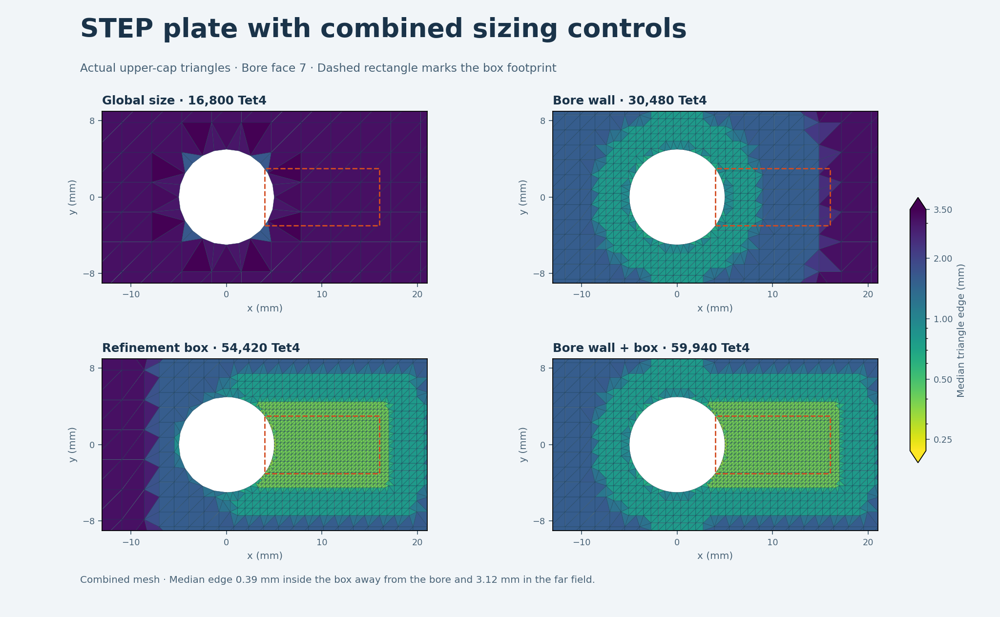

# PAACS Mesh

PAACS Mesh is a C++ meshing engine with a command-line tool for generating and
auditing meshes. It builds Tet4, straight-sided Tet10, Prism6, Hex8 and Pyramid5 meshes
on documented geometry routes. An optional Open CASCADE adapter imports STEP
and BRep with CAD face and body tags.

Applications can link the core library directly through `PAACS::mesh`. It uses
the C++ standard library and platform threads. The STEP adapter, CLI tools and
debug UI bridge are optional.

**Release line** · [1.2.0](RELEASE_NOTES.md) ·
[Release qualification](docs/STABLE_1.2.0_QUALIFICATION.md) · [Roadmap](docs/ROADMAP.md)

## Build a first mesh

The reference build uses GCC 16, C++26, CMake 3.30 or newer and Ninja.
Tests also use Boost headers. An explicit [C++23 compatibility build](docs/BUILDING.md)
is available.

```sh
cmake --preset gcc16-release
cmake --build --preset gcc16-release --parallel 4
ctest --preset gcc16-release
build/gcc16-release/paacs-mesh tet-box 0.45 box.paacsmesh --threads 1
build/gcc16-release/paacs-mesh audit box.paacsmesh
```

To install the C++ SDK, run `cmake --install build/gcc16-release --prefix out/install`.
Set `PAACS_BUILD_CLI=OFF` and `PAACS_BUILD_TESTS=OFF` for a library-only build.
An application can then use the installed package:

```cmake
find_package(PAACSMesh 1.2.0 EXACT CONFIG REQUIRED)
target_link_libraries(my_target PRIVATE PAACS::mesh)
```

## STEP preview

The [51-file qualification](docs/RELEASE_READINESS.md) published 32 independently
audited meshes under the documented time and resource limits. That historical
score is unchanged. The separate [22-model owned hollow study](docs/THIN_HOLLOW_QUALIFICATION.md)
records local RC4 construction results and their remaining quality limits.

The optional STEP build downloads and verifies OCCT 8.0.1, then compiles its
shared libraries and the PAACS tools for your platform.

```sh
cmake -S cmake/step -B build/step
cmake --build build/step --config Release
ctest --test-dir build/step -C Release --output-on-failure
```

The tools go in `build/step/bin` and OCCT goes in `build/step/occt`.
See the [STEP build instructions](docs/BUILDING.md#automatic-step-build) for
runtime paths and using an existing SDK. The [native CAD guide](docs/NATIVE_CAD.md)
covers face selection, volume sizing and C3D4 export with CAD tags.



The [plate-with-hole example](examples/elasticity_plate_hole/README.md) uses a
STEP model generated by the project to demonstrate bore sizing and a refinement
box.

## Examples

- [C++ SDK and installed consumers](examples/consumer)
- [Plate with a hole and stress convergence](examples/elasticity_plate_hole/README.md)
- [Straight duct with Prism6 walls and a Tet4 core](examples/flow_hybrid_duct/README.md)
- [SDK background jobs and the debug UI example](docs/UI_INTEGRATION.md)

## Python

The [Python STEP interface](docs/PYTHON.md) imports STEP, generates audited Tet4
meshes and exports tagged VTK or native archives. Version **1.2.0**
targets regular, 64-bit CPython 3.12–3.15 on Windows x64/ARM64, Linux x64/ARM64
with glibc 2.28 or newer, and macOS ARM64 with a minimum of macOS 15. The same
macOS wheels must pass installation on macOS 15, 26 and 27. CAD libraries are
bundled; wheel users need no compiler or separate OCCT installation.

The expanded implementation passed its
[20-wheel and 28-consumer qualification](docs/PYTHON_COMPATIBILITY.md#qualification-evidence).
Official releases pass the [publication gates](docs/PYPI_RELEASE.md) from their
own immutable tagged source. The matching GitHub release carries its publication
receipts. Install the exact release with `python -m pip install paacs-mesh==1.2.0`.
Published release-candidate files and tags remain immutable. The earlier
`1.2.0rc2` release supports CPython 3.12 on Windows x64, Linux x64 and macOS ARM64 only.

The [sizing guide](docs/PYTHON.md#face-sizing-volume-regions-and-growth) covers
selected-face refinement, volume boxes, minimum size and growth controls.
Optional [NumPy snapshots](docs/PYTHON.md#numpy-mesh-arrays) expose coordinates,
typed connectivity and CAD classifications for solver and analysis workflows.
[CAD inspection and selections](docs/PYTHON.md#inspect-cad-and-select-faces)
support geometric predicates, representation names and guarded saved groups.
Headless selection previews and [bounded recipes](docs/PYTHON.md#reproducible-bounded-meshing-workflows)
support automated callers, with explicit recovery choices and recorded audits.

## Citation

If you use PAACS Mesh in your work, please cite the software using
[CITATION.cff](CITATION.cff).

## Contributing

See [CONTRIBUTING.md](CONTRIBUTING.md) for the source layout and test commands.
The [release policy](docs/RELEASE_POLICY.md) describes what this release line
supports.

Paul LeDewhurst is the project author. PAACS Software Ltd licenses the
PAACS-authored software source under [MPL 2.0](LICENSE). See the [copyright notice](NOTICE) and
[licensing notes](LICENSING_STATUS.md).
