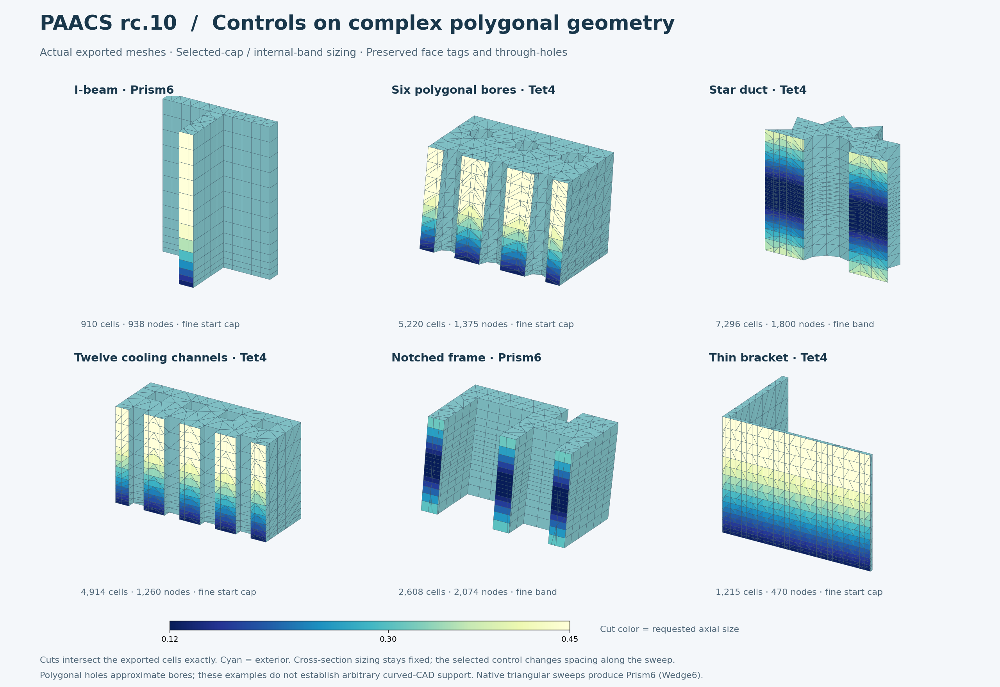
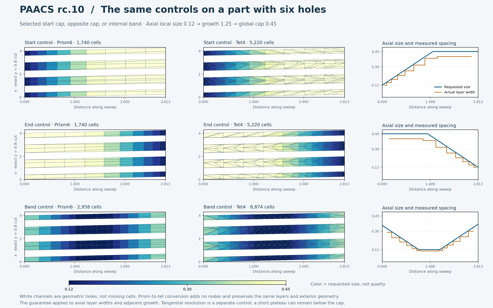

# Complex geometry controls — PAACS 1.0.0

The capped profile can drive recognized **polygonal geometry models**,
not just primitive cylinders and prepared patches. The same input model can
produce native Prism6/Hex8 or an all-Tet4 mesh, with CAD face/node tags retained.
This is a bounded extension of the geometry router, not arbitrary CAD meshing.



## Public workflow

See the complete installed-SDK example
[`complex_geometry_controls.cpp`](../examples/complex_geometry_controls.cpp).

```cpp
paacs::sizing::CappedSizeSpecification specification;
specification.length = 4;       // physical length of the recognized translation
specification.globalSize = .4; // axial size cap, in model units
specification.controls = {
    {0, 0, .1, 1.25},          // selected source cap
    {2, 2.4, .16, 1.2}         // a finite internal band
};
auto profile = paacs::sizing::compileCappedSizeProfile(specification);
// Check profile.compiled before using it.

paacs::algo::GeometryBodyControl body;
body.solidTag = 1;
body.sourceFaceTag = 1; // use a real face tag from the model
body.sizeProfile = &profile.profile;
body.elements = paacs::algo::GeometryElements::Tet4;

paacs::algo::GeometryMeshingOptions options;
options.targetSize = .3; // independent source-face (tangential) target
options.warningElementQuality = .15;
options.bodyControls = {body};
paacs::mesh::Mesh output;
auto result = paacs::algo::meshGeometryModel(model, options, output);
// Check result.published. On failure, output is unchanged.
```

The profile must remain alive and immutable until the call returns. Its length
must match the source-to-target translation within relative tolerance `1e-10`.
`sourceFaceTag` fixes the origin and direction; selecting the opposite cap
reverses the profile physically. `geo::extrudedPolygon` assigns bottom tag 1
and top tag 2. Imported model tags must be obtained from that model, not guessed.
Use `analyzeGeometryStrategies` to inspect recognition and selected faces.

`GeometryBodyControl::targetSize` overrides the global tangential target for
one solid. A profile cannot be combined with an explicit `layers` count or
nonunit `endToStartLayerWidthRatio`; ambiguous requests are rejected.

## What each control guarantees

| Control | Contract |
|---|---|
| Capped axial profile | Every layer width is below the minimum requested size over its complete physical interval. |
| Adjacent growth | Symmetric width ratio, limited by both `maximumAdjacentLayerRatio` and the profile distribution limit. A zero profile limit derives from the profile controls. |
| Global plateau | Growth stops at the size cap. Finite-domain closure can leave a short plateau finer than the cap. |
| Tangential size | Existing source-face meshing target, independent of axial refinement. Its triangulation is retained along the entire sweep. |
| Native elements | Recognized affine blocks use mapped Hex8; general recognized polygonal sweeps use Prism6. |
| Tet4 elements | Convex native cells are conformingly split, preserving all existing nodes and their coordinates/classification. |
| Quality warning | Positive `warningElementQuality` runs assessment and sets `qualityWarning` while retaining a valid result. Zero disables this optional assessment. |
| Quality rejection | Positive `minimumElementQuality` rejects before publication when the minimum quality is too low. |

The profile is one-dimensional. It is **not** a bound on every 3D edge, an
isotropic size control on an arbitrary selected side face, or a material
interface. A band spans the complete cross-section. Curvature/feature analysis
remains independently opt-in; this release does not silently change uniform
defaults or turn every detected feature into refinement.



## Conforming conversion without added nodes

`convertConvexCellsToTet4(source, options, destination)` is a separate public
utility accepting a single-region mesh of Tet4, Prism6 and Hex8 with a complete,
oriented Tri3/Quad4 exterior. Convexity and planar faces are required. It uses
pulling triangulation: the lowest global node ID determines each local apex and
each shared quadrilateral diagonal. Thus independently visited neighboring
cells choose the same diagonal. One prism produces three tets; one hex produces
six; each boundary quad becomes two triangles. Tet4 input is also accepted.

The converter checks finite nodes and classification, source topology, source
exterior winding, face planarity, convexity, positive tetrahedra, output boundary
incidence, budgets and cancellation. Exact orientation predicates guard the
emitted tetrahedra. Node/face/body tags are copied, with no invented CAD entities.
Source and destination may alias; failure retains the prior mesh.

Its explicit limitations are important:

- It is a format/conformity conversion, not an optimal tetrahedral generator.
  More cells do not establish better solver accuracy or quality.
- It rejects warped quads and nonconvex source cells. Planarity and distance to
  the other vertices use a relative, coordinate-resolution-aware tolerance.
- It does not detect global cell overlap or project curved CAD. The caller must
  provide a nonoverlapping source. No multi-region interface conversion is claimed.
- It does not add a Tet10 geometry-model option. Primitive Tet10 remains available;
  general high-order CAD placement needs separate qualification.

Quality is the tetrahedral mean ratio (ideal 1), or the minimum fixed sub-tet
mean ratio for native mixed cells. `ConvexToTetResult::lowQualityCells` counts
cells below its warning threshold; the geometry router reports distributions
and a warning flag. A positive Jacobian is necessary but not sufficient for
solver suitability.

## Resource and failure controls

`maximumNodes`, `maximumCells` and `maximumOutputBytes` constrain the final mesh.
Mapped block Tet4 count estimates account for the sixfold cell expansion.
Source-face preparation retains its own `maximumSourcePoints` and meshing-work
limits. No generation route is selected merely because another failed.

`maximumProfileWorkingBytes` limits profile planning plus previously retained
profile arrays across bodies. `profileLimits` supplies per-body planning caps.
`maximumConversionWorkingBytes` bounds conversion temporary-array payload.
The converter checks counts and output payload before construction and checks
its source/result audit budgets. Working and output budgets are **separate**;
the native source, prior destination, allocator overhead, model, and unrelated
library state are not a hard process-RSS quota. During conversion the native
mesh and final mesh coexist. Tets can therefore cost more memory than prisms.

Profiles are compiled outside mesh generation and reused. The geometry call
plans each distribution once; mapped construction consumes normalized boundaries,
while the prism request takes ownership of the planned array. The public mapped
API also accepts caller-owned `StructuredAxisGrowth::boundaryFractions` with
exact endpoints 0 and 1, strict monotonicity and checked adjacent growth. Both
ordinary and reusable-workspace mapped paths consume the same validator.

`GeometryBodyReport` reports layer counts, physical min/max widths, measured
adjacent growth, width-to-target ratio, plateau compaction, profile reason and
conversion outcome. General Tet failures now retain the deeper constrained
boundary status/reason/phase and nested surface reason, stopped face identity,
face counts and Steiner recovery detail for reproducible diagnosis. Body and
aggregate `generationSeconds` include attempted generation even when it stops
without publishing a mesh.

## Reproduction

Use the C++26 reference toolchain documented in the root README. After configuring:

```sh
cmake --build build --parallel 3
ctest --test-dir build --output-on-failure
./build/tests/paacs-complex-geometry --gallery out/complex
./build/tests/paacs-convex-to-tet
./build/tests/paacs-complex-allocation-failure
./build/tests/paacs-geometry-frontier-probe pocket_block
./build/tests/paacs-geometry-frontier-probe branch_junction
./build/tests/paacs-geometry-frontier-probe tapered_hollow_duct --require-published
python benchmarks/render_complex_controls.py out/complex docs/images
python benchmarks/run_complex_controls.py ./build/tests/paacs-complex-controls-benchmark out/complex-benchmark.json
```

Run benchmarks after builds/tests finish. They compare the same tangential
resolution with locally refined versus uniformly fine **axial** spacing.
The reported call time includes recognition/planning, generation, conversion,
quality assessment and boundary audit; model/profile compilation, serialization
and process startup are outside the timed interval. RSS is the fresh-process peak, including work outside that interval and
inherited launcher/startup high-water. Small cases can be floor-dominated;
see the validation report before interpreting these values as memory savings. The three-repeat data is a
small engineering benchmark on the documented inputs.

See [validation](../VALIDATION.md), raw evidence (`evidence/rc10/README.md`), and
[the next general-meshing milestone](GENERAL_MESHER_ROADMAP.md).
