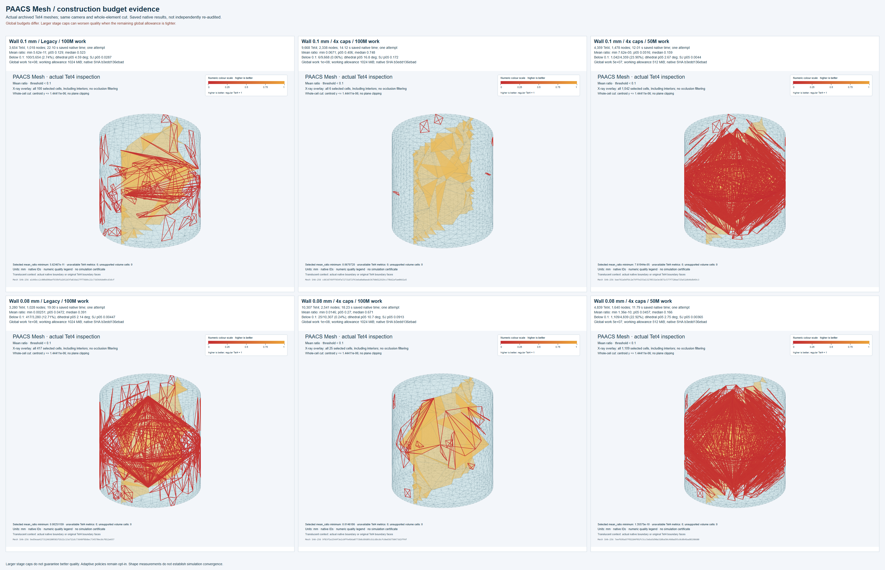

# Construction-budget study

Larger construction allowances improve the fine-wall cylinder on the studied
build, but they are not a general quality fix. Adaptive policies remain opt-in;
`construction_effort="legacy"` stays the default. In particular, the better
surface obtained by `auto` can still lead to poor interior tetrahedra, and
larger stage caps can perform worse within smaller overall resources.

The [sanitized numerical receipt](data/construction-budget-study.json) contains
36 successful attempts on owned repository fixtures, their native validity
receipts, all three quality distributions, achieved edge-size populations,
stage counters/times, peak process memory, source/archive/binary hashes and
reproduction commands. No retries or native validity relaxations were used.
These are unreleased development builds, not published RC3 wheel behaviour.



Rows show wall requests of 0.1 and 0.08 mm. The left column uses Legacy caps
with 100 million work units and 1 GiB working memory; the middle raises the
four stage caps within those same overall allowances. The right uses the
raised caps with 50 million work units and 512 MiB, exposing the poorer
interior quality under tighter resources. All six runs use the same Phase 2
binary. Red outlines identify every original Tet4 below mean ratio 0.1,
including cells outside the cutaway. Gold faces expose whole retained elements;
the camera and centroid-cut rule are shared. The [figure receipt](images/construction-budget-study-provenance.json)
records exact IDs and hashes. Rendering remeasures archived element shape and
does not repeat the native CAD audit.

## Method and scope

The primary geometry is the same radius-1 mm, height-2 mm cylinder used in the
[RC3 refinement investigation](REFINEMENT_FINDINGS.md). Global size is 0.5 mm,
wall requests are 0.1 and 0.08 mm, growth is 1.3, and no volume sizing region is
added. Each isolated attempt uses one meshing worker and one validation worker,
standard recovery, `assembly="conforming"`, no quality acceptance threshold,
and the existing native orientation, connectivity, geometry and resource gates.
All attempts complete those gates with zero inverted cells. That is distinct
from having good element shape or demonstrated simulation accuracy.

The principal experiments allow 100 million logical work units, 1 GiB modeled
working memory, 500,000 nodes, 3 million cells, 256 MiB output, 512 MiB audit
memory and 90 native seconds, with a 150-second process deadline. A separate
group lowers only overall work and working memory to their API defaults,
50 million and 512 MiB; the other diagnostic settings stay fixed. It does not
isolate the effects of work and memory individually.

The host is Windows 11 x64 with CPython 3.12.6 and OCCT 8.0.1. Native seconds
include construction and validation, excluding import, export and inspection.
Those additional timings are retained separately. Observations are individual
runs, not controlled timing medians or a cross-platform benchmark. Peak process
working set after meshing is observed separately from modeled memory admission;
it is not a hard operating-system limit.

Two compiled snapshots were measured. Phase 1 exposes explicit caps and couples
their supporting allowances. Phase 2 also adds opt-in adaptive estimates and
source/bulk/closure allocation. Their extension and key source-file hashes are
retained separately. Phase 1 has no standalone source commit and is exploratory
evidence; the headline comparison below uses the same Phase 2 binary throughout.
The final source provides the final route, rather than reconstructing that
intermediate snapshot from its hashes.

## Same-build explicit-cap comparison

`quadruple` explicitly sets surface spacing points to 1,024 per rebuilt face
chart, chord points to 384, interior candidates to 65,536 and interior sites to
2,048. Its effort policy is still `legacy`, keeping the old source/bulk order.
Supporting work, query and storage allowances are coupled to the explicit
request under the overall budgets. The name describes the four nominal caps;
it does not promise four times the actual work or element count.

The `final-paired` group uses the Phase 2 binary for every row:

| Wall request (mm) | Policy | Tet4 | Minimum mean ratio | Mean mean ratio | Cells below 0.1 | Wall median / maximum edge (mm) | Native seconds | Peak process MiB |
| --- | --- | ---: | ---: | ---: | ---: | ---: | ---: | ---: |
| 0.1 | Legacy, caps unset | 3,654 | 5.62 × 10⁻¹¹ | 0.520 | 100 | 0.154 / 0.863 | 22.10 | 54.8 |
| 0.1 | Quadruple caps | 9,668 | 0.0671 | 0.722 | 6 | 0.103 / 0.295 | 14.12 | 71.5 |
| 0.08 | Legacy, caps unset | 3,280 | 0.00251 | 0.370 | 417 | 0.146 / 0.790 | 19.00 | 53.1 |
| 0.08 | Quadruple caps | 10,307 | 0.0146 | 0.647 | 25 | 0.0948 / 0.332 | 18.23 | 73.0 |

Quality here is independently recomputed Tet4 mean ratio, with 1 representing a
regular tetrahedron. The receipt retains the native aggregate separately:
roundoff can affect extremely small minima. Achieved sizes are unique physical
boundary-triangle edge chords, not geodesic lengths or strict size certificates.
The maximum edges still exceed the requests, so improved medians do not mean
complete local sizing.

Legacy's repeated 0.1 mm archive hash matches the original Windows RC3 archive,
`a144bcc2c00bd90aef939bfa2b52d3fa83da17ff7684c21c73d364de09cd3dcf`.
The repeated 0.08 mm Legacy mesh is unchanged too. This is same-host preservation
evidence; it does not establish cross-platform bitwise identity.

The earlier Phase 1 experiments also tested double caps. At 0.1 mm they produced
8,988 tetrahedra, minimum mean ratio 0.00106, 49 cells below 0.1, and maximum wall
edge 0.483 mm. At 0.08 mm they produced 8,231 tetrahedra, minimum 0.0146, 38 cells
below 0.1 and maximum wall edge 0.758 mm. The receipt preserves these exploratory
results without mixing their binary identity into the final paired comparison.

## Adaptive allocation is mixed

Phase 2's adaptive policies estimate surface/interior demand and reserve effort
for bulk placement before resuming deferred wall-front work. They retain the
same candidate admission and validity checks. A reserved share does not
guarantee accepted bulk points.

| Wall request (mm) | Policy | Tet4 | Minimum mean ratio | Mean mean ratio | Cells below 0.1 | Wall median / maximum edge (mm) | Native seconds |
| --- | --- | ---: | ---: | ---: | ---: | ---: | ---: |
| 0.1 | Auto | 8,786 | 6.63 × 10⁻¹¹ | 0.685 | 7 | 0.100 / 0.172 | 14.46 |
| 0.1 | Thorough | 10,201 | 1.41 × 10⁻¹⁰ | 0.717 | 2 | 0.100 / 0.127 | 14.53 |
| 0.08 | Auto | 9,672 | 0.0273 | 0.457 | 1,407 | 0.0800 / 0.124 | 13.66 |
| 0.08 | Thorough | 10,874 | 0.0435 | 0.552 | 503 | 0.0800 / 0.101 | 11.12 |

At 0.1 mm the adaptive wall sizing is substantially more regular, but a tiny
minimum remains. At 0.08 mm `auto` produces more cells below mean ratio 0.1 than
Legacy despite a much tighter surface edge distribution. This separates the
surface-sizing improvement from the unresolved interior construction problem.

An allocation-only comparison holds the four explicit caps at their old values.
`explicit-legacy` accepts 390 initial wall sites and no bulk sites; its final
mesh has 82 cells below mean ratio 0.1. `fair-legacy`, using the adaptive policy
with those same explicit caps, accepts 215 wall sites and 233 bulk sites, yet
its final mesh has 534 cells below 0.1. It demonstrates that bulk starvation
can be relieved, while fairness alone is insufficient on that under-resolved
boundary. The untouched Legacy baseline is a separate comparison: explicit
caps also change the coupled supporting allowances.

## Overall resources still matter

With 50 million work units and 512 MiB modeled working memory, larger stage
caps improve the cylinder wall sizes but worsen the number of poor cells:

| Wall request (mm) | Policy | Tet4 | Cells below mean ratio 0.1 | Initial-front budget reason | Native seconds |
| --- | --- | ---: | ---: | --- | ---: |
| 0.1 | Legacy | 3,315 | 135 | `candidate_limit` | 9.64 |
| 0.1 | Quadruple caps | 4,359 | 1,042 | `auxiliary_bootstrap` | 12.01 |
| 0.1 | Auto | 5,001 | 1,255 | `modeled_memory_or_work` | 12.76 |
| 0.08 | Legacy | 2,771 | 449 | `candidate_limit` | 9.78 |
| 0.08 | Quadruple caps | 4,839 | 1,109 | `auxiliary_bootstrap` | 11.79 |
| 0.08 | Auto | 7,695 | 2,712 | `modeled_memory_or_work` | 9.46 |

The enlarged/adaptive requests admit no initial-front sites in these four
limited cases. Other existing construction stages still produce a mesh that
passes the mandatory native checks. The stop diagnostics show why exposing a
larger point count alone cannot promise refinement freedom. These combined
work/memory experiments do not identify one resource as the sole cause.

## Broader fixture checks

Box, oblique L, through-hole and sphere fixtures were run at global size 0.5 mm
without face or volume controls, using Legacy, quadruple caps and Auto. Each
fixture produces byte-identical archives across those three requests:

| Fixture | Tet4 | Minimum mean ratio | Cells below 0.1 |
| --- | ---: | ---: | ---: |
| Box | 210 | 0.242 | 0 |
| Oblique L | 414 | 0.325 | 0 |
| Through-hole | 795 | 0.299 | 0 |
| Sphere | 2,834 | 0.0212 | 1,122 |

These are known repository fixtures, not an unseen generalization set. The
sphere uses `native_surface_star` and has no rebuilt-chart receipt; these caps
do not improve that route. Its unchanged low-quality population remains a
separate limitation. The other three use `native_spatial_sizing` and provide
per-face construction receipts.

## Interpretation and next work

The new [public controls](CONSTRUCTION_BUDGETS.md) give users bounded access to
construction effort and make unfinished stages visible. Larger allowances help
both fine cylinder requests under the tested larger overall budgets, without
changing geometry or validity acceptance. They do not establish monotonic
quality, size completion, solver accuracy or improved arbitrary-CAD coverage.

Keep adaptive policies opt-in until demand estimation, auxiliary-complex
admission and source/bulk allocation are qualified together. The remaining
near-boundary slivers and the poor 0.08 mm adaptive interior need geometric
construction diagnostics, rather than a larger default constant or weaker
checks. Study stage stop reasons alongside per-element/spatial measurements;
pending triangle-entry counts can increase under subdivision and are not an
error or quality metric.

## Reproduction

Local Windows x64 qualification rebuilt and installed the wheel with cleared
SDK and loader paths. All 200 base tests passed; seven optional NumPy tests and
one POSIX fixture were expected skips. NumPy 1.26.4 and 2.5.5 then each passed
all nine array tests. Four native CLI/Python parity cases, including explicit
construction caps, produced byte-identical archives and matching cap receipts.
Both native front tests passed. The larger-cloud test admitted 1,536 sites,
including 1,409 bulk sites, and checked charged work, material inclusion and
unchanged boundary coordinates and classifications. These local checks do not
qualify other platforms or publish the development wheel.

Run the final implementation from a rebuilt development wheel:

```sh
python -I benchmarks/construction_budget_trials.py --output build/budget-paired --profiles legacy quadruple --wall-sizes .1 .08
python -I benchmarks/construction_budget_trials.py --output build/budget-adaptive --profiles auto thorough --wall-sizes .1 .08
python -I benchmarks/construction_budget_trials.py --output build/budget-default-resources --profiles legacy quadruple auto --wall-sizes .1 .08 --max-work 50000000 --max-working-bytes 536870912
python -I benchmarks/construction_budget_trials.py --output build/budget-box --source tests/fixtures/cad/box.step --profiles legacy quadruple auto --wall-sizes none
```

Repeat the last command with `oblique_l.step`, `through_hole.step` and
`sphere.step`, each in a new output directory. To use a local compiled extension,
add `--development-native <extension-path> --occt-sdk <sdk-path>`. The receipt
includes the exact relative development commands and compiled snapshot used in
the original observations. Every run retains native reports and archives;
the committed receipt omits machine-local paths and binary meshes.

Render those retained archives with a development wheel that provides mesh
inspection. This command produces portable SVG and self-contained HTML without
third-party plotting dependencies or further meshing:

```sh
python benchmarks/render_construction_budgets.py \
  --case "Legacy / 100M work" build/budget-paired/legacy-wall-0p1 \
  --case "4x caps / 100M work" build/budget-paired/quadruple-wall-0p1 \
  --case "4x caps / 50M work" build/budget-default-resources/quadruple-wall-0p1 \
  --case "Legacy / 100M work" build/budget-paired/legacy-wall-0p08 \
  --case "4x caps / 100M work" build/budget-paired/quadruple-wall-0p08 \
  --case "4x caps / 50M work" build/budget-default-resources/quadruple-wall-0p08 \
  --columns 3 --allow-mixed-budgets --output build/budget-figures --png none
```

Use one line on shells without POSIX line continuations. PNG is optional:
`--png cairosvg` uses a separately installed CairoSVG/Cairo development tool;
`--png browser --browser-executable <path>` uses an existing Chromium browser
with fresh temporary profiles and local self-contained SVGs. Neither is a
PAACS runtime dependency. Rasterizers and fonts can change pixels; the archive
coordinates, measured IDs and hash-paired saved reports remain the evidence.
