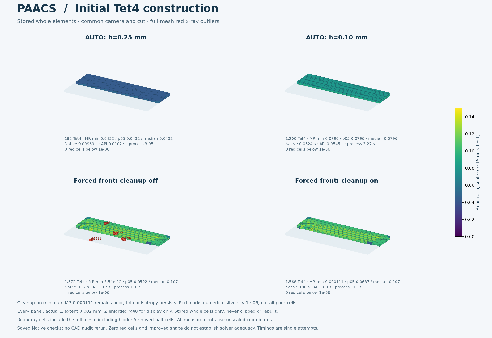

# Initial construction and method selection

This development round continues the [thin and curved qualification](QUALITY_QUALIFICATION.md).
It changes general construction and dispatch rather than adding geometry-specific
size controls. The release and package publication remain separate work.

## Causes and changes

The initial front could test an unchanged apex against the same fixed geometry
repeatedly. Normal admission now caches a bounded number of proven geometric
refusals per active face. Changing front topology, external CAD classification,
temporary point IDs and resource stops are excluded. Cache-only unit comparisons
require identical admitted coordinates and cone connectivity.

Four nearly flat cells in the thin-plate case were already present before
constraint recovery. They joined almost coplanar points on opposite skins, whose
projected coordinates differed at binary64 precision. None of their faces was a
prescribed boundary triangle. Moving boundary points or adding a control volume
would address a different problem.

The new optional finalization stage tests local 2-to-3, 3-to-2 and 4-to-4
connectivity changes after the last initial point insertion. Each accepted patch
keeps the oriented cavity shell, positive orientation, surviving cells, body
ownership and present source constraints. Coordinates stay fixed. Both mean
ratio and scaled Jacobian participate in admission; poor-cell populations cannot
increase at the checked thresholds. The result is not a Delaunay certificate.

Work, memory, candidate and edit limits apply. Cancellation, allocation failure
and interrupted certification discard the staged topology. Final constraint,
material, CAD and validity checks remain mandatory. The conservative default
search trigger is mean ratio below `1e-6`; it is not a required publication
quality or a solver-adequacy threshold.

Normal AUTO now checks compatible existing whole-body capabilities before
choosing general initial construction. A recognized face alone is insufficient:
the existing primitive proof or planar strategy analysis must admit the whole
body. Explicit choices, spatial controls and historical Bounded dispatch retain
their meaning. Recognition and failed attempts consume the shared allowance.
Structured methods can imply finer achieved spacing through their own geometry
resolution constraints; their runtime is not automatically comparable to a
different-sized general mesh.

Python, saved recipes and the CLI expose chord error, relative volume error and
curvature sampling. Requested, effective and achieved values remain distinct.
The topology stage has an explicit on/off override. Reports distinguish method
selection from actual stage entry and preserve completed partition and front
receipts on cancellation.

## Qualification scope

The serial executor is
[`benchmarks/qualify_initial_generation.py`](../benchmarks/qualify_initial_generation.py).
It consumes a pinned source/hash manifest and retains every attempted result.
The Native call, export, independent archive inspection and complete child-process
times are separate. One meshing worker and one validation worker are used.
The cooperative Native allowance is 600 seconds, with a separate 720-second
process deadline; this does not replace the historical deadline score.

Eight identical owned requests reuse frozen baseline artifacts. A forced-front
thin-plate pair isolates topology finalization from AUTO route selection. Further
owned cases and three held-out files begin broader qualification. The held-out
selection excludes the pinned corpus and enumerated saved metadata; it makes no
claim about unrecorded historical inspection.

Native acceptance and independently decoded archive orientation, ownership and
tag checks are reported separately. The archive screen is not an independent CAD
or global-intersection certificate. Initial-front site counts are separate from
final interior nodes, which can include later recovery additions.

Downloaded CAD contents and figures stay outside tracked evidence until their
redistribution rights are established. A saved failure with no mesh has no
measured element-quality population; placeholder zeros are unavailable data.

## Owned-case results

All eight repeated requests passed Native acceptance and independent archive
orientation, ownership and tag screens. Five archives are byte-identical to the
frozen baseline: both bore-sized plates, both spheres and the wall-sized cylinder.
The changed AUTO outputs are the two thin plates and the torus.

| Request | Baseline Tet4 | Current Tet4 | Baseline API seconds | Current API seconds |
| --- | ---: | ---: | ---: | ---: |
| Thin plate, size 0.25 | 312 | 192 | 3.374 | 0.0102 |
| Thin plate, size 0.10 | 1,572 | 1,200 | 100.345 | 0.0545 |
| Plate, global 4 / bore 1 | 4,209 | 4,209 | 65.298 | 67.444 |
| Plate, global 2 / bore 0.5 | 23,823 | 23,823 | 58.14 | 62.98 |
| Sphere, size 0.5 | 3,637 | 3,637 | 9.09 | 8.87 |
| Sphere, size 0.25 | 7,390 | 7,390 | 12.11 | 12.71 |
| Cylinder, global 0.5 / wall 0.15 | 10,024 | 10,024 | 37.40 | 39.70 |
| Rotated torus, size 0.5 | 8,511 | 226,800 | 12.96 | 0.740 |

These are single quiet samples, not medians or equivalent-output speed tests.
The torus now uses its verified structured method, with substantially finer
achieved edges and smaller CAD error; its complete worker process took 36.02
seconds, including 32.05 seconds of optional detailed Python inspection. The
thin AUTO outputs use different points and fewer cells. At size 0.10 their
minimum mean ratio improves from `8.54e-12` to `0.07956`, while their median falls
from `0.1068` to `0.07956`. Both retain the exact 0.002 mm thickness, with one
element spanning that thickness. These are highly anisotropic meshes, not thin
solid simulation qualifications.

The forced-front pair isolates the editor: both use exactly the same 556 node
coordinates/classifications and 1,108 indexed source triangles/face tags.
Four certified 3-to-2 flips reduce 1,572 Tet4 to 1,568 without adding points.
Minimum mean ratio changes from `8.54e-12` to `1.1085e-4`, and its fifth percentile
from `0.05224` to `0.06366`. Minimum scaled Jacobian changes from `7.44e-17` to
`3.35e-6`; minimum dihedral angle changes from `3.24e-15` to `0.0001384` degrees.
CAD volume, mesh volume and measured node/facet errors are unchanged. The editor
took 0.0269 seconds; the 112.39 versus 107.53 second whole-call samples do not
establish a speed gain attributable to that editor. Remaining quality is poor.



[Machine-readable comparisons and figure provenance](data/general-construction.json)
retain all three shape distributions, sizing populations, geometry limits and
errors, failed-attempt receipts, timing scopes and exact final mesh signatures.
Initial point-cloud snapshots are explicitly unavailable; final signatures are
not relabeled as initial point data.

Local regression evidence on the aligned development binaries: 94 Native CAD
checks, 104 Native CLI checks and 247 Python tests passed, with one expected
POSIX-only skip. All 82 isolated Python children loaded the same selected source
and binary. Front/topology units and planner/archive-integrity tests also pass.
These are development-build results, not newly installed-wheel qualification.
The measured pilot binary is identified by SHA256 beginning `fbd9d6e600a3` in
the dataset. A subsequent reporting fix restores historical recovery-family
selection after a continuing bounded probe, while retaining stopped-probe
receipts. Final regressions use the aligned binary beginning `7b88a73ea1e7`.
It does not change the numerical constructors exercised by these pilot paths;
the measured artifacts and their original identities remain frozen.

## Broader qualification started

Six further owned requests passed Native and archive/tag checks, as did the
first fixed held-out file. These are fresh qualifications, with no paired frozen
runtime baseline:

| Request | Tet4 | API seconds | Minimum mean ratio |
| --- | ---: | ---: | ---: |
| Thin plate, size 0.20 | 300 | 0.0141 | 0.0501 |
| Thin plate, size 0.15 | 588 | 0.0278 | 0.0627 |
| Box, size 0.5 | 96 | 0.00466 | 0.756 |
| Through-hole extrusion, size 0.5 | 408 | 0.0302 | 0.595 |
| Oblique extrusion, size 0.5 | 216 | 0.0130 | 0.606 |
| Cylinder, size 0.5 | 18,432 | 0.1004 | 0.701 |
| Held-out ID 00008645, size 0.15 of diagonal | 324 | 0.0107 | 0.713 |

The held-out file was selected before execution from a source-hash-ranked size
bucket, excluding the original corpus and enumerated local saved metadata.
One success does not establish general coverage. Two larger held-out files remain
pinned but unexecuted in this round.

Original-corpus CAD03 still refuses a valid volume mesh. The finer experiment
uses size `0.075 * diagonal` and configured curvature sampling of 32 points per
turn. Its first source attempt fails `nonconforming_edge` in 0.0673 seconds,
after producing 44 nodes and no triangles. AUTO then changes to legacy dispatch.
That fallback has the same measured counts (1,773 nodes / 3,542 triangles), chord
limit (0.102616 mm) and volume-error scalar as the coarse baseline. No source
archive was retained, so equal counts do not establish identical triangles.

Eleven partition attempts are retained. Their inclusive times total 570.04
seconds, nested within the 600.03 second Native call. A Cartesian cut strategy
creates 81 pieces and 160 interfaces. Two results fail the original-solid
centroid check; a tighter third attempt cancels after 407.58 seconds. No mesh is
published, and there is no measured final quality population.

The failed first source used the curvature request. The standard legacy fallback
does not establish a curvature-sized final surface; its explicit curvature route
is gated by Advanced recovery. The default chord also remains unchanged when
the diagonal-based size is halved. A configured value of 32 therefore does not
prove that a usable finer fallback was constructed.

The corpus harness initially read named body bounds as positional arrays. Both
import-only failures, their process costs and exact historical runner versions
are retained. The corrected runner has independent single/multiple-body bounds
tests; only the two affected requests were rerun. CAD03's complete development
history here totals 1,210.20 process seconds across two Native builds/profiles
and one harness failure. This is not a same-settings algorithm speed comparison.
The full 51-file run has not been repeated, and no new corpus score is claimed.

## Reproducing owned requests

[`benchmarks/manifests/initial-generation-owned.json`](../benchmarks/manifests/initial-generation-owned.json)
pins 14 requests, fixture hashes, generator references and explicit resource
settings. It contains no downloaded CAD, local paths or bundled timing baseline.
With a development extension, its matching OCCT SDK, NumPy and the native
dependency search path configured, run:

```sh
python benchmarks/qualify_initial_generation.py \
  --case-manifest benchmarks/manifests/initial-generation-owned.json \
  --development-native <compiled-extension> --occt-sdk <sdk-directory> \
  --output <new-output-directory> --include-thin-forced-pair \
  --native-seconds 600 --hard-seconds 720
```

`--plan-only` checks identities and saves the plan without calling the native
engine. The output directory must be new. Each child records its source/binary
identities, all Native attempts and separate inspection/process costs. Downloaded
qualification uses a separate local manifest; its sources are not redistributed.

## Remaining coverage work

Source construction, volume recovery and assembly interference are distinct
failure classes. A nonconforming prescribed surface cannot be repaired by
improving initial volume connectivity. Source-provider and volume-constructor
selection currently remain coupled in some fallback paths; that coupling is a
candidate for a separately qualified change. Named source diagnostics should
guide the next experiment before changing geometric tolerances.
CAD03's next proposed route is to feed an independently certified fallback
surface to the live Tet4 constructor, instead of discarding that constructor
when the chart provider refuses. First expose the failing curve/chart witness,
preserve explicit controls and geometry limits, and test the route behind an
experimental recovery choice before any default promotion.

Assemblies preserve original body identities and report interference. Valid
independent parts do not become a globally non-overlapping conforming domain by
changing a report label. A longer successful run does not count as a pass under
the original deadline, and one changed mesh does not establish scaling.
