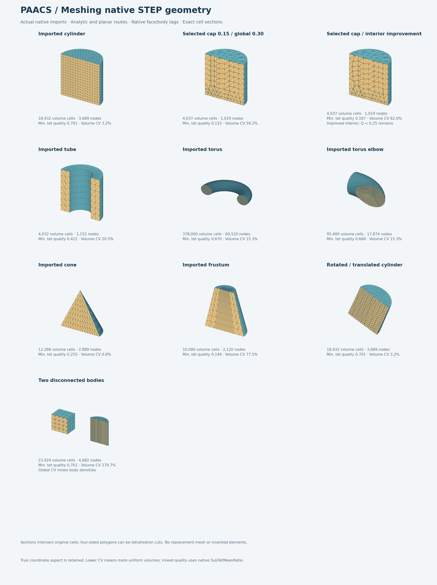
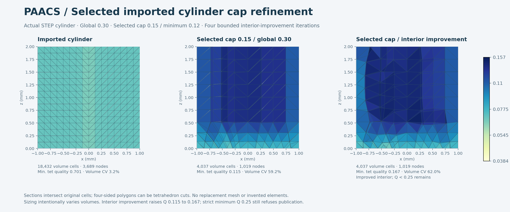

# Local native CAD extension and visual validation

This is a development extension to the condensed 1.1.0 source, separate from
the original release qualification and the [earlier local baseline](LOCAL_VALIDATION_2026-10-03.md).
The older repository and the earlier reviewed ZIP remain intact.

The extension restores native CAD evaluation and oriented topology through an
optional adapter, connects recognized curved solids to existing meshing
engines, and adds actual mesh images. It does not yet restore every older API
or provide arbitrary curved CAD volume meshing.

Comparable `src/` + `include/` text is about 1.4% smaller than the old tree
(about 4.26 MB versus 4.32 MB), while the full selected source tree including
apps/tests/benchmarks/examples is about 5% larger. Files are more numerous;
these figures exclude generated output, evidence and documentation images.
The footprint inventory is retained in the core-only evidence.

## Implemented capabilities

- `PAACS::occt` now provides `OcctModel` and `meshNativeCad`, with public headers
  that do not expose OCCT types. `PAACS::mesh` remains independent of OCCT.
- Native solid, face, edge and vertex identities, locations, tolerances,
  solid-face orientations, wire-edge uses and use-specific pcurves are retained.
  Regression inputs include periodic seams, holes, reversed faces, poles,
  scaled trims and disconnected located bodies. STEP transfers explicitly to mm.
- Supported planar parts retain the current core engines. Complete cylinders,
  coaxial tubes, cones, frusta, solid tori and planar-capped solid elbows use
  existing analytic engines after BRep volume/intersection recognition.
  Imported entity tags replace primitive tags. Touching bodies are refused.
- Imported cylinder/tube cap selections support refinement and growth controls.
  An optional four-iteration interior optimizer improves a profiled cylinder;
  boundary coordinates, classifications and connectivity stay unchanged.
- Opt-in planar surface recovery and bounded existing-node general edge-cavity
  recovery preserve exact boundaries, protected entities and transaction rules.
  Default routing remains unchanged. No Steiner node or coordinate merge was added.
- CAD checks, incidence audits, quality checks and output budgets run before
  destination publication. Failed calls preserve the prior mesh/archive.
  The native CLI rejects output aliases to the source CAD file, including hard
  links; same-path/hard-link regressions preserve the original STEP bytes.
- Recognition Boolean operations use OCCT non-destructive mode. A reproduced
  cylinder mutation added pcurves to the imported snapshot before this fix;
  repeated BRep serialization now guards source immutability as well as output rollback.
- The renderer reads actual archives and creates exact cell-plane sections,
  cyan/gold cutaways, quality histograms, volume CV and provenance hashes.
  The separate display tessellator copies the BRep before OCCT triangulation.

The implementation reuses current primitive, surface, constrained-volume,
predicate, audit and transaction code. Retired standalone T2-C/T5 and legacy
per-cell topology routes were not reintroduced. Full XDE product names and
occurrence metadata, persistent selectors and the old V1 model archive remain
unrestored. Snapshot tags do not establish correspondence across edited CAD files.

## Executed checks

The complete Windows Release suite passed **58/58 CTest entries**, including
the inherited full unit suite. Fresh installed examples passed **15/15**,
including a consumer that imports native CAD, meshes it, audits it and
round-trips its archive using only installed public headers and targets.
The native-only checks and installed consumers were repeated after the final
source-immutability repair; their final receipts accompany the earlier full run.
The final native fixture generator passes 53 checks. All ten retained mesh
archives are byte-identical before and after the non-destructive recognition
fix, so the earlier figure provenance remains valid for those mesh bytes.

The main run took 768.62 seconds; the full unit entry took 768.56 seconds.
This is local functional evidence, not an isolated performance benchmark.
The four added checks cover general edge recovery, the native adapter,
native meshing and native CLI contracts. CLI coverage includes malformed
geometry, unknown selections, unsupported operations, quality refusal and
work/storage bounds, with prior output bytes preserved on refusal.

Receipts are under `evidence/local-2026-10-03/`: `native-full-tests.xml`,
`native-source-protection-tests.xml`, `native-final-consumer-tests.xml`, their logs,
and the final validation receipt. A fresh OCCT-OFF configure/build/install
passed. Its core and optional-unavailable installed consumers compile and
run; requesting the unavailable required component fails clearly. Exact
commands, project/export checks and logs are recorded in `core-only/`.

## Downloaded CAD screen

The same 51 source files and SHA256 hashes used in the baseline were selected
from the 10,000-file ABC directory. Each native process used size factor 0.15,
one attempt, a 60-second timeout, 200,000 nodes, 1,000,000 cells, 128 MiB logical
output/audit bounds and 2,000,000 work units, with both recovery flags enabled.

| Outcome | Earlier planar adapter | Native adapter |
|---|---:|---:|
| Published mesh | 5 | 12 |
| Unsupported | 45 | 35 |
| Invalid imported geometry | 0 | 3 |
| Accepted geometry, meshing failure | 1 | 1 |
| Crash / timeout / publication violation | 0 | 0 |

All five previous successes remain successful. Seven new successes are one
cylinder and six complete tori. Their minimum tetrahedron quality is about
0.685-0.697 and their volume error about 0.188-0.290%. Native Tet4 is the default,
so native counts can differ from earlier mixed cells. This is a sample, not
coverage of all 10,000 models. Invalid-shape rejection is useful failure
classification, not a successful mesh.

The first native screen overlapped tests and rendering. Its child wall-time
sum was 149.9 seconds, longest case 35.36 seconds and measured peak working set
124.36 MiB. Memory was measured, not capped. Final-binary repeat receipts and
archive comparisons are separate from that first run.

The non-destructive recognition executable repeat has the same 51 outcomes and diagnostics, and all
12 successful archives match the earlier native SHA256 hashes. Its summed
child wall time is 136.583 seconds, longest case 29.981 seconds, sampled peak
working set 130,719,744 bytes. This also overlapped development/rendering load.

The [asset provenance](ASSET_PROVENANCE.md) identifies the two ABC models used
in the archived cylinder and torus figure.

The representative downloaded cylinder has 3,456 tetrahedra, Q minimum 0.685
and CV 3.24%; the torus has 438,912 tetrahedra, Q minimum 0.695 and CV 7.38%.
Their archive geometry, metrics and entity-tag ranges were checked independently.

The earlier native screen, comparison and exact run plan are under
`evidence/local-2026-10-02/abc-native-*`; final screening is under
`evidence/local-2026-10-03/abc-native-final-screening/`. The final CLI source
protection check repeats the same 51 into `abc-native-source-protected-screening/`,
with separate source-protected comparison and run-plan receipts.
It also confirms all 51 outcomes/diagnostics and all 12 archive bytes remain
unchanged, rehashes all 51 original CAD files unchanged, and observes zero
crashes, timeouts or partial publication. `out/native-windows-install` contains
the final executable; the earlier `out/windows-install` is retained separately.

## Measured mesh quality and uniformity



These are imported STEP solids and actual exported volume cells. The figure
separates volume cells from boundary triangles. Uniform cylinder Tet4 has
18,432 volume cells, minimum quality 0.701 and volume CV 3.2%; the torus has
minimum quality 0.670 and CV 15.3%. Tube and cone engines have different
distributions. The frustum's CV is 77.5% and minimum quality 0.144, which
remains a quality/uniformity limitation.

CV across disconnected bodies can mix intentionally different cell densities.
For the displayed assembly the individual box has CV 0% and cylinder about
3.24%; their combined CV is 279.7%. Use per-body distributions for that comparison.



The selected cap requests 0.15 with global size 0.30, minimum 0.12 and growth
1.3. Its 4,037 tetrahedra achieve varying section and axial counts, but the
minimum quality is 0.115. Four bounded interior-improvement iterations raise
it to 0.167, preserving boundary/connectivity; CV changes from 59.2% to 62.0%.
The optimizer improves shape quality, not uniform volume. A strict quality
floor of 0.25 still refuses publication and preserves the old output.
Uniform/default and refined comparisons also have different chord-driven
section discretizations and engine policies: selection switches from uniform
cylinder to profiled-volume meshing. Within the profile the selected end has
174 section nodes versus 85 at the opposite end, with measured axial growth
at most 1.2395. The profile proves local variation, not a denser overall mesh
than the unselected uniform example. Element counts are not a pure sizing ratio.

Exact sections color cube root of actual volume, not requested edge length.
Volume CV, shape quality and CAD error are distinct measurements. Boundary
node/face-centroid projection samples and primitive chord bounds are recorded;
they are not a general Hausdorff certificate. Rendering refuses unsupported
curved Tet10 or nonconvex/nonplanar mixed cells rather than inventing an exact cut.

## Remaining geometry work

The archived overview uses labeled OCCT display tessellations. The original
ABC input is identified in the [asset provenance](ASSET_PROVENANCE.md).
Spheres, partial cylinders, touching/shared body interfaces and arbitrary
curved Boolean/freeform parts remain unsupported. Displaying a part does not
establish volume meshing support. Curved wall/hole-local sizing needs the
general surface/volume route; existing spatial-box and polygonal-hole examples
are separate working capabilities.

The planar ABC5454 case remains incomplete. The baked planar diagnostic route
now passes its original first edge cavity and reaches ordinal 217 before
refusing a later protected cavity. Its native chart route has a separately
recorded surface failure; the two paths must not be conflated. Exact local
source/candidate images and bounded feasibility evidence are in
`evidence/local-2026-10-03/edge-general-recovery/README.md`. No completed
ABC5454 volume mesh or successful broader recovery is claimed.

The archived recovery figure shows local source and candidate tetrahedra.
The certified first cavity
replacement and later protected refusal are distinct from a completed solid mesh.

The native surface trace identifies a vertex-mapping check on face tag 2
(persistent ID 3), not a normal reversal. A shared edge point differs from its
exact face mapping by 1.409e-11 mm, within the imported 1e-7 mm tolerance but
above the current core's 2.667e-13 mm roundoff-only mapping bound. A native
tolerance-aware shared-boundary contract needs separate implementation and
regression coverage; simply loosening geometric predicates or moving shared
nodes would not establish a conforming mesh.

## Environment and reproduction

Fresh native validation records Windows 11 Home x64 **10.0.26300**, Ryzen 9
8945HS (8 cores / 16 threads), 33,601,921,024 bytes RAM, MSVC 19.44.35207.1,
MSBuild 17.14.8, SDK 10.0.26100.0 and CMake 4.0.2. The earlier baseline and
cached main CMake system record say 10.0.26200; fresh OS discovery is saved in
`native-environment.json`. These runs use explicit C++23 compatibility
(`/std:c++latest`), strict floating point, no sanitizer, no IPO and no native
architecture flags. C++26 and reference Linux/sanitizer qualification were
not newly executed. The inherited MSVC skips documented in the baseline remain.
The full unit build uses the existing Boost 1.89 headers under `C:/vcpkg`.

The supplied headers/binaries identify OCCT 8.0.1 x64 VC14, matching the
[official V8.0.1 release](https://github.com/Open-Cascade-SAS/OCCT/releases/tag/V8.0.1).
The selectively extracted SDK stays in `build/deps/`; it is excluded from the
source package. Keep global vcpkg app-local copying disabled so another OCCT
installation cannot shadow the explicitly selected DLLs.

Run from the repository root; substitute your SDK CMake/runtime directories:

```powershell
$sdk = Get-Content evidence/local-2026-10-02/occt-sdk-setup.json | ConvertFrom-Json
$env:PATH = ($sdk.RuntimePaths -join ';') + ';' + $env:PATH
cmake -S . -B build/windows-msvc-release -G 'Visual Studio 17 2022' -A x64 `
  -DPAACS_CXX_STANDARD=23 -DPAACS_WITH_OCCT=ON `
  -DPAACS_BUILD_TESTS=ON -DPAACS_BUILD_EXTENDED_PROBES=ON `
  -DPAACS_BUILD_UI_BRIDGE=ON -DPAACS_BUILD_BENCHMARKS=ON `
  -DPAACS_BOOST_INCLUDE_DIR=C:/vcpkg/installed/x64-windows/include `
  -DPAACS_UNIT_TEST_TIMEOUT=1800 '-DCMAKE_CXX_FLAGS=/MP2 /EHsc' `
  '-DCMAKE_VS_GLOBALS=VcpkgEnabled=false;VcpkgApplocalDeps=false' `
  "-DOpenCASCADE_DIR=$($sdk.OpenCASCADE_DIR)" "-DTBB_DIR=$($sdk.TBB_DIR)"
cmake --build build/windows-msvc-release --config Release --parallel 2
$env:PATH = (Resolve-Path build/windows-msvc-release/Release).Path + ';' + $env:PATH
ctest --test-dir build/windows-msvc-release -C Release --parallel 2 --output-on-failure
cmake --install build/windows-msvc-release --config Release --prefix out/native-windows-install
cmake -S examples/consumer -B build/native-installed-consumer `
  -G 'Visual Studio 17 2022' -A x64 `
  "-DCMAKE_PREFIX_PATH=$((Resolve-Path out/native-windows-install).Path)" `
  "-DOpenCASCADE_DIR=$($sdk.OpenCASCADE_DIR)" "-DTBB_DIR=$($sdk.TBB_DIR)" `
  '-DCMAKE_VS_GLOBALS=VcpkgEnabled=false;VcpkgApplocalDeps=false'
cmake --build build/native-installed-consumer --config Release --parallel 2
ctest --test-dir build/native-installed-consumer -C Release --parallel 2 --output-on-failure
```

For retained test meshes and an independently rendered gallery:

```powershell
build/windows-msvc-release/tests/Release/paacs-occt-native-meshing.exe `
  --gallery out/native-gallery
python -m pip install -r scripts/mesh_visual_requirements.txt
python scripts/mesh_visual_report.py --self-test
python scripts/mesh_visual_report.py --manifest out/native-gallery/manifest.json `
  --output out/native-gallery-images
```

See [NATIVE_CAD.md](NATIVE_CAD.md) for selection/recovery controls and
[mesh_visual_report.md](../scripts/mesh_visual_report.md) for figure conventions.
Logical output, audit, primitive working payload and exact recovery limits are
distinct from process RSS. OCCT kernel parsing/recognition/projection work is
outside the PAACS counters. The reported generation timer includes body-engine
internal checks and planar surface/volume preparation; separate pure surface
and volume benchmarks remain future work.

Stages 3-5 have useful new native coverage and controls; stages 6-7 have scoped
hardening and screening evidence. General CAD meshing, remaining metadata/
selector persistence, transition-quality improvements, isolated scaling
benchmarks and `paacs-studio` remain to be completed.
