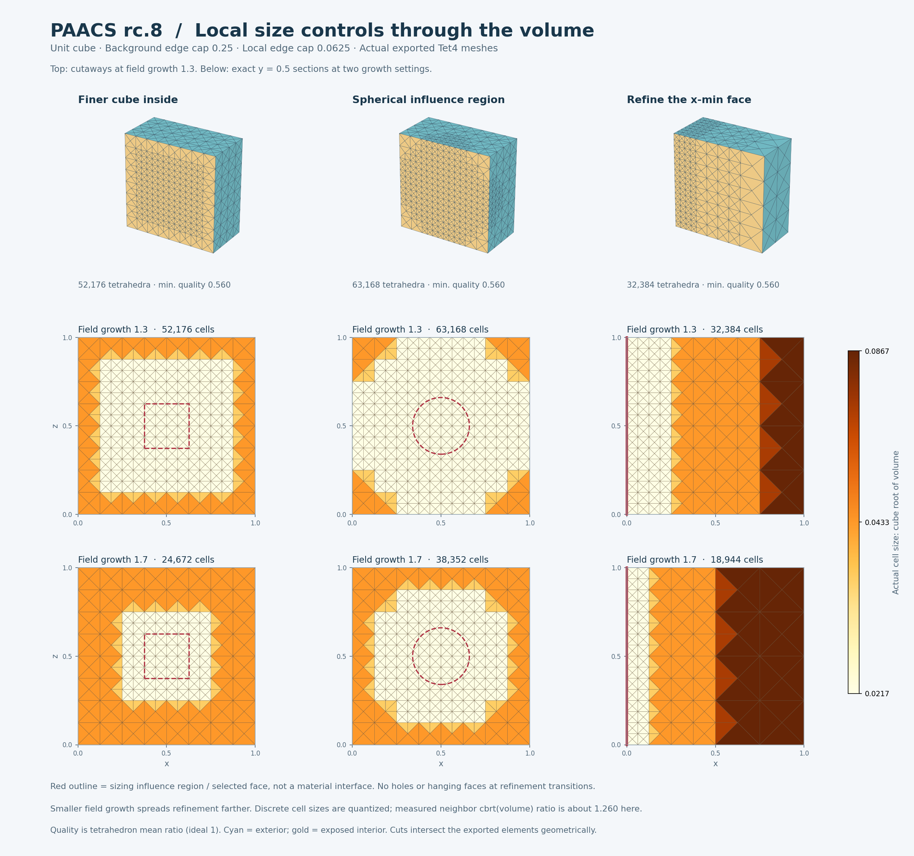

# Local surface and volume sizing (PAACS 1.0.0)

This revision implements explicit size controls for a fine box, a fine ball,
or a finite axis-aligned rectangular surface patch. `boxFaceSizeControl`
selects any of the six faces of a box. Controls are opt-in: without them,
the new box mesher is uniform and the existing primitive meshes are unchanged.

The first qualified volume consumer is `meshAdaptiveBox`: an axis-aligned box
with a conforming Tet4 mesh, including local transitions. A ball control is a
spherical **influence region inside that box**, not a new spherical outer-domain
mesher. These regions do not create holes or material interfaces, and their
boundaries need not coincide with element faces.



## C++ use

```cpp
#include <paacs/algo/AdaptiveBoxMesher.hpp>
using namespace paacs;
sizing::RegionSizeSpecification specification;
specification.baseSize = .25;
specification.minimumSize = .02;

sizing::RegionSizeControl region;
region.kind = sizing::SizeRegionKind::Box;
region.lower = {.375, .375, .375};
region.upper = {.625, .625, .625};
region.targetSize = .0625;
region.growthRatio = 1.3;
specification.controls.push_back(region);

auto compiled = sizing::compileRegionSizeField(specification);
if (!compiled.compiled) { /* handle compiled.reason */ }
algo::AdaptiveBoxRequest request;
request.field = &compiled.field; // Keep this immutable field alive during the call.
request.maximumAdjacentSizeRatio = 1.3; // Optional achieved-size rejection gate.
request.maximumOutputBytes = 128ULL * 1024 * 1024;
request.maximumWorkingBytes = 128ULL * 1024 * 1024;
mesh::Mesh mesh;
auto result = algo::meshAdaptiveBox(request, mesh);
if (!result.published) { /* previous mesh is unchanged; inspect result.reason */ }
```

For a spherical influence region, use `kind=Ball`, `lower={.5,.5,.5}` as the
center, and `radius=.16`; `upper` is unused. For a face control, replace the
region above with:

```cpp
specification.controls = {sizing::boxFaceSizeControl(
    {0,0,0}, {1,1,1}, sizing::BoxFace::XMin, .0625, 1.3)};
```

Compile again after modifying the specification. `Rectangle` also supports a
smaller finite rectangular patch: exactly one bound coordinate must have zero
extent and the other two must have positive extent. Distance is measured to
the finite rectangle, not its infinite supporting plane. Multiple controls
combine by minimum; overlaps therefore retain the finer target. The explicit
global `minimumSize` floor can limit refinement. Invalid controls and budgets
produce structured compilation failures.

`request.targetSize` is the uniform target when `field == nullptr`; a supplied
compiled field supplies all sizes instead. Face tags in the result are
1/2=xmin/xmax, 3/4=ymin/ymax, 5/6=zmin/zmax; volume tag is 1. These are analytic
box identities, not imported CAD IDs. Edge/corner nodes receive separate
dimension-appropriate tags. The installed [example](../examples/local_controls.cpp)
demonstrates both the face-control and layer APIs.

## Three distinct meanings of growth

| Control/measurement | Definition | What it guarantees |
|---|---|---|
| `RegionSizeControl::growthRatio` | Physical field slope `s = 2*(g-1)/(g+1)` | Bounds how fast the continuous target changes with distance; independent of a sampling grid |
| `audit.maximumAdjacentSizeRatio` | Maximum `cbrt(max(Va,Vb)/min(Va,Vb))` over face-sharing cells | Measures the generated mesh's equivalent-volume size jump |
| `AdaptiveBoxRequest::maximumAdjacentSizeRatio` | Zero disables this acceptance gate; positive values must be >=1 | Refuses publication if the measured size jump exceeds the limit, allowing 1e-10 relative roundoff |

For one region, `h(x) = min(baseSize, hLocal + s * distance(x, region))`,
after applying the explicit minimum-size floor. Its transition distance to the
base cap is `(baseSize-hLocal)/s`. At `g=1`, the local cap necessarily extends
throughout space: zero growth cannot return to a larger background size.

The slope mapping has a useful one-dimensional interpretation. If ideal
adjacent cells of widths `ha` and `hb` have center distance `(ha+hb)/2`, then
the Lipschitz bound with that slope limits `hb/ha` to `g`. This interpretation
does **not** turn a continuous field into an arbitrary-mesh growth theorem.

The new mesh uses dyadic block widths, so cell sizes are quantized. In the
qualified cubic examples, the largest measured face-neighbor size jump is
`cbrt(2)`, about **1.259921**. A field growth of 1.15 spreads refinement farther
but does not guarantee every actual cell pair differs by at most 1.15. Set
the separate acceptance gate if that is a hard requirement; an incompatible
request is refused, not silently relaxed or made uniformly fine as a fallback.
Do not interpret this volume-based metric as an edge-length ratio or as a
finite-volume solver's complete mesh-quality assessment.

The older `CompiledSpatialField::maximumAdjacentGrowth` still limits adjacent
background-grid samples. `MeshSpec::gradation` remains reserved in its legacy
route. Neither is silently reinterpreted by this additive API.

## Conformity, size and quality

1. Compute the analytic minimum size over each prospective leaf block. Box,
   ball and rectangle distance minima are evaluated over the whole block;
   a tiny enclosed influence region cannot be missed between sample points.
2. Refine until the maximum block width is no larger than this minimum.
3. Enforce strong 2:1 balance across face, edge and corner neighbors. Refinement
   only reduces cell size, so balancing preserves the size cap.
4. Tile each shared face consistently. Insert necessary edge midpoints and
   shared face centers; fan these face triangles to the cell center. Integer
   lattice keys give one node per shared location without tolerance welding.
5. Check every tetrahedron's positive volume and mean-ratio quality, then run
   the complete independent face-incidence audit before exchanging the result.

Every generated tetrahedron edge is at most its leaf's maximum block width:
face-fan edges lie within a face tile, and center-to-corner distances are no
larger than `sqrt(3)/2` of that width. Thus this route conservatively honors
the size cap throughout each leaf, up to coordinate roundoff. This is not an
equal-volume or lower-bound guarantee; smaller cells are common at transitions.

The regular unit-cube mesh has minimum mean ratio 0.8. The displayed locally
graded cases have minimum 0.560259 (ideal 1), independently recomputed from
exported coordinates. A very elongated outer box inherits that anisotropy;
the measured `minimumQuality` and optional rejection threshold remain the
authority. Do not extrapolate the cubic scores to all box aspect ratios.

## Cost and failure behavior

Planning uses a compact octree, deterministic traversal, integer neighbor
queries and flat sorted node keys. There is no per-element hash allocation.
Generation writes fixed, disjoint arrays and is deterministic at 1/4 threads
in the qualification corpus. Tree balancing/key sorting and the boundary
audit remain serial; this release makes no many-core scaling claim.

Limits cover depth (at most 20), leaf/node/cell counts, explicit output array
bytes, working array payload, audit face uses and temporary bytes. The reported
working peak includes overlapping tree-vector growth and the extra volume
array used for growth measurement, excluding the caller's field, existing
destination, allocator overhead and thread-pool/process resources. The ordinary
and new output meshes coexist until publication; an old destination is not
charged to the new-output budget. Use process RSS benchmarks for total memory.

The growth measurement is fused into the existing bucketed boundary audit.
It uses wider face records only when caller-supplied cell volumes are present;
all prior callers retain the original compact path. The audit validates the
volume span's length and positive finite volume entries, but trusts their
values; `meshAdaptiveBox` computes those values during its geometric checks.

Cancellation is polled in linear/tree passes and around parallel phases and
sorting; a single standard-library sort is not interruptible. A depth/budget,
quality, growth, numerical or allocation failure leaves the destination mesh
unchanged. The result includes diagnostics accumulated before the refusal.

## Reproduction and remaining scope

```sh
cmake --build --preset gcc16-release --target paacs-adaptive-sizing paacs-local-controls-benchmark
ctest --preset gcc16-release -R paacs.sizing.adaptive_box --output-on-failure
build/gcc16-release/tests/paacs-adaptive-sizing --gallery sizing-archives
build/gcc16-release/tests/paacs-local-controls-benchmark cube .25 .0625 1.3 4 cube.paacsmesh
```

Executable paths above assume CMake's default output directories; an explicit
`CMAKE_RUNTIME_OUTPUT_DIRECTORY` places them there instead. The benchmark
program is a reproducible unit-domain fixture driver, not a general CAD CLI.
Use the public C++ API for arbitrary box bounds and region positions.

No new Tet10 adaptive conversion, non-box outer domain, material interface
recovery, automatic feature-to-control mapping, curved CAD projection, or
solver convergence proof is claimed. Existing primitive Tet4/Tet10 choices
remain available. Automatic feature detection is still off by default.

Distance-based size fields and local refinement are established meshing ideas;
see the [CGAL Mesh_3 sizing-field examples](https://doc.cgal.org/latest/Mesh_3/index.html).
This implementation's contribution here is a measured, bounded integration
into PAACS, not a claim to have invented those techniques.

## Reusable profiles

The [reusable size-profile guide](REUSABLE_SIZE_CONTROLS.md) adds a shared
global/local/gradation planner for cylinder caps, axial bands, and normal
prism/hex layer spacing. Its axial growth guarantee is separate from the
three-dimensional equivalent-volume growth measured by the adaptive box API.
