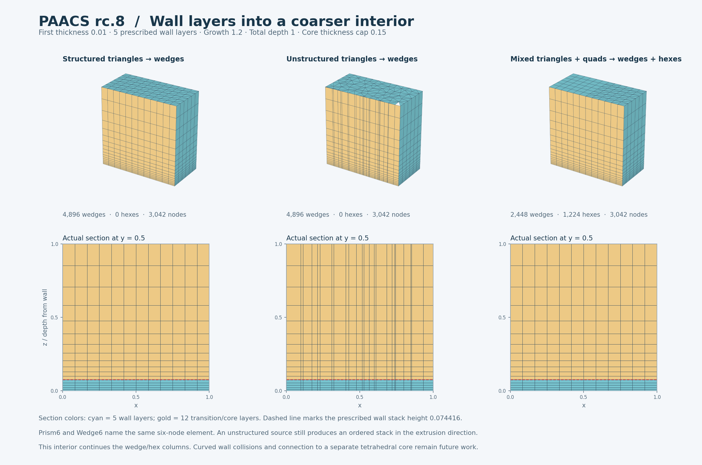

# Planar prism/wedge and mixed wall layers (PAACS 1.0.0)

`Prism6` and `Wedge6` refer to the same six-node triangular-prism element.
The new `meshLayeredPatch` API consumes a prepared planar surface patch:

| Surface cells | Generated volume cells | Source organization |
|---|---|---|
| Tri3 | Prism6/Wedge6 | Structured triangles or an unstructured triangulation |
| Convex Quad4 | Hex8 | Structured or conforming unstructured quad patch |
| Conforming Tri3 + Quad4 | Prism6 + Hex8 sharing their interface nodes/faces | Mixed patch |

All cases have an ordered stack in the normal/extrusion direction. An
unstructured source does not make the wall-normal stack unstructured, and a
triangular cut on a wedge's end does not make the volume a tetrahedron.



## Schedule and use

```cpp
#include <paacs/algo/LayeredPatchMesher.hpp>
paacs::algo::LayeredPatchRequest request;
request.direction = {0,0,1};
request.schedule.wallLayers = 5;
request.schedule.firstLayerThickness = .01;
request.schedule.growthRatio = 1.2;
request.schedule.maximumAllowedGrowth = 1.3;
request.schedule.totalDepth = 1;
request.schedule.maximumCoreThickness = .15;
request.maximumOutputBytes = 128ULL * 1024 * 1024;
request.maximumWorkingBytes = 128ULL * 1024 * 1024;
paacs::mesh::Mesh result;
auto outcome = paacs::algo::meshLayeredPatch(preparedSurface, request, result);
if (!outcome.published) { /* result is unchanged; inspect outcome.reason */ }
```

The first five thicknesses are exactly the requested geometric schedule, up
to floating-point rounding: **0.01, 0.012, 0.0144, 0.01728, 0.020736**. They
total **0.074416**. In the illustrated unit-depth example, **12 additional
layers** fill the remaining depth. All achieved adjacent thickness ratios are
at most 1.2 up to roundoff, and the core cap is retained. These heights are
checked against actual exported node coordinates, not only schedule metadata.

`totalDepth=0` produces just the prescribed wall stack. Otherwise the planner
retains that stack and builds a capped geometric core sequence. It rescales
only the core sequence to fill the remaining depth, checking the wall/core
interface and every resulting adjacent ratio. It may try one fewer core layer
when the first candidate is unsuitable. A transition that does not fit this
bounded construction is refused; this is not an exhaustive optimizer over
every possible non-geometric schedule. Wall heights are never silently reduced.

The schedule alone is reusable through `planLayerSchedule`; it returns absolute
offsets, wall/core counts, achieved thickness extrema and maximum adjacent
growth. `PreparedMixedSweepRequest::layerFractions` also now accepts explicit
normalized boundaries, exactly `layers+1` entries from 0 to 1. They override
the old geometric spacing while retaining its maximum-growth acceptance check.
An empty vector preserves the previous route and its mesh connectivity.

The meaning of growth here is **layer thickness ratio**, not the volume-based
tetrahedron metric in [local sizing](LOCAL_SIZE_CONTROLS.md). The latter is an
isotropic size diagnostic; thin wall layers are intentionally anisotropic.
A first-cell height has no universal CFD y-plus meaning without the flow and
wall-treatment inputs supplied by the downstream analysis.

## Validation and classification

The wrapper checks source bounds, classifications, connectivity, finite
coordinates, unused nodes, planarity relative to the supplied normal, and
positive projected triangle/convex-quad orientation. Planarity tolerance is
`1e-10 * maximum source bounding-box span`; it is not a CAD healing tolerance.
Projected source intersections and T-junctions are checked before extrusion.

The intersection pass uses exact-sign orientation predicates on a normalized
2D projection, flat triangle records sorted by x extent, and a bounded
sweep of overlapping-x pairs. It detects proper crossings, containment,
duplicate triangles, unmerged contacts and collinear T-junctions. The predicate
claim concerns the rounded normalized projection, not exact arbitrary real
coordinates. Very badly scaled/unresolved geometry may be refused.

The existing mixed-sweep component then verifies shared-edge winding and
manifold incidence, constructs shared layers, and checks positive emitted
subcells. For a straight normal translation of a valid planar triangle/convex
quad, positive projected area and positive layer thickness give a positive
full-element Jacobian. Finally the wrapper runs the complete volume/exterior
face-incidence audit. All stages finish before publication.

Source boundary faces retain their input classification. Target, side and
volume classifications are explicit in the request. Intermediate nodes on
the patch perimeter receive the side classification; other intermediate nodes
receive the volume classification. No imported CAD ownership is invented.

The new intersection checker is specific to planar patches. It is not a
general 3D collision detector and is not silently added to the older curved
front implementation. Both legacy straight and curved layer APIs remain
available with their separately documented scopes.

## Budgets, scaling and limitations

Output node/cell limits are checked before construction. A conservative
output-byte reservation assumes every source edge could be a boundary edge;
`plannedOutputBytes` is consequently larger than actual `outputBytes` for
ordinary connected patches. Set a byte budget using the planned value if
repeating a qualified request. Exact output arrays remain deterministic.

Source cells/nodes, x-overlap pair checks, layer count, schedule bytes, output
bytes, audit face uses and audit temporary bytes are bounded. `plannedWorkingBytes`
is a conservative payload estimate for flat source geometry records, the
retained legacy map-based sweep analyzer on the reference ABI, schedule and
classification arrays, and the final audit. It is not a portable bound on
allocator bookkeeping or total RSS. Existing source/destination meshes and
thread-pool memory are caller/process resources outside these counts.

The source sweep can be quadratic for pathological overlapping bounds; its
explicit work limit refuses such a request rather than skipping checks. A
hierarchical spatial index is a measured future optimization if that pass
dominates realistic patches. Output generation is parallel; source validation
and the boundary audit retain serial portions. Do not infer many-core scaling
from the existence of a thread option.

Cancellation is checked before/after major phases and during source candidate
scans. The retained mixed-sweep call itself is not interruptible mid-call;
cancellation still prevents publication once it returns. Failure, including
allocation failure, preserves the previous destination.

This release qualifies **straight normal extrusion of planar prepared patches**.
The illustrated core continues the wedge/hex columns. It does not yet attach
a separately generated Tet4/Tet10 core, terminate layers around arbitrary
corners, recover curved CAD surfaces, or qualify the older curved-front
collision/backoff route for general viscous CFD meshes. The
[straight-duct convergence study](../examples/flow_straight_duct/README.md)
checks straight prism layers and laminar pressure drop for a square section.
The [hybrid duct study](../examples/flow_hybrid_duct/README.md) constructs
four mitered prism stacks against the shared triangular boundary of a
prepared Tet4 core.

## Reproduction

```sh
cmake --build --preset gcc16-release --target paacs-layered-patch paacs-local-controls-benchmark
ctest --preset gcc16-release -R paacs.sizing.layered_patch --output-on-failure
build/gcc16-release/tests/paacs-layered-patch --gallery layer-archives
build/gcc16-release/tests/paacs-local-controls-benchmark unstructured 12 .01 1.2 4 wedges.paacsmesh
python3 benchmarks/render_local_controls.py sizing-archives layer-archives docs
```

Executable paths assume default CMake output placement. The unit-domain
benchmark driver uses a seeded jittered triangulation for its unstructured
fixture; the public API accepts a caller's prepared conforming patch instead.
The [installed C++ example](../examples/local_controls.cpp) requires no test
framework or geometry kernel.

## Reusable profiles

The [reusable size-profile guide](REUSABLE_SIZE_CONTROLS.md) adds a shared
global/local/gradation planner for cylinder caps, axial bands, and normal
prism/hex layer spacing. Its axial growth guarantee is separate from the
three-dimensional equivalent-volume growth measured by the adaptive box API.
