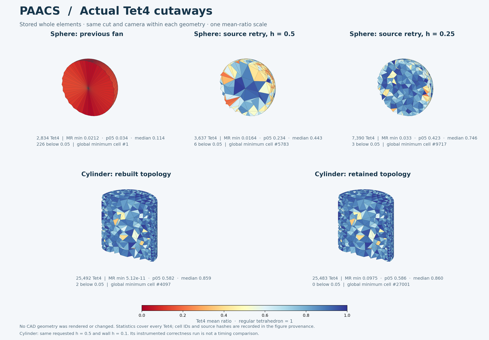

# Tet4 quality and sizing evidence

This is an incomplete development qualification record. It retains all eight
owned STEP baseline requests, two source-shell experiments, and separate
cylinder-topology and thin-plate diagnostics. A subsequent quiet run completed
all eight owned requests on one combined development artifact.
It does not qualify a release, arbitrary CAD, or simulation accuracy. Exact
measurements, hashes, routes and metric conventions are in
[quality-qualification.json](data/quality-qualification.json).

## Scope and provenance

The baseline collection is named `frozen-c154-v1`. Its installed Windows x64,
Python 3.12 wheel was built from the clean source revision `ae7638be6a64`;
the collection name must not be substituted for that build receipt. The wheel
SHA-256 is `5b23e0321be90f4bbcf259d4ee8a6467e4fdf2c3e8d282de188d357e3e8d708e`.
The two later sphere runs used a development extension, SHA-256
`192bc63182f982a0b434a1d0bf95f339d61768da5ac9e0771bbc853da88e7fc6`,
not an independently qualified installed candidate wheel.
The combined quiet run used extension
`ee1f2bd4547c8e84d6e068badbaa7424880bc5b0dfe11d35184ccfd50d53e57b`
and source snapshot
`8f78e28c9601d4ccc890fcfc08a9e60abb9b198ab2d82cce489532e680ba07be`.
That snapshot records a modified development tree based on `c154ab8`, not a
clean installed-wheel receipt.

The baseline and source-shell sphere requests ran serially with one meshing
worker, one validation worker, Normal
resource admission, Legacy construction effort, 1 GiB modeled working memory,
500,000 nodes and 3,000,000 cells. Preferred and strict quality arguments were
omitted; their effective thresholds were zero. Native geometric and resource
checks remained active. There was one observation per request, so these are
neither repeated timing statistics nor a scaling or speedup claim.

Reported CAD checks come from the saved Native reports. Separate bounded
archive inspection measured Tet4 shape, orientation, body ownership, tags and
archive identity. It did not independently repeat CAD intersection or fidelity
audits. Raw reports and meshes remain under local ignored `build` directories;
the committed data retains their paths and hashes.

## Frozen baseline

Sizes and distances are in millimeters. MR is mean ratio; larger values mean
more regular isotropic tetrahedra, with an ideal value of one. Times cover the
`mesh()` call, including internal attempts, and exclude import and archive
inspection.

| Request: global / selected wall size | Outcome and actual route | Tet4 | Time (s) | Minimum MR | p05 MR | Median MR |
| --- | --- | ---: | ---: | ---: | ---: | ---: |
| Thin plate: 0.25 | Published, `native_spatial_sizing` | 312 | 3.21 | 0.0000793 | 0.00742 | 0.0558 |
| Thin plate: 0.10 | Cancelled; retained route label `planar_core` | — | 90.02 | — | — | — |
| Plate with bore: 4 / 1 | Published, `native_spatial_sizing` | 4,208 | 64.04 | 0.216 | 0.666 | 0.764 |
| Plate with bore: 2 / 0.5 | Published, `native_spatial_sizing` | 23,822 | 61.11 | 0.0384 | 0.591 | 0.810 |
| Sphere: 0.5 | Published, `native_surface_star` | 2,834 | 1.05 | 0.0212 | 0.0337 | 0.114 |
| Sphere: 0.25 | Published, `native_surface_star` | 2,834 | 1.04 | 0.0212 | 0.0337 | 0.114 |
| Cylinder: 0.5 / 0.15 | Published, `native_spatial_sizing` | 10,028 | 36.93 | 0.107 | 0.592 | 0.861 |
| Rotated torus: 0.5 | Published, `torus` | 226,800 | 1.04 | 0.598 | 0.692 | 0.784 |

All seven publications passed their Native audit and quality-validity gates,
then the separate archive screens. The one refusal published no mesh. The
baseline requested a 90-second Native deadline and a 120-second process limit;
no hard process timeout occurred. The cancellation is retained rather than
counted as incompatible geometry. Ninety seconds is a comparison condition,
not a fixed engine limit. The later sphere probes requested 300 seconds and a
360-second process limit; callers' explicit deadlines remain authoritative.
The historical route label alone does not prove which stage was entered or
where its time was spent.

Archive inspection can be material work: the torus took another 31.63 seconds
to inspect. The data keeps inspection and worker totals separate from meshing.

## Sphere source-shell correction

Both baseline sphere requests produced the same archive hash. The sized
construction had refused its source shell before initial-point placement;
the final fan used no volume size field. Its valid geometric approximation
therefore did not establish that the requested volume size was applied.

The source retry experiment tightens the effective source chord when the
shell misses the requested volume tolerance. Each attempt consumes the shared
resources. It preserves the requested size, minimum, growth and geometric
acceptance limits. Normal allows at most three source preparations; historical
Bounded preparation retains one. This is a general source-volume correction,
not a sphere-specific point layout.

Both completed probes needed two attempts. The first chord limit, 0.0086603,
produced 1.3227% relative volume error. Tightening it to 0.0043301 produced
0.6542%, within the unchanged 1% limit. Every source attempt and its work/time
is retained in the data. The STEP files and development extension had unchanged
before/after hashes. Both resulting meshes passed Native gates and separate
archive orientation, ownership, identity and face/body-tag checks.

| Global size | Actual route | Tet4 | Time (s) | Minimum MR | p05 MR | Median MR | Median / maximum cell max-edge |
| --- | --- | ---: | ---: | ---: | ---: | ---: | ---: |
| 0.5 | `native_spatial_sizing` | 3,637 | 9.35 | 0.0164 | 0.234 | 0.443 | 0.335 / 0.620 |
| 0.25 | `native_spatial_sizing` | 7,390 | 12.58 | 0.0330 | 0.423 | 0.746 | 0.236 / 0.333 |

The former fan's cell max-edges were approximately one at both requested sizes.
The new volume responds to size, but this is not proof that every target is
met. Both initial fronts report `stalled`; queue exhaustion is not a sizing
certificate. The coarse minimum MR worsened despite the improved distribution.
Its minimum dihedral angle also fell from 3.32 degrees to 0.129 degrees.
These tails remain visible in the machine-readable record.

## Cylinder numerical-topology correction

A separate instrumented run traced the original cylinder at global size 0.5
and wall size 0.1. Initial scoring removed eight severe bootstrap cells and
finished with 23,797 nonguard tetrahedra, minimum MR 0.03515 and no MR below
`1e-8`. The old recovery path then rebuilt a fresh Delaunay complex from that
point set. Two extremely near-flat cells first appeared at that import, before
constraint recovery and sizing.

The retained-topology probe imported the already scored complex: the same
23,797 cells and minimum MR survived import and constraints, without the two
defects. Material selection left 23,689 cells with minimum MR 0.2209. After
sizing, the published mesh contained 25,483 cells with minimum MR 0.09745.
The saved probe result reports successful Native publication; a separate
Python archive measurement confirms the final shape metrics below.

| Final archived cylinder | Tet4 | Minimum MR | p05 MR | Median MR | Minimum scaled Jacobian | Minimum angle (degrees) | MR below `1e-8` |
| --- | ---: | ---: | ---: | ---: | ---: | ---: | ---: |
| Fresh topology rebuild | 25,492 | 5.12e-11 | 0.5824 | 0.8595 | 3.99e-16 | 2.28e-14 | 2 |
| Retained scored topology | 25,483 | 0.09745 | 0.5857 | 0.8598 | 0.02757 | 1.7756 | 0 |

Independent hashes establish that both initial snapshots are byte-identical,
including the same 4,734 stored node coordinates. The final 3,684 boundary
triangles also have exactly matching stored coordinates, orientations and CAD
face tags. This isolates a topology change rather than a new point layout or
changed boundary. The cutaways look similar because their bulk distributions
barely changed; the correction removed two extreme defects.

The instrumented probe ran with contention. Its identity explicitly records
`timing_comparison_valid=false`; no speed improvement follows from it. This
single controlled case does not qualify topology handoff for arbitrary CAD.

## Thin geometry and earlier simulation examples

The thin fixture is a 2 × 1 × 0.002 box. At size 0.25 it captures the geometric
thickness, but 288 of 312 tetrahedra span at least 98% of that thickness. All
312 have a minimum dihedral angle below five degrees. The small MR values
describe strong anisotropy; a geometric pass does not establish acceptable
conditioning or sufficient through-thickness resolution.

The frozen 0.10 cancellation cannot be attributed to planar construction or
to a point before the initial front: `planar_core` was a stale dispatch label,
not a stage-entry certificate. A new diagnostic exposes `planar.attempted=false`.
With an explicit 600-second Native deadline and 720-second process limit, it
published 1,572 tetrahedra. The contended call took 126.94 seconds: the initial
front accounted for 125.93 seconds while inserting zero sites, and constraint
recovery completed in 0.118 seconds. These observations identify current work
placement; they are not a quiet-run performance comparison.

Native validity passed, but its minimum MR was 7.85e-12. Separate archive
inspection measured 8.54e-12; both indicate an extremely near-flat cell, with
metric evaluation sensitive at this scale. The archive median MR was 0.1068.
Of 1,572 cells, 1,548 span at least 98% of the 0.002 thickness. Geometric
validity therefore remains distinct from shape and solver suitability.

The original longer-deadline harness record still reports
`inspection_or_harness_failed`: NumPy was missing during its thickness
measurement after Native publication. A separately recorded supplemental
archive/metric/tag/thickness inspection succeeded without repeating meshing.
It does not retroactively turn the original harness run into a complete pass.

Earlier planar/sweep tests of the thin box and the plate-with-hole stress
convergence example used separately prepared constructions. The plate example
used planar triangulation and a conforming sweep. Those remain useful checks
of those methods, but do not validate the general STEP route used here.
The rotated torus's actual STEP dispatch is also recorded separately from
earlier explicitly parameterized primitive tests.

## Quiet combined eight-request run

One quiet, serial attempt per request completed on the combined source-shell
and retained-topology artifact. All eight passed Native publication, geometry,
audit and quality-validity gates, followed by independent archive orientation,
ownership, metric, tag and identity screens. The retained topology was used in
all eight. These are development-extension results, not installed-package
qualification or a broader CAD coverage score.

The run explicitly requested 600-second Native and 720-second process limits;
other requested controls and resource caps matched the frozen baseline. The
table reports individual `mesh()` observations, including internal retries.
It contains no median runtime or repeated-performance estimate. Shape medians
remain ordinary per-element distribution statistics.

| Request | Baseline → combined Tet4 | Baseline → combined call (s) | Combined minimum MR | Combined median MR |
| --- | ---: | ---: | ---: | ---: |
| Thin plate: 0.25 | 312 → 312 | 3.21 → 3.37 | 0.0000793 | 0.0558 |
| Thin plate: 0.10 | Refused → 1,572 | 90.02 cancelled → 100.34 | 8.54e-12 | 0.1068 |
| Plate with bore: 4 / 1 | 4,208 → 4,209 | 64.04 → 65.30 | 0.216 | 0.7635 |
| Plate with bore: 2 / 0.5 | 23,822 → 23,823 | 61.11 → 58.14 | 0.0384 | 0.8102 |
| Sphere: 0.5 | 2,834 → 3,637 | 1.05 → 9.09 | 0.0164 | 0.4432 |
| Sphere: 0.25 | 2,834 → 7,390 | 1.04 → 12.11 | 0.0330 | 0.7465 |
| Cylinder: 0.5 / 0.15 | 10,028 → 10,024 | 36.93 → 37.40 | 0.107 | 0.8613 |
| Rotated torus: 0.5 | 226,800 → 8,511 | 1.04 → 12.96 | 0.0216 | 0.8024 |

The original 90-second thin-plate refusal remains counted in the baseline.
Its new 100.34-second success uses a longer allowance and does not demonstrate
an improvement to that earlier 90-second score. The mesh has the same archive
hash as the preceding contended diagnostic and retains its near-flat cell.
The coarse thin plate is also byte-identical to its baseline; its shape and
through-thickness limitations are unchanged.

Sphere size responsiveness persists in the combined build, with much better
bulk shape distributions and more construction work than the old fan. Its
coarse worst cell remains worse than the old minimum. Final sphere relative
volume error is 0.654%, versus the old fan's 0.506%; both satisfy the unchanged
1% limit. This is not an across-the-board quality, fidelity or speed gain.
Plate and cylinder count/distribution changes are small. The finer plate's
minimum MR is still lower than the coarser plate's; refinement alone does not
guarantee better element shape.

The torus changed from the analytic `torus` route to `native_spatial_sizing`.
Although both requested global size 0.5, its median cell max-edge increased
from 0.160 to 0.458. Relative volume error increased from 0.224% to 0.795%,
and maximum boundary-sample error from 0.00205 to 0.01119. Minimum MR fell
from 0.598 to 0.0216, while median MR rose slightly. All Native limits passed,
but the much smaller mesh has different achieved size, fidelity and quality
tails. Neither its cell-count reduction nor these timings establish a
comparable-fidelity speed improvement.

The eight API calls totaled 298.71 seconds in this one run; the eight complete
processes totaled 327.27 seconds. Import, archive inspection and process costs
remain separately recorded. The committed data links the exact plan, results,
paired comparison, source snapshot, extension and every output/report hash.

## Interpretation and remaining work

The JSON preserves independent mean ratio, minimum interior dihedral angle
and scaled Jacobian conventions. Distribution arrays use the explicit
`distribution_fields` ordering. Achieved edge distributions, requested controls
and Native geometry errors are separate measurements. Neither finer elements
nor good shape alone establishes solver accuracy.

The new shape-review advisory can flag severe Native shape minima or poor
distributions even with preferred warnings disabled. It does not change Native
validity, infer causal CAD faces, recommend refinement automatically, or approve
a solver model.

The figure combines isolated experiments. Its sphere panels are the earlier
`source-shell-v1` extension, not the combined topology build. Its cylinder
panels compare the separate correctness probe; neither row supplies timing
evidence for a combined candidate. The figure's cylinder wall size is 0.1;
the quiet eight-request cylinder uses wall size 0.15.

The quiet combined eight-request development run is complete. Local regression
checks also passed: 234 Python tests with one expected platform skip, 101 native
CLI checks including source hard-link protection, and both focused C++ point
placement/topology tests. Isolated Python child commands explicitly loaded the
current development code and extension.

Installed-wheel validation and broader corpus/platform checks remain required.
The thin-plate placement cost and near-flat cells, and the torus route/quality
tradeoff, remain open qualification issues.
No merge, release tag or package publication is implied by these results.
