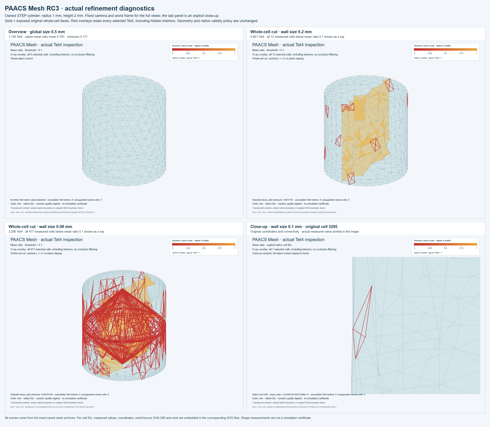

# Selected-face refinement findings

The bundled cylinder exposes a reproducible sizing and quality problem in
v1.2.0-rc.3. Finer requested wall sizes eventually produce less regular surface
triangles and fewer, poorer tetrahedra. The direct Python controls and saved
selection recipes produce identical mesh archives, so the observed difference
is in native construction rather than recipe replay.

This test does **not** reproduce the reported geometry refusals on the original
Claude-generated geometry. That geometry has not been established as the same
input. All 14 attempts on this owned fixture pass the existing native validity
checks. Passing those checks does not establish suitability for a simulation.



The [numerical evidence and figure receipts](data/refinement-cylinder-rc3.json)
retain all 14 measurements, direct/recipe archive equality and exact figure,
mesh and source hashes. The SVGs embed original cell IDs, measured values and
coordinates: [overview](images/refinement-rc3-uniform-direct-all-poor.svg),
[0.2 mm cut](images/refinement-rc3-wall-0p2-direct-all-poor.svg),
[all 417 cells below 0.1](images/refinement-rc3-wall-0p08-direct-all-poor.svg),
and [rim close-up](images/refinement-rc3-wall-0p1-worst-rim.svg).
The cuts retain whole original tetrahedra; the red x-ray overlay includes all
selected cells regardless of whether the cut exposes them.

## Reproduction

`tests/fixtures/cad/cylinder.step` contains one solid with radius 1 mm, height
2 mm and volume 2π mm³. The cylindrical wall is selected by surface type and
radius, rather than an assumed face number. Its current local tag is 1; the caps
are 2 and 3. The source SHA-256 is
`a05d283e8c8cecee8e0917147db2e359689f3e5d8312a5f051010f002ba42988`.

Run the benchmark from the repository root using a Python interpreter with the
package to be measured installed:

```sh
python -I benchmarks/refinement_diagnostics.py --output build/quality-feedback/cylinder-refinement
```

The benchmark runs each attempt in a separate process. It compares direct
`FaceSize` calls with an equivalent source-bound selection recipe that is saved
and reopened through `run_saved_recipe`. Both use `assembly="conforming"`, one
meshing worker and one validation worker. There are no refinement boxes or
retries. The native time allowance is 90 seconds per attempt and the process
limit is 150 seconds. The common budgets are 500,000 nodes, 3,000,000 cells,
100,000,000 work units, 256 MiB output, 1 GiB working memory and 512 MiB audit
memory. These are explicit diagnostic settings, not a claim about all defaults.

Global size is 0.5 mm, growth is 1.3, and `min_size=None` retains the native
effective minimum of zero without a requested clamp. Face growth is unset and
inherits 1.3. Quality thresholds and the advancing-front override are unset.
An additional wall-size-0.5 control separates the effect of specifying a face
control from actually requesting finer spacing.

Every case retains native diagnostics, successful mesh archives and VTK files,
plus independently computed measurements. Recipe cases also retain the recipe
and workflow report. `summary.csv` includes subprocess time, native meshing time,
counts and quality; `pair-comparison.json` checks exact archive equality. Use
`--summarize-existing` with the same output directory to refresh measurements
without rerunning native construction.

With a development wheel containing the inspection API, reproduce the SVGs and
self-contained SVG/HTML gallery from those retained results:

```sh
python benchmarks/render_refinement_diagnostics.py build/quality-feedback/cylinder-refinement --output build/quality-feedback/refinement-figures --png none
```

The renderer derives its worst cell and camera frames from actual measurements.
To reproduce the archived figure frames, add
`--view-bounds -1.1 -1.1 -0.1 1.1 1.1 2.1` and
`--closeup-bounds 0.25 -0.99 -0.02 0.55 -0.82 0.11`.
CairoSVG is an optional PNG renderer, not a package dependency. Retained input
bundles preserve their producer reports verbatim; share the generated images
and relative-path manifests when local producer paths should remain private.

The `RC3 cylinder refinement evidence` Actions workflow independently repeats
the published-wheel experiment on Linux with Python 3.12 and retains the wheel
hash and every attempt. Failed or timed-out attempts cause a failed study job;
its artifacts still retain the available evidence. Success does not establish
solver accuracy.

## RC3 measurements

The following single-run results were measured on Windows on 23 November 2026,
using the package installed from PyPI. Times are native end-to-end meshing times
for the direct calls; they include all native construction and validation work.
They exclude interpreter startup, import, export and measurement, which are
recorded separately by the benchmark. There were no failed attempts or retries.
All seven direct/recipe pairs produced byte-identical archives.

| Wall request (mm) | Tet4 | Minimum mean ratio | Mean mean ratio | Wall median edge (mm) | Wall maximum edge (mm) | Native seconds |
| --- | ---: | ---: | ---: | ---: | ---: | ---: |
| No face control | 1,740 | 0.171 | 0.761 | 0.228 | 0.286 | 0.99 |
| 0.5 | 1,740 | 0.171 | 0.761 | 0.228 | 0.286 | 0.95 |
| 0.3 | 2,301 | 0.143 | 0.805 | 0.228 | 0.286 | 2.62 |
| 0.2 | 5,061 | 0.0612 | 0.820 | 0.200 | 0.379 | 13.29 |
| 0.15 | 5,761 | 0.00821 | 0.753 | 0.170 | 0.613 | 14.21 |
| 0.1 | 3,654 | 5.80 × 10⁻¹¹ | 0.520 | 0.154 | 0.863 | 21.98 |
| 0.08 | 3,280 | 0.00251 | 0.370 | 0.146 | 0.790 | 22.05 |

Mean ratio is dimensionless, with 1 representing a regular tetrahedron. Wall
edges are unique physical triangle edges measured as Euclidean chords. They
are achieved-size observations, not geodesic lengths or strict certificates
under the current sizing contract. The 0.08 case has 417 of 3,280 tetrahedra
below mean ratio 0.1, compared with 12 of 5,061 for the 0.2 case.

## Confirmed construction limits

`OcctSurfaceSpacing.hpp` bounds insertion to 256 points per face and returns
success even when its spacing queue is unfinished. `OcctBoundary.cpp` then
permits up to 96 additional chord-refinement points for the regular front and
checks geometric facet witnesses. The spatial route starts without OCCT face
interior nodes. Later source-facet insertion is disabled for this route.

The 0.1 wall contains exactly 352 face-classified interior nodes, reaching the
combined 256 + 96 limit. Its longest edge has length 0.863 mm, including 0.858 mm
axial distance. A cylinder generator is straight: a long axial edge can satisfy
the chord tolerance while failing the intended spacing. The other refined
wall node counts, 322, 347 and 338, do not identify the exact split between the
two passes; additional native counters are needed for those cases.

The initial interior front also has a fixed limit of 16,384 candidate proposals.
At wall size 0.2 it completes its original source sweep and accepts 496 sites,
including 290 bulk sites. At 0.15, 0.1 and 0.08 it exhausts the candidate limit
before completing that sweep. Accepted initial sites fall to 367, 156 and 2,
respectively, and no bulk proposals are reached. These are observed termination
differences. The current public report does not include the detailed rejection
counts needed to assign them to spacing, shape, geometry or scorer refusals.

The worst tetrahedra at 0.2, 0.15, 0.1 and 0.08 each use four cylinder-boundary
vertices. The worst 0.1 cell lies near the wall/cap rim, with two vertices on the
bottom circle and two on the wall at almost the same height. Its native volume
is approximately 1.64 × 10⁻¹⁹ mm³. This establishes a near-boundary sliver issue;
it does not show that a central interior point caused it. Identifying the exact
diagonal or cavity operation that retained the sliver requires stage-level
construction evidence.

The coarse wall is already curvature-limited: the default chord tolerance is
approximately 0.00866 mm, giving a surface curvature spacing near 0.228 mm.
This explains why requests of 0.5 and 0.3 leave the wall geometry unchanged.
The 0.3 volume mesh still differs because its interior size field is finer.
Selected-face growth also propagates toward the caps and interior, and shared
curve samples use the more restrictive neighbouring-face size. That propagation
is intentional and does not indicate lost face identity.

## Additive native report fields

The existing `sizing` block remains unchanged. It describes wrapper policy
before native automatic dispatch; `mode="standard"` can therefore accompany an
actual `native_spatial_sizing` body route. New `effective_policy` fields preserve
that distinction:

- `requested_native_sizing` and `requested_advancing_interior_front` retain the
  caller's overrides, including `None` for automatic dispatch.
- `wrapper_native_sizing` and `wrapper_sizing_mode` describe the wrapper's
  pre-dispatch choice.
- `body_routes` copies each native body report's `solid_tag`, `route` and
  `reason`. Refused attempts retain only the body reports actually available.

Each body also gains `interior_front`, reporting the existing adaptive stage
after initial point construction: `diagnostic`, `nodes`, `candidates`, `work`,
`queries`, `remaining_oversized`, `front_activations`, `void_activations`,
`front_advances` and `seconds`. A diagnostic of `targets_satisfied` describes
that native stage; `budget_limited`, `targets_unmet`, `scaffold_refused` and
`not_attempted` retain their distinct meanings. Zero remaining counts for a
stage that was not attempted do not certify sizing. These fields neither
certify per-face spacing nor change geometry validity or algorithm budgets.

## Next construction work

Return a structured result from surface spacing, including pending work,
blocked proposals and the termination reason. Derive insertion allowances
from the requested surface metric and admit them against existing global work,
node, triangle, memory and time limits. This allows a small requested size to
receive appropriate bounded work without raising a constant indiscriminately.

Report achieved sizing and incomplete spacing separately from geometric
validity. Then investigate fair work allocation between the original source
sweep and bulk interior construction, and local treatment of tetrahedra formed
from nearly coplanar boundary vertices. None of these findings justifies
relaxing outside, orientation, embedding or body-identity checks.

## Comparison with the supplied independent findings

The original executed report and its exact cylinder were not supplied. This
comparison addresses the reported behaviors using the identified owned fixture;
it does not claim a numerical reproduction of an unknown input.

| Reported concern | Status in this iteration | Evidence or remaining work |
| --- | --- | --- |
| Finer wall requests reduce minimum Tet4 quality | Reproduced; construction fix deferred | Minimum native mean ratio falls from 0.171 to 5.80 × 10⁻¹¹; boundary slivers and incomplete point construction are measured separately. |
| Element counts reverse as the requested wall gets finer | Reproduced and partly explained | Counts fall from 5,761 to 3,280 after proposal budgets stop before bulk construction. No claim that one counter explains every rejected site. |
| Requested and achieved wall sizes differ | Reproduced and explained; sizing completion deferred | Wall edge populations and long axial chords expose missing spacing even when CAD chord checks pass. New summaries separate requests, effective policy and achieved measurements. |
| Geometry-error refusals at fine sizes | Not reproduced on this fixture | All 14 attempts pass unchanged native checks. The exact original geometry/settings are needed to establish the reported refusal. |
| Direct and recipe controls may differ | Not reproduced here; interface consistency improved | All seven original pairs are byte-identical; direct guarded selections now use the same conversion as saved recipes. |
| Only aggregate/worst-cell diagnostics are available | Resolved for opt-in linear Tet4 analysis | Every cell is queryable by native ID, with paginated/filterable metrics, geometry, classification and spatial distributions. Other families remain explicitly unsupported for shape metrics. |
| Bad interior elements are hidden in surface views | Resolved for the new SVG path | All threshold matches are drawn as x-ray overlays, with whole-cell cuts, close-ups, legends and hash/ID-linked VTK/SVG evidence. |
| Quality-to-CAD location is unavailable | Resolved within a stated sampling scope | Exact trimmed-face distance at cell node centroids, requiring matching source/kernel/units. Proximity does not establish ownership, causation or a full-cell error bound. |
| Iterative comparisons lack localized evidence | Resolved for separately reported-valid snapshots | Common-world spatial bins, shape/sizing/count/CAD-error deltas, preserved interference and explicit provenance. Workflow retry totals remain unavailable in this comparison interface. |
| API parameters, selection failures and native hints are hard to discover | Improved and tested | Explicit `CadModel.mesh` signature, structured selection/control errors, native hints and documented capability/issue schemas. |
| Smaller elements imply a more accurate simulation | Not asserted | No solver convergence study is performed here. Shape, geometric validity, resolution and solver adequacy remain distinct. |

The new inspection operations do not repair these meshes. The measured
construction limits remain work for the next meshing change, qualified with
both this fixture and held-out CAD before selecting new defaults.
