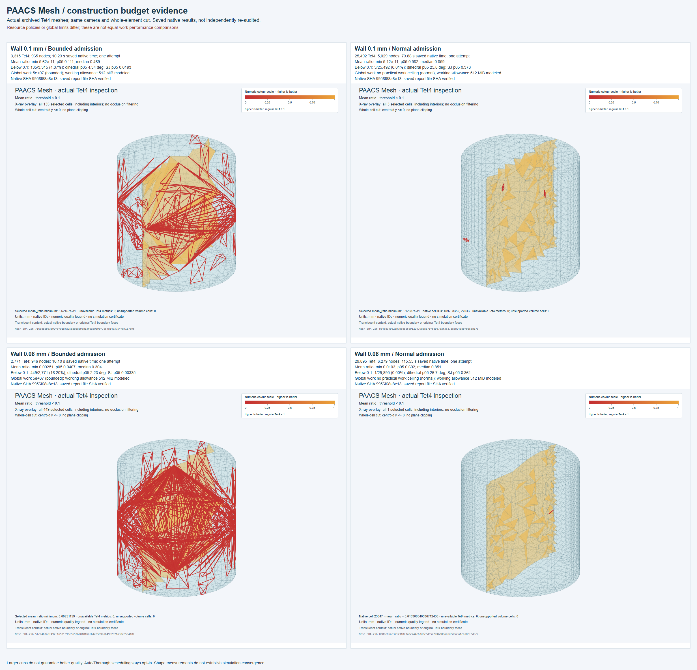

# Resource-admission study

Progressive admission removes a reproduced obstacle to initial interior-point
construction. Focused cylinder runs show better shape distributions under the
same explicit caps, and finer achieved wall spacing when those caps are unset.
They also expose remaining memory stops, poor individual elements and long
construction times. New development Python meshing calls, new recipes and
direct STEP CLI requests now default to `resource_policy="normal"`. Historical
missing-policy recipes and C++ options aggregates retain Bounded semantics.
Construction effort stays Legacy and omitted modeled memory stays 512 MiB.
This choice permits more work; it is not a quality or speed guarantee.
Experimental `auto` and `thorough` scheduling remain opt-in.

These are unreleased development results. A package version of `1.2.0rc3` in a
local report does not identify the tested native binary. This study distinguishes
the frozen parent, the exploratory P6 snapshot and the corrected P7 snapshot.
The completed P7 corpus, work/memory grid and owned-fixture scaling runs retain
source, binary, archive and saved-report fingerprints. P6 probes remain labeled
separately. These measurements do not describe a new published wheel.

The [machine-readable study](data/resource-policy-study.json) retains all
recorded attempts, resource receipts, repeated groups, sanitized source
fingerprints and independent-screen scope. Downloaded CAD and mesh coordinates
are excluded. After the frozen P7 measurements, commit `157d9ac` changes new-call
argument defaults and tests. Among the frozen compiled production sources,
only the Python binding and CLI wrapper differ; the native meshing algorithm
sources remain identical. Measured P7 profiles explicitly select their policy;
the historical parent uses its frozen Bounded behavior without a resource-policy
option. Installed-wheel checks qualify the wrappers separately from these frozen
performance observations.

The [implementation and qualification plan](RESOURCE_POLICY_PLAN.md) defines
the remaining checks. [Construction controls](CONSTRUCTION_BUDGETS.md) and
[diagnostic contracts](DIAGNOSTIC_SCHEMAS.md) explain the request and receipt
fields. The [earlier construction study](CONSTRUCTION_BUDGET_STUDY.md) concerns
different snapshots and must not be combined with these rows as one timing
experiment.

Local measurements use Windows 11 build 26300, an AMD Ryzen 9 8945HS with
16 logical processors and 31.3 GiB of visible physical memory, CPython 3.12.6,
OCCT 8.0.1 and MSVC 19.44 with strict floating-point compilation. Each attempt
uses one meshing worker and one validation worker; timed mesh cases run
serially. These are observations on one host. A timing median requires at
least three complete repetitions with matching source, binary and mesh hashes.

The frozen parent source commit is
`94dcfbc732d1c0131d1b513f3f4b7d02226a78e5`; its corpus CLI SHA-256 is
`fce84eba7cca10dcb7f11234116efbce58d5a17be671fce8669bdeb686f24bee`.
The measured P7 source commit is `efe7256bf6f393375cfdf23132f2af2235575cdd`.
Its corpus CLI SHA-256 is
`673b60bf413a3c9559b8f2e31028f8c8c5dae3fd09fb91b50172f6ed9fdc49dc`,
and its cylinder/scaling extension SHA-256 is
`9956f68a8e1353947d9715621384ab854a0e0b13341f94959abfdbb61da5ba8e`.
Recorded compiled-source fingerprints supplement the commit IDs. These frozen
identities must not be replaced with the current checkout or a later wheel's
identity when interpreting the timings.

The owned cylinder input is `tests/fixtures/cad/cylinder.step`, SHA-256
`a05d283e8c8cecee8e0917147db2e359689f3e5d8312a5f051010f002ba42988`.
Sanitized evidence retains each owned fixture's relative path and source hash,
all 51 external input IDs, sizes and hashes, and per-attempt native/archive/report
fingerprints. It excludes downloaded CAD geometry, mesh coordinates and
personal absolute paths. Source receipts cover a recorded compiled-file subset,
not a complete dependency-source manifest.

## Defect and corrections

The old initial-point auxiliary admission coupled its permitted future cell
count to bootstrap storage and import-work reservations. A larger ceiling could
therefore prevent the same small initial seed from being admitted. Raising
global work alone did not address that dependency. The parent fixed-cap cylinder
runs below admitted no initial-front points and reported `auxiliary_bootstrap`.

Normal admission now constructs the initial numerical seed once within the
available work and temporary-memory allowance, then admits the returned cells
and their actual import work. It separates the future ceiling from currently
reserved storage. Capacity grows between candidate batches; compaction and
growth retain allowances for old and replacement arrays while both coexist.
Capacity-only growth preserves IDs, while compaction invalidates insertion
plans and rebuilds affected queue state. Resource retries revisit the proposal
instead of interpreting a storage refusal as a failed geometric candidate.

The bulk queue also grows by demand. The enclosing front, queue and auxiliary
complex share a modeled allowance. Initial placement no longer reserves a
future volume front or apex cache that is created after its temporary data is
released. Later recovery retains a separate input/workspace envelope. Normal
curve sampling uses adaptive numerical integration and model/resource-derived
segment and face limits instead of the historical fixed curve and face-count
ceilings. Shared-edge identity, trims, orientation and subsequent CAD checks
remain required.

Completed work receipts are collected before propagating an observed
cancellation. Ordinary incremental callbacks still check cancellation before
another operation. Explicit work, memory, node, cell and output limits remain
active; Normal with omitted work keeps accounting and an overflow guard without
a practical logical-work ceiling. Its omitted modeled memory remains 512 MiB.
Logical work is not CPU instructions, and a stage-memory estimate is not process
resident memory or a hard operating-system limit.

Focused native tests cover bootstrap independence from an unused larger
ceiling, transactional growth/refusal, cancellation, ID/plan handling, adaptive
curves exceeding 256 segments and a valid 112-face boundary. These checks do not
establish general CAD coverage or simulation adequacy.

## Curve metric correction after coarse-case diagnostics

The new adaptive curve route also introduced a numerical compatibility
regression on some coarse inputs. In the P6 capped comparison, CAD06 and CAD08
abandoned their regular surface trials during shared-edge sampling with
`nonconforming_edge`. The parent accepted those trials. Normal instead selected
partition-star or general cavity fallbacks, changing both surface and volume
meshes. Initial interior-point placement had not been attempted, so these
particular first-stage failures were not evidence against its live numerical
complex or volume constructor.

An isolated, source-pinned curve probe identified `curve_parameter_resolution`
on 24 of CAD06's 33 shared edges and six of CAD08's 41. Every refused curve had
a valid historical bounded schedule under generous unused resource allowances.
The failure was not a work/memory stop or a nonfinite-data refusal.

Two sizing effects caused relative quadrature error to persist through
subdivision. Vertex feature sizes applied only at exact endpoints created a
pointwise jump to the immediately interior size. On remaining CAD06 curves,
the final rejected samples exposed curvature-derived size jumps a few ULPs
before nominal C2 breaks. Derivative-speed, length and geometric-mapping checks
passed there; the sizing-metric error did not. Sampling only one ULP to either
side of the rounded C2 break had missed those transitions.

The correction prepares a continuous endpoint feature envelope and lowers each
five-sample stencil under the existing growth slope before estimating metric
error. Raw cached samples remain unchanged, and the final global arclength
growth pass still runs. Physical chord distance is a conservative bound on
arclength for these local envelopes. This deliberately estimates a prepared
metric instead of trying to certify integration of a discontinuous raw sizing
field. It adds charged bounded traversal; it does not change source geometry,
weaken geometric/validity checks or introduce a permissive fallback.

After this correction the isolated probe completed all 33 CAD06 and all 41
CAD08 shared curves. An owned wide-parameter line joining unequal-radius
features passed an independent analytic metric/spacing reference. An owned C1
spline with a curvature jump passed a dense analytic-arclength reference, with
metric agreement within 0.1% and per-segment metric-spacing agreement within
1%. Fine circle and Bezier cases retained their 629 and 664 segment counts;
the historical Bounded schedule checks also passed.

Successful curve sampling alone does not establish volume-mesh quality or
runtime. The selected full-mesh checks and the complete paired corpus below
provide separate evidence for those stages.

## P7 selected full-mesh follow-up

Four selected inputs were meshed on the corrected P7 build with Normal
admission, the same explicit 300-million work cap and size factor 0.15, one
meshing worker and one validation worker. All four published and passed their
saved native validity checks. A separate archive screen passed all 12,923
positive Tet4 elements, with no inverted or degenerate Tet4. This screen checked
archive structure, shape and recorded body ownership; it did not repeat CAD
queries or a global intersection audit. Original body counts were checked, but
original body IDs were not independently known; tag agreement is with the
saved native evidence.

| Input | Parent → P7 Tet4 | Parent → P7 minimum mean ratio | Parent → P7 mean mean ratio | Parent → P7 process wall seconds |
| --- | ---: | ---: | ---: | ---: |
| CAD06 | 1,033 → 1,041 | 0.120227 → 0.102373 | 0.581536 → 0.578071 | 1.581 → 1.504 |
| CAD08 | 1,518 → 1,505 | 0.012531 → 0.012531 | 0.397824 → 0.401136 | 1.452 → 1.365 |
| CAD09 | 2,476 → 2,546 | 0.143005 → 0.227552 | 0.614666 → 0.639493 | 2.197 → 2.058 |
| CAD09999 | 7,873 → 7,831 | 3.97 × 10⁻¹⁵ → 7.56 × 10⁻¹⁴ | 0.454292 → 0.456683 | 16.784 → 20.655 |

Shape values in this table are independently recomputed, rather than rounded
native aggregate estimates. Counts refer to Tet4, excluding boundary triangles.
Each time is one observed complete process attempt, including its retries and
startup; these are not repeated-runtime medians.

CAD06 and CAD08 again use `native_frontal_quality`, with complete constraint
seeds. The P6 sampling failures had redirected CAD06 to partition-star and
CAD08 to general cavity recovery. Their P7 surfaces contain 728 and 1,018
triangles, compared with the parent's 726 and 1,024. CAD06's quality distribution
is close to the parent but its minimum is slightly lower. CAD08's near-flat P6
minimum around 5.6 × 10⁻¹⁴ is removed; its older, still-poor minimum of 0.012531
remains. Restoring the intended route does not improve every element or every
geometric-error measure.

CAD09 and CAD09999 have exactly the same archive hashes as P6. CAD09 retains
the measured change from the parent. CAD09999 retains a severe near-flat tail
already present in the parent: its median around 0.60 does not characterize
those elements. Its slower P7 wall sample also prevents a blanket speed claim.
The corpus requests a 0.25 quality warning threshold; warnings do not replace
validity checks or certify solver adequacy.

The retained achieved-size data use per-cell edge distributions and
boundary-triangle edge incidences. For example, the per-cell median-edge
population median is 0.633277 → 0.634976 for CAD06 and 5.889866 → 5.920775 for
CAD08, in stored coordinate units. Parent per-face boundary distributions were
not retained, so they are not reconstructed from counts. Bare archives lack a
sizing recipe and intrinsic source/unit metadata; absent effective targets are
unavailable, not inferred from the known CLI size factor. The selected checks
provide the detailed four-file quality comparison; full-corpus coverage is
reported separately below.

## Completed parent corpus baseline

The frozen parent completed all 51 selected input attempts with one meshing
worker, one validation worker and one case at a time. The profile uses Tet4,
advanced recovery, size factor 0.15, an explicit 300 million logical-work cap,
200,000 nodes, one million cells, 128 MiB output/audit allowances and a
90-second process deadline. Inputs are pinned by path, size and SHA-256.

| Parent outcome | Files |
| --- | ---: |
| Reported successful publication | 32 |
| Process deadline | 15 |
| Unsupported | 2 |
| Invalid geometry | 1 |
| Other failure | 1 |
| Total | 51 |

The separate archive screen passed all 32 published meshes, examining
**3,919,286 positive Tet4 elements**. Its scope is archive structure, exact
orientation/shape measurements and recorded body-identity checks against the
saved evidence. It did not re-import CAD, repeat native geometric validation,
perform a global intersection audit or demonstrate solver convergence. The
remaining 19 attempts published no mesh to screen.

## P7 paired full-corpus comparison

Both corrected P7 profiles completed all 51 attempts using the same pinned
inputs, size factor, worker counts, recovery options and 90-second process
deadline as the parent. Both request Normal admission with 512 MiB modeled
working memory. The capped profile explicitly requests 300 million logical
work units; the inherited profile omits that cap and reports the Normal
overflow guard of 4,611,686,018,427,387,903. Other explicit resource ceilings
remain in force.

| Outcome | Parent | P7 capped | P7 inherited |
| --- | ---: | ---: | ---: |
| Reported successful publication | 32 | 32 | 32 |
| Process deadline | 15 | 15 | 14 |
| Unsupported | 2 | 2 | 2 |
| Invalid geometry | 1 | 1 | 1 |
| Other failure | 1 | 1 | 2 |
| Gains / lost parent successes | — | 0 / 0 | 0 / 0 |
| Total attempts | 51 | 51 | 51 |

The same 32 source files succeed in all three profiles. Every successful P7
publication retains the saved native validity gates, source hashes and body
tags. Failed and timed-out attempts publish no archive. The only changed
outcome classification is CAD01 in inherited Normal: its former timeout
becomes a `geometry_error` refusal. That is not a coverage gain.

All 32 capped and inherited P7 archives are byte-identical to each other.
Twenty-eight match the parent's archives; the remaining four match the
selected P7 archives screened above. Independent screen coverage is therefore
**reused by matching source hash, archive hash and recorded body tags**, not by
rerunning an archive screen or CAD audit. The retained receipts cover all 32
publications. They add no new CAD reclassification or global intersection
certificate, and original body IDs remain independently unknown.

| Complete-process cost | Parent | P7 capped | P7 inherited |
| --- | ---: | ---: | ---: |
| Sum over all 51 attempts (s) | 1,825.528 | 1,802.258 | 1,806.861 |
| Sum over 32 successful attempts (s) | 429.045 | 407.208 | 410.316 |
| Slowest successful attempt (s) | 85.983 | 77.442 | 79.608 |

These are one complete run per profile, counting all attempts and internal
retries. They are not timing medians or evidence of a general speedup. Nested
stage timers cannot be added as independent costs; retained exclusive timings
and open-stage bounds have separate meanings. The result establishes
preservation of this bounded 32-file baseline, not broader CAD coverage or a
solution to the remaining 19 failures.

## Fixed-cap cylinder comparison

The owned fixture is a radius-1 mm, height-2 mm cylinder. Global size is 0.5 mm,
the cylindrical wall request is 0.1 mm and growth is 1.3. No volume sizing region
is added. Both runs request `construction_effort="legacy"`, surface/chord caps
of 1,024/384 per face, 65,536 interior candidates, 2,048 initial sites,
100 million work units and 512 MiB modeled memory. Both use one meshing worker
and one validation worker.

| Build/policy | Tet4 | Mean ratio below 0.1 | Minimum / median mean ratio | Wall median / p95 / maximum edge (mm) | Native seconds |
| --- | ---: | ---: | --- | --- | ---: |
| Parent, bounded | 4,581 | 851 | 0.0000762 / 0.214 | 0.102748 / 0.172800 / 0.294896 | 24.950 |
| P6, normal | 8,326 | 10 | 0.018282 / 0.702 | 0.103403 / 0.172576 / 0.318633 | 20.704 |

Native seconds include meshing and its validation, excluding import, export and
inspection. These are single attempts, not repeated medians. Requested caps
are comparable, but surface triangulations and volume meshes differ. The time
change is not a comparison of equal element counts or identical achieved
volume meshes.

The P6 initial front admitted 630 points, then stopped at its allocated work
limit after 9.384 seconds. Its source sweep and bulk queue did not complete.
The cylindrical face still reached its 1,024-point cap with 765 pending entries.
The wall median changed little, and its maximum edge became longer. This result
supports the admission correction and an improved measured shape distribution;
it does not establish complete requested sizing or improvement in every metric.

## Repeated work/memory grid

The corrected P7 build completed a 72-attempt grid: wall requests of 0.1 and
0.08 mm, Bounded and Normal admission, work caps of 50, 100 and 500 million,
512 MiB and 1 GiB modeled working memory, and three repetitions per
configuration. Both policies request the same explicit stage caps as the
fixed-cap comparison. Every attempt published with the native validity checks
passing; none failed or retried. All 24 groups have matching source, native
binary and archive identities for their three successful repetitions.

The following selected rows illustrate the resource tradeoffs. Every attempt,
including its complete-process cost, quality, achieved wall sizes and stage
stops, remains in the retained grid evidence.

| Wall / work / memory | Bounded → Normal Tet4 | Cells below mean ratio 0.1, Bounded → Normal | Native median seconds, Bounded → Normal |
| --- | ---: | ---: | ---: |
| 0.1 mm / 50M / 512 MiB | 4,359 → 6,027 | 1,042 → 31 | 12.014 → 10.213 |
| 0.1 mm / 100M / 512 MiB | 4,581 → 8,326 | 851 → 10 | 24.004 → 20.021 |
| 0.1 mm / 100M / 1 GiB | 9,668 → 8,317 | 6 → 10 | 14.645 → 19.733 |
| 0.1 mm / 500M / 512 MiB | 4,581 → 23,550 | 851 → 28 | 25.062 → 59.130 |
| 0.08 mm / 100M / 512 MiB | 5,093 → 9,166 | 714 → 58 | 21.587 → 19.496 |
| 0.08 mm / 500M / 512 MiB | 5,098 → 23,798 | 711 → 350 | 22.481 → 56.106 |

The 100M/512 MiB result supports the corrected admission diagnosis; the 1 GiB
row also shows that Normal is not uniformly faster or better shaped. Larger
work ceilings do not imply monotonically better quality: for Normal at
0.08 mm/512 MiB, increasing 100M to 500M adds cells while the number below mean
ratio 0.1 rises from 58 to 350. Their minima change from 0.025537 to 0.013163.
Surface stage caps remain active, so this volume work does not complete the
wall-spacing request. For that Normal 0.08 mm surface, the median and maximum
wall edge remain approximately 0.095109 and 0.354101 mm across the tested work
and memory values.

These comparisons use equal requested caps, not identical achieved meshes
between policies. Native medians exclude import, export and independent
measurement; complete-process costs are retained separately. They demonstrate
controllable resource admission and its limitations rather than a general
quality or speed guarantee.

## Repeated default wall-size series

The P7 five-size series completed all 30 attempts: 0.3, 0.2, 0.15, 0.1 and
0.08 mm wall requests, two policies and three repetitions. Stage and overall
work caps are omitted, construction effort is Legacy, and modeled memory
inherits 512 MiB. Bounded therefore uses its historical 50-million work
allowance; Normal reports its finite overflow guard. Each attempt explicitly
allows 180 native seconds. This differs from the 90-second corpus profile and
from the larger explicit budgets in the original RC3 experiment.

All 30 attempts publish with their native checks passing and no retries. All
ten repetition groups have matching source, native binary and archive hashes.
Global size remains 0.5 mm and growth is 1.3; no volume sizing region is added.

| Wall request (mm) | Bounded → Normal Tet4 | Cells below mean ratio 0.1, Bounded → Normal | Minimum mean ratio, Bounded → Normal | Native median seconds, Bounded → Normal |
| --- | ---: | ---: | ---: | ---: |
| 0.3 | 2,301 → 2,302 | 0 → 1 | 0.142536 → 0.098376 | 2.365 → 5.519 |
| 0.2 | 4,906 → 4,970 | 14 → 0 | 0.061178 → 0.153407 | 8.042 → 15.023 |
| 0.15 | 4,191 → 10,028 | 18 → 0 | 0.008206 → 0.107255 | 9.172 → 37.175 |
| 0.1 | 3,315 → 25,492 | 135 → 3 | 5.62 × 10⁻¹¹ → 5.12 × 10⁻¹¹ | 10.034 → 71.455 |
| 0.08 | 2,771 → 29,895 | 449 → 1 | 0.002512 → 0.010309 | 10.219 → 111.146 |

Normal removes the decreasing-count pattern on this owned fixture and keeps
its median mean ratios approximately 0.835–0.861. It does not eliminate severe
outliers: the 0.1 mm result retains an almost-flat tetrahedron despite only
three cells below 0.1. These table values come from the PAACS Python per-element
inspector, using filtered floating-point arithmetic and exact-dyadic fallback
for uncertain orientation or extreme ranges. The separate simple binary64
Python reference gives a 5.41 × 10⁻¹¹
minimum for the same 0.1 mm archive, rather than the inspector's 5.12 × 10⁻¹¹;
both expose the severe tail. Separate measurement receipts and conventions
are retained, without interpreting cancellation differences as a different
quality definition. Saved Native aggregate summaries are separate C++ mesher
reports. The 0.3 mm request also has a slightly worse minimum and
takes more than twice the native time for nearly the same element count. This
is not a uniform quality or speed improvement.

| Wall request (mm) | Achieved wall median, Bounded → Normal (mm) | Normal wall p95 / maximum (mm) |
| --- | ---: | ---: |
| 0.3 | 0.228406 → 0.228107 | 0.246840 / 0.291992 |
| 0.2 | 0.199849 → 0.199813 | 0.222325 / 0.251237 |
| 0.15 | 0.169601 → 0.149859 | 0.151480 / 0.184731 |
| 0.1 | 0.154308 → 0.099977 | 0.105316 / 0.126619 |
| 0.08 | 0.145913 → 0.079988 | 0.083605 / 0.100709 |

These are unique physical wall-edge measurements. Better median tracking is
not a guarantee that every edge meets its request or that growth is certified.
Normal completes the recorded source sweep in each group; its 0.1 and
0.08 mm initial fronts still report `combined_working_memory`. The 0.08 mm
bulk queue remains unfinished. Its 111.146-second native median is not a
90-second success; complete-process median is 119.171 seconds. Greater resource
freedom permits substantially more geometry and volume work, so these timings
do not compare equal achieved meshes.

### Verified whole-element cutaways

These four panels render the actual owned-cylinder archives with the same
camera. The cut retains whole Tet4 elements whose centroids satisfy `y <= 0`
and exposes their original faces; it does not slice elements into new polygons.
The red x-ray overlay shows every cell below mean ratio 0.1 in the full mesh,
including cells hidden by or excluded from the cut. Highlighted counts are
135 and 3 for the 0.1 mm pair, and 449 and 1 for the 0.08 mm pair. Translucent
archived boundary faces provide geometric context.

The [figure provenance](data/resource-policy-figure-provenance.json) pairs
source, archive, native binary, saved report and image hashes, and retains the
actual native cell IDs. Panel timings describe the first saved attempt;
the tables above use three-repeat medians. Policies inherit different work
limits, so the panels are not an equal-work speed comparison. Quality is
recomputed for rendering, while CAD-validation evidence comes from hash-paired
saved native reports: rendering does not rerun CAD checks or a global
intersection audit, and it does not establish solver convergence.

## Earlier inherited Normal cylinder probe

A separate P6 attempt requests a 0.08 mm wall, the same 0.5 mm global size and
growth 1.3, with stage caps unset and Normal's inherited work/memory policy.
The effective modeled memory is 512 MiB. This probe explicitly allows
180 native seconds; its **112.093-second** result is not a 90-second pass.

| Measurement | Observed result |
| --- | ---: |
| Tet4 / nodes | 29,895 / 6,279 |
| Cells with mean ratio below 0.1 | 1 |
| Mean-ratio minimum / p01 / median | 0.010309 / 0.403815 / 0.850844 |
| Minimum dihedral angle | 0.057035 degrees |
| Minimum scaled Jacobian | 0.00100357 |
| Unique wall-edge median / p95 / maximum | 0.079988 / 0.083605 / 0.100709 mm |
| Initial-front time / logical work | 81.099 s / 371,955,983 |
| Largest recorded combined placement estimate | 536,869,376 bytes |

All three surface construction queues exhausted with no pending entries. The
initial front completed its source sweep, but its bulk queue remained
unfinished and its stop reason was `combined_working_memory`. Queue state and
the historical unresolved-void ratio are not final sizing certificates. The
wall maximum still exceeds the request, and no complete growth or solver-error
certificate is inferred from the edge population.

The published result passed its recorded native validity checks. Its maximum
sampled boundary error was 0.001189 mm and relative volume error was about
0.0794%. These geometric measurements are separate from the very small minimum
dihedral angle and scaled Jacobian. One element below a threshold does not
describe the severity of that element or establish a simulation-ready mesh.

## Quality warnings and validity

The cylinder benchmark omits both `warning_quality` and `minimum_quality`.
Its saved native reports explicitly record a zero warning threshold,
`warning_enabled=false`, zero required minimum and null requested thresholds.
Consequently, `quality_warning=false` does not mean that poor-shaped elements
were absent. Positive orientation and a completed native audit are distinct
from a requested shape-quality target.

The repeated P7 Normal 0.1 mm series retains a positively oriented, almost-flat
cell with inspector mean ratio around 5.12 × 10⁻¹¹. Its positive
orientation does not prevent severely poor shape or establish solver adequacy.
That observation remains a quality defect to investigate, not a reason to
discard orientation or CAD-validity checks. Native aggregate and independent
per-element metrics are retained separately; near cancellation can affect
their floating-point magnitudes without changing the intended mean-ratio
definition.

## Owned fixture scaling and overhead

Thirty-six further attempts compare Bounded and Normal on six owned fixture
requests, with three serial repetitions per policy. They hold the explicit
work cap at 300 million and modeled working memory at 512 MiB, use Legacy
construction effort, and allow 90 native seconds and 150 process seconds.
All 36 attempts publish with their native checks passing, no retries, and
source, native binary and archive identity matching within each three-run
group. These are known fixtures rather than unseen CAD.

| Fixture / global size (mm) | Bounded → Normal Tet4 | Same archive between policies | Native median seconds, Bounded → Normal | Complete-process median seconds, Bounded → Normal |
| --- | ---: | --- | ---: | ---: |
| Box / 0.5 | 210 → 210 | Yes | 0.140 → 0.151 | 1.098 → 1.096 |
| Box / 0.25 | 1,700 → 1,700 | Yes | 0.839 → 1.283 | 2.071 → 2.549 |
| Oblique / 0.5 | 414 → 432 | No | 0.263 → 0.329 | 1.210 → 1.284 |
| Sphere / 0.5 | 2,834 → 2,834 | Yes | 0.908 → 1.004 | 2.600 → 2.618 |
| Sphere / 0.25 | 2,834 → 2,834 | Yes | 0.883 → 0.984 | 2.506 → 2.594 |
| Through-hole / 0.5 | 795 → 795 | Yes | 0.555 → 0.662 | 1.629 → 1.718 |

Native medians exclude import, export and inspection; complete-process medians
include them. Normal adds approximately 0.011–0.107 native seconds on five
requests. The fine box is a larger relative overhead: about 0.444 seconds, or
53%, despite producing an identical final archive. Its initial-front diagnostic
changes from `budget_limited` to `stalled`. More construction work has not
improved this output. Serial observations without randomized order or hardware
isolation do not establish portable timing ratios.

The oblique request changes the mesh. Its mean-ratio median rises from 0.827513
to 0.839628, but its minimum falls from 0.324555 to 0.273184, and minimum
dihedral and scaled Jacobian also fall. Neither output has a cell below mean
ratio 0.1. This is a tradeoff, not evidence that Normal improves every metric.

The sphere exposes a separate sizing limitation. Requests of 0.5 and 0.25 mm
produce the same 2,834-tetrahedron archive under both policies, using the
`native_surface_star` route without an attempted initial interior front.
The median per-cell edge remains 0.561848 mm; 1,122 cells are below mean ratio
0.1, with a minimum of 0.021226. Increasing resource freedom does not repair
this size-invariant fallback or its quality tail. That route needs separate
algorithm work; the successful native audit does not certify the requested
spacing or simulation adequacy.

## Status against the original refinement findings

The [RC3 findings](REFINEMENT_FINDINGS.md) distinguish the original external
report from the owned cylinder reproduced on Windows and Linux. The following
statuses preserve that distinction; they do not substitute a different fixture
for the unavailable original geometry.

| Finding | Status | Current evidence and limitation |
| --- | --- | --- |
| Fine wall requests reduce counts and degrade shape quality | Partly resolved on the owned fixture | Reproduced on the owned RC3 fixture on both platforms. The completed P7 default series removes the count reversal on this fixture and improves median shape distributions. Severe individual outliers remain, and the work grid confirms that more work can worsen the quality tail; general resolution is deferred. |
| Requested and achieved sizes differ | Median tracking improved; completion unproven | Normal's fine-wall medians now follow the requests, including 0.079988 mm for 0.08 mm. Its 0.100709 mm maximum and unfinished bulk queue prevent a complete sizing or growth certificate. |
| Larger user budgets fail to admit initial points | Corrected in Normal admission | Future ceilings no longer reserve their full storage during bootstrap, and actual transactional growth is charged. Explicit overall limits remain active; the 0.08 mm result still reaches its 512 MiB modeled allowance. |
| Geometry-error refusals reported externally | Not reproduced | The original external geometry has not been established as the same input. CAD validity gates remain unchanged; no claim is made to have repaired that unverified case. |
| Consistency of direct sizing and saved selection recipes | Not reproduced as a cause | The owned RC3 experiments found byte-identical direct/recipe archives on Windows and Linux. These paths did not explain the reproduced sizing and quality decline. |
| Very poor individual tetrahedra are hard to assess from aggregate quality | Measured; quality repair deferred | Per-element inspection and independent distributions expose the tail. Near-flat cells persist in the default 0.1 mm cylinder and CAD09999; native validity is not a solver-quality certificate. |
| Fine meshing should remain practical | Resource tradeoff measured | Original-set coverage is preserved at 32/51 within its process deadline, all 36 known-fixture scaling attempts pass, and all 102 repeated cylinder attempts publish. The default 0.08 mm native median is 111.146 seconds with a memory stop; fine-box overhead, size-invariant sphere and general fine-mesh completion remain limitations. |

## Qualification status

| Evidence | Status |
| --- | --- |
| Frozen parent 51-case run and independent archive screen | Complete: 32 publications and 32 archive-screen passes. |
| Corrected P7 selected-four meshes and independent screen | Complete: four publications and four archive-screen passes; remaining quality limitations recorded above. |
| Corrected P7 capped and inherited 51-case runs | Complete: same 32 publications, no gains or losses; saved independent screen receipts reused for identical source/archive/tag identities. |
| Repeated work/memory grid with every refusal and retry retained | Complete: 72 successful attempts, no refusals or retries, and 24 three-run groups with matching source/binary/archive identities. |
| Default wall-size series, 0.3 through 0.08 mm | Complete: 30 successful attempts and ten matched three-run groups; near-flat outliers and modeled-memory stops remain. |
| Box, sphere, through-hole and oblique scaling cases | Complete: 36 known-fixture attempts, three matched repetitions per policy/request; sphere sizing and timing overheads remain documented limitations. |
| Fixed-camera cutaways with verified archive cell IDs | Complete: four owned-cylinder panels with whole-element cuts, full-mesh x-ray highlights and hash-paired provenance. |
| Clean installed Windows x64 / Python 3.12 wheel | Complete: 215 passed, eight expected skips; nine array tests each on NumPy 1.26.4 and 2.5.5; all six native/Python archive and resource-parity cases pass. |
| Cross-platform CI | Tracked by [PR 16 checks](https://github.com/PAACS-Software/paacs-mesh/pull/16/checks); distinct from this local measurement campaign. |

The local wheel uses clean source commit
`ae7638be6a64aa17f992b96395563ca00d8fb7f8` and has SHA-256
`5b23e0321be90f4bbcf259d4ee8a6467e4fdf2c3e8d282de188d357e3e8d708e`.
Installation tests clear SDK, loader and CAD environment paths and first run
without NumPy. The eight base-environment skips cover seven optional NumPy
tests and one POSIX-only named-pipe fixture; the optional array tests are then
run explicitly on both NumPy versions. Full native CLI checks pass 99 cases,
and the Release-active C++ native compatibility test passes in 22.05 seconds.
Automatic construction under both presets and explicit work refusals remain
covered separately from the historical analytic-route checks.

Qualification attempt receipts also retain a runtime-path harness timeout and
the stale analytic-route test assumption corrected during this work. These
costs are separate from the serial meshing experiments. Neither correction
relaxes native validity gates. The local wheel is an unreleased development
artifact; it has not been uploaded to a package index.

The [plan](RESOURCE_POLICY_PLAN.md#reproducible-experiment-plan) supplies the
repeatable grid and inherited-policy commands. The
[trial runner](../benchmarks/construction_budget_trials.py),
[corpus runner](../scripts/run_cad_corpus.py) and
[archive screen](../benchmarks/audit_resource_corpus.py) retain different scopes
of evidence. Sanitized results and provenance are linked above. The new-call
default decision has the limited scope stated above. Verified cutaways and local
installed-wheel checks are complete; current cross-platform status is available
through the linked PR checks. This work does not change release tags or publish
a package.
