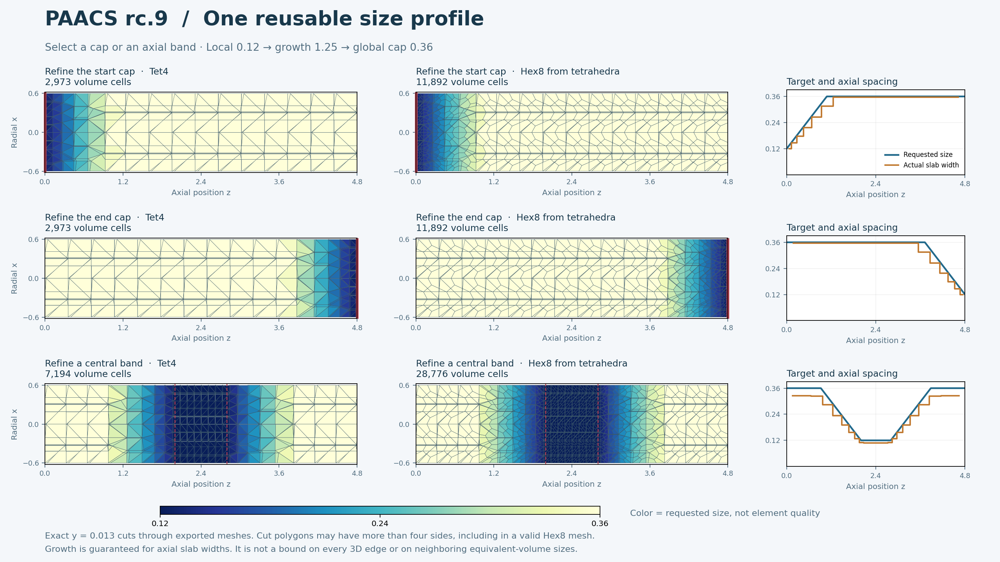
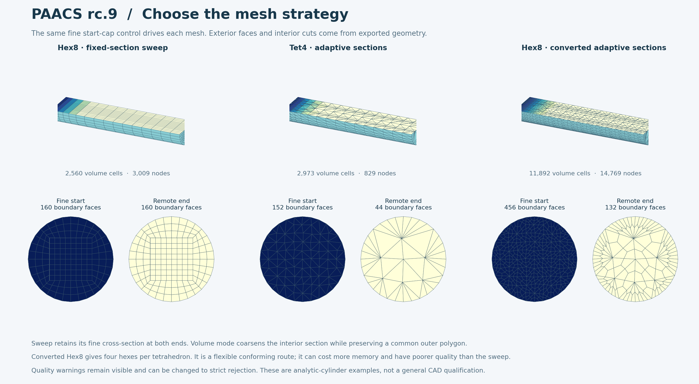

# Reusable global/local controls (PAACS 1.0.0)

Specify a global size, one or more local sizes, and growth. The target rises
from each local control to the global cap and stays there. A common immutable
profile and distribution planner now serve multiple element families and
geometry adapters. This replaces repeated shape-specific layer recipes.



## Public example

```cpp
#include <paacs/algo/PrimitiveSizeControls.hpp>
using namespace paacs;
algo::PrimitiveShape cylinder;
cylinder.radius = .6;
cylinder.height = 4.8;
sizing::CappedSizeSpecification sizes;
sizes.length = cylinder.height;
sizes.globalSize = .36;
sizes.controls = {
    algo::primitiveFaceSizeControl(cylinder, 2, .12, 1.25)
};
auto compiled = sizing::compileCappedSizeProfile(sizes);
if (!compiled.compiled) { /* inspect compiled.reason */ }

algo::PrimitiveMeshingOptions request;
request.sizeProfile = &compiled.profile; // Keep it alive and immutable.
request.elements = algo::PrimitiveElements::Tet4;
request.profileStrategy = algo::PrimitiveProfileStrategy::Volume;
request.maximumChordError = .015;
request.maximumRelativeVolumeError = .03;
mesh::Mesh mesh;
auto result = algo::meshPrimitive(cylinder, request, mesh);
if (!result.published) { /* previous mesh is unchanged; inspect reason */ }
```

Change `elements` to `Tet10` or `HexDominant` for the same sizing request.
For this cylinder `HexDominant` contains only Hex8 volumes and Quad4 boundary
faces. `Tet10` uses shared straight midside nodes with complete reference-cell
Jacobian certification, not curved CAD-projected geometry.

Cap tag 2 means the start, tag 3 the end. Replace 2 with 3 to refine the other
end. These are analytic primitive tags, not imported CAD face IDs. A sidewall,
unknown tag or unsupported shape produces an invalid control and a structured
compilation refusal. The API does not pretend to map a curved wall to a cap.

To refine a finite axial band instead:

```cpp
sizes.controls = {{2.0, 2.8, .12, 1.25}}; // begin, end, local size, growth
```

This refines the whole cross-section within that band. It is a sizing influence,
not an embedded material interface. Add multiple controls for both ends,
overlapping bands or different local targets. Recompile after changing `sizes`.
An empty control list yields uniform global sizing.

## Profile and distribution contracts

For physical axial coordinate `z` in `[0,length]`, the target is

```
h(z) = min(globalSize, min_i(local_i + slope_i * distance(z,[begin_i,end_i])))
local_i = max(control_i.size, minimumSize)
slope_i = 2 * (growth_i - 1) / (growth_i + 1)
```

The finest influence wins in an overlap. `minimumSize` defaults to zero; a
positive floor limits refinement explicitly. All local sizes must be positive;
growth must be finite and at least one. A growth of one extends that local size
through the full domain: no growth cannot recover a larger global background.
For one control with growth greater than one, its transition distance is
`(globalSize-local_i)/slope_i`, when the local size is below the global cap.

The compiler builds the piecewise-linear lower envelope, including intersections
between competing controls. Canonical control ordering makes reordered input
produce identical distributions. It has count, knot, work and byte limits, and
does not publish a partial valid profile on failure. Queries outside the domain
or on an invalid/moved-from profile return NaN. The profile is read-only and
allocation-free during evaluation; `eval` uses binary search and interval
minimum queries also visit knots inside the requested interval.

`planProfileDistribution(profile, limits)` returns physical boundaries starting
at exactly zero and ending at exactly `length`. It integrates `1/h` over the
piecewise-linear segments, uses stable `log1p`/`expm1`, and distributes closure
over the domain. It guarantees, within relative roundoff allowance `1e-10`:

- Every interval has positive width, no larger than the minimum target over
  the **entire** interval, including a narrow control between its endpoints.
- Each pair of adjacent physical interval widths satisfies
  `max(widthA/widthB, widthB/widthA) <= maximumAdjacentGrowth`.
- Constant runs are compacted toward the local/global cap where both neighboring
  widths permit it. A short plateau or finite-domain closure may remain finer.

`maximumAdjacentGrowth=0` uses the largest specified control growth. A stricter
value can be supplied independently; one produces uniformly fine spacing.
The planner does not promise that every layer is exactly the target width.
`maximumWidthToTarget`, minimum/maximum width, measured growth and the number
of removed plateau cells are reported. Allocation/count admission is performed
before compaction, so a budget can conservatively reject a plan that would have
had fewer final cells after compaction.

## Choose a geometry consumer

| Consumer | Transverse behavior | Elements and constraints |
|---|---|---|
| Primitive `Sweep` (default profile strategy) | Keep one section at the minimum profile target; vary only axial spacing | Cylinder or Tube; Tet4, Tet10, Hex8; inexpensive and structured through the axis |
| Primitive `Volume` (opt-in) | Interior sampling changes with the local profile; outer polygon remains common | Solid Cylinder; Tet4, Tet10, or converted Hex8; section/slab budgets apply |
| `meshLayeredPatch` | Preserve the caller's prepared planar source mesh; vary normal spacing | Tri3 → Prism6/Wedge6, convex Quad4 → Hex8, or conforming mixed sources |



The sweep is often the best speed/memory choice for a swept part. It cannot
coarsen tangentially without changing its source topology. The volume strategy
does coarsen the interior cross-section: in the one-end example, the Tet4 cap
changes from 152 boundary triangles at the selected end to 44 at the remote end.
The fixed outer ring preserves the polygonal geometry and slab compatibility;
it can retain fine boundary segmentation even where the interior is coarse.

The profile's size and growth bounds refer to **axial slab widths**, not every
tetrahedron edge, the maximum Hex8 edge, or adjacent equivalent-volume sizes.
Cross-section spacing is quantized by a sampling lattice. Tet-to-hex conversion
adds smaller cells and additional axial coordinates inside each slab. Reported
profile spacing still describes the original slab distribution. These concepts
must not be interchanged with `AdaptiveBoxRequest::maximumAdjacentSizeRatio`.

### Volume construction and reuse

Each section contains a deterministic perturbed interior lattice and a common
outer ring. Consecutive sections are triangulated together by the existing exact
predicate, serial Delaunay engine. Shared section nodes have shared global IDs.
A separate face-incidence pass rejects exposed internal slab cracks; only the
two end caps and actual outer polygon facets may be exterior. Downstream
geometric quality checks and the complete boundary audit still run.

When consecutive two-section patterns match exactly in their transverse
coordinates and ring identities, connectivity is reused under axial translation
and positive scaling. This does not require allocating a cache. Affine reuse
preserves the slab topology; all generated world-space cells are revalidated.
It is not a promise of global three-dimensional Delaunay optimality. Set
`reuseProfileSlabs=false` to exercise the uncached path for comparison.
`profileDelaunaySlabs` and `profileReusedSlabs` expose the work avoided.
No failure silently falls back to a different mesh or disables an audit.

### Tet4 to Hex8 as an independent API

`convertTet4ToHex8` accepts a positive, nonoverlapping, single-region Tet4 mesh
with a complete oriented Tri3 exterior. It inserts one shared midpoint per
edge, one centroid per face and one centroid per tetrahedron. Each tetrahedron
becomes four Hex8; each exterior triangle becomes three Quad4. Flat sorted
keys make node identity deterministic without tolerance welding.

Original node classifications are retained. At intersections of differently
tagged boundary faces, edge endpoints must carry the same curve/vertex
classification; ambiguous ownership is refused. Multiple material regions are
not supported by this converter. It preserves the input's piecewise planar
boundary; new surface nodes are not projected onto an analytic circle or CAD.
The source is required to be nonoverlapping: incidence and Jacobian checks do
not constitute a global tetrahedron-intersection detector.

Every Hex8 gets a full-reference Bernstein Jacobian test, positive subcell
checks, quality diagnostics and a full output boundary audit. Conversion
increases cell/node counts and can lower the sub-tetrahedron quality score.
For swept geometry, a direct Hex8 sweep can be substantially cheaper and better
shaped. This converter is not a general automatic high-quality all-hex mesher.

## Prepared prisms and reusable distributions

```cpp
#include <paacs/algo/LayeredPatchMesher.hpp>
algo::LayeredPatchRequest layers;
layers.sizeProfile = &compiled.profile;
mesh::Mesh output;
auto result = algo::meshLayeredPatch(preparedSourcePatch, layers, output);
```

A supplied profile replaces `LayerScheduleRequest`; the profile length is the
normal extrusion depth. Structured or unstructured triangles become prisms;
quads become hexes. Source planarity, winding, intersections, T-junctions,
positive volumes and boundary incidence retain their existing checks. This is
not advancing-layer growth over a curved CAD wall or automatic stitching to a
separate tetrahedral core.

For repeated primitive sweeps, call `planProfileDistribution` once, keep its
`positions` alive, then supply `request.axialPositions`, `targetSize`, and
`maximumAxialGrowth` with `sizeProfile=nullptr`. Raw positions must be finite,
strictly increasing and span exactly zero to the primitive height. The profile
and raw-position interfaces are mutually exclusive. The reusable raw route is
for Sweep; Volume needs the compiled field to size its cross-sections.

## Resources, quality and cancellation

Compilation limits controls, knots, work and array bytes. Distribution limits
cells and array bytes. Primitive/patch generation also respects node, cell,
output-array, working-array and audit limits. Volume has additional
`maximumProfileSectionNodes` and `maximumProfileSlabWork` admission limits;
the latter counts the sum of squared two-plane point counts, including slabs
that can be reused. Bounds do not become weaker when reuse is enabled.

The volume planner conservatively reserves an estimate of `1024*n*n` bytes for
each local Delaunay arena/scratch/output envelope. Peak overlapping vector
capacities, including reallocation, and retained distribution storage are
charged as well. `profileDelaunayBytes` reports observed arena plus scratch
storage. The envelope is an admission estimate, **not** a custom allocator's
hard process-memory quota. Measured process RSS is reported separately.
Allocator overhead, thread-pool resources, the caller's profile/source, and
the previous destination mesh are outside the new-array budget. Publication
temporarily coexists with that old destination.

`qualityPolicy=Warn` publishes valid meshes with bounded warning examples and
complete counts/histograms. `Reject`, `minimumQuality`, and `warningQuality`
allow stricter acceptance. The one-end Volume Tet4 example includes transition
elements below quality 0.2; converted Hex8 includes cells below the default 0.1
warning threshold. Inspect diagnostics before solver use. No policy accepts
nonpositive or unverified Jacobians.

Cancellation is polled in planning, linear scans and between bounded slabs.
A single sort or Delaunay slab call is not interruptible. The top-level
primitive cancellation flag covers the entire request; a separate
`profileLimits.cancellation` flag covers only distribution planning. All
refusals, cancellations and allocation failures preserve the prior destination.

## Reproduce and interpret evidence

```sh
cmake --preset gcc16-release
cmake --build --preset gcc16-release --parallel 2
ctest --preset gcc16-release -R 'paacs.sizing.(capped_profile|profiled_primitives|tet_to_hex)' --output-on-failure
build/gcc16-release/tests/paacs-profiled-primitives --gallery profile-archives
python3 benchmarks/render_profiled_controls.py profile-archives docs/images
python3 benchmarks/run_profiled_scaling.py build/gcc16-release/tests/paacs-profiled-controls-benchmark profile-scaling.json
```

An explicit `CMAKE_RUNTIME_OUTPUT_DIRECTORY` changes executable paths. Run the
timing script with no competing build/test/render work. It measures complete
mesh calls, including validation and audit, and records every fresh-process
sample, repeat/thread identity, memory and cached/uncached comparison. The
[validation report](../VALIDATION.md) links the measured results and limits.
The [installed example](../examples/profiled_controls.cpp) exercises Tet4,
Tet10, Hex8 and a prism consumer through exported public headers.

This is an additive C++ API change; rebuild consumers. The archive format and
existing uniform defaults are unchanged. Analytic cylinder evidence is not a
general CAD, structural-solver or CFD convergence qualification. Extending
arbitrary CAD-face distance fields, curved/prismatic boundary layers, material
interfaces and high-quality hex transitions remains future work.
