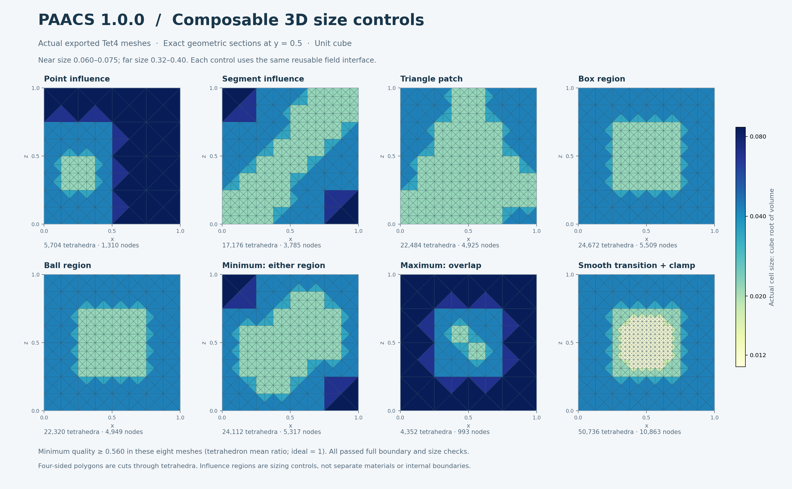
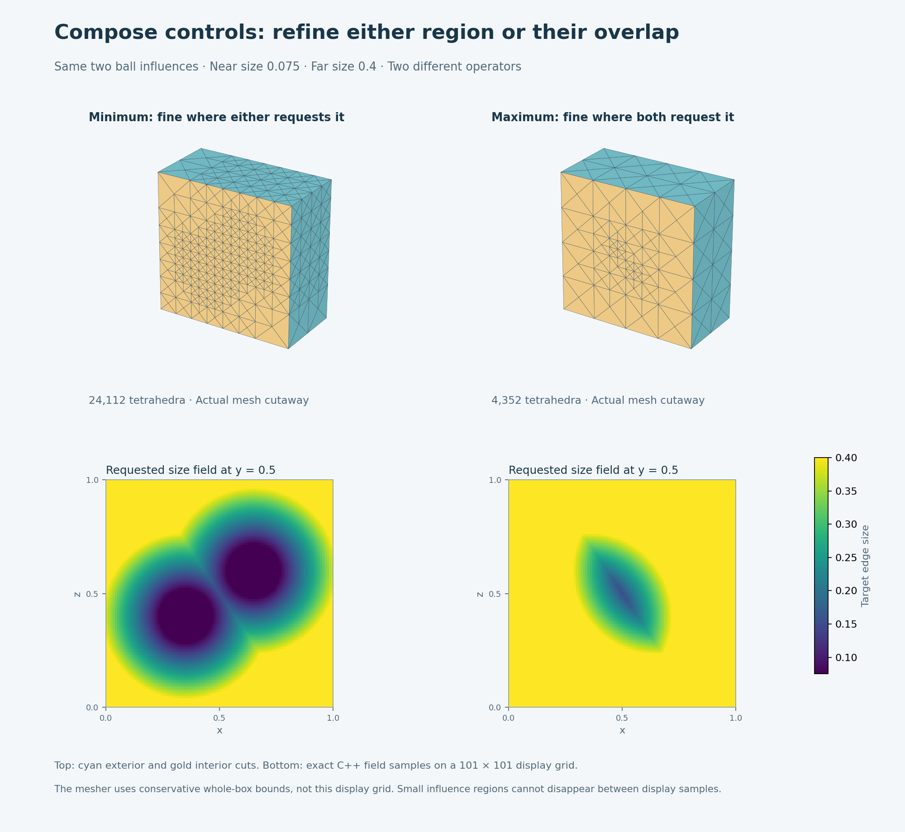

# Composable spatial controls — PAACS 1.0.0

PAACS now has one reusable scalar field interface for local 3D sizing, a bounded
field compiler, and an independent achieved-size audit. The adaptive box route
enforces field bounds throughout its Tet4 cells. The geometry-model Tet4 route
uses the same field for boundary discretization and optional interior refinement,
but can still refuse when protected boundaries need refinement. The table below
records which routes support each control.

Uniform sizing remains the default. C++26/GCC 16 remains the reference build.
Public C++ request/report layouts and the field base class changed: rebuild
clients. Mesh archive format v1 is unchanged. These additions are C++ APIs;
there is no new GUI, CLI field language or C field API in this revision.

## A complete field and mesh

The installed [example](../examples/spatial_controls.cpp) compiles this control,
meshes a unit box, and checks a conservative maximum-edge/target ratio:

```cpp
using namespace paacs;
sizing::ControlFieldSpecification s;
s.minimumSize = .03;
s.maximumSize = .4;
s.nodes = {
    sizing::field::distanceSegment({.15, .5, .1}, {.85, .5, .9}),
    sizing::field::threshold(0, .015, .3, .07, .4),
    sizing::field::distanceBall({.7, .5, .25}, .08),
    sizing::field::threshold(2, 0, .2, .07, .4, true),
    sizing::field::minimum(1, 3)
};
s.output = 4;
auto compiled = sizing::compileControlField(s);
if (!compiled.compiled) { /* inspect compiled.reason and rejectedNode */ }

algo::AdaptiveBoxRequest request;
request.field = &compiled.field;
request.maximumSizingWork = 1'000'000;
mesh::Mesh mesh;
auto result = algo::meshAdaptiveBox(request, mesh);
// Use mesh only when result.published. A refusal retains the old destination.
```

The example's error branches return; applications must also stop on failed
compilation. The caller owns the immutable field and keeps it alive throughout
the meshing call. Compiled fields support concurrent read-only queries.

## Field operations and their meaning

Dependencies are indices of **earlier** nodes. `output` selects the final node.
Compilation validates all supplied nodes, then removes unreachable nodes.

| Factory | Meaning |
|---|---|
| `constant(value)` | Nonnegative constant, usable as a size or intermediate scalar. |
| `distancePoint(p)` | Euclidean distance to a point. |
| `distanceSegment(a,b)` | Distance to a finite segment, including its end caps. |
| `distanceTriangle(a,b,c)` | Distance to a closed finite triangle, not its infinite plane. |
| `distanceBox(lo,hi)` | Distance to the closed solid axis-aligned box; zero inside. |
| `distanceBall(center,radius)` | Distance to the closed solid ball; zero inside. |
| `threshold(id,d0,d1,h0,h1,smooth)` | Constant `h0` through `d0`, transitions to `h1` at `d1`, then stays constant. Linear by default; `smooth=true` uses cubic smoothstep. |
| `minimum(a,b)` | The finer size wins. Either influence can request refinement. |
| `maximum(a,b)` | The coarser size wins. Useful for the intersection of two refinement requests. |
| `scale(id,factor)` | Scales this intermediate scalar. |
| `clamp(id,lo,hi)` | Clamps this intermediate scalar. |

The global envelope is applied **after the graph**, in this order:

`h(x) = sizeFactor * clamp(graph(x), minimumSize, maximumSize)`.

Thus the effective size limits are also multiplied by `sizeFactor`. Threshold
distances use model coordinates; no implicit unit conversion occurs. Threshold
sizes can increase or decrease. For an increasing linear threshold, the slope
is `(h1-h0)/(d1-d0)`. This controls the spatial field; it does **not** guarantee
a particular adjacent-element growth ratio. Cubic smoothstep also has a larger
maximum slope than the corresponding linear ramp.

The solid box/ball distance differs from distance to a hollow shell. A triangle
can represent one prepared face patch. There is no automatic CAD-face selection
or curved-face distance node yet. Large unions of triangulated faces need a
spatial index and a dedicated distance adapter, not thousands of graph nodes.





## Route and precedence rules

| Consumer | Field behavior and qualification |
|---|---|
| `meshAdaptiveBox` | `field` replaces uniform `targetSize`. Conservative leaf-box minima drive a balanced octree and conforming Tet4 mesh. Full boundary audit always runs. |
| `meshGeometryModel`, Auto + field | Chooses the constrained Tet4 route. The effective target is `min(body/global targetSize, field(x))`. Boundary generation uses it; interior compliance is measured separately. |
| Geometry per-body field | `GeometryBodyControl::spatialField` overrides the global pointer. Null inherits it. Set only per-body pointers when other bodies should remain uniform. |
| Explicit mapped/swept route + field | Rejected with `SpatialFieldRejected`; arbitrary spatial controls are not silently ignored. Use the retained axial-profile controls for those routes. |
| Geometry field + axial profile, selected source cap, exact layers or total-ratio grading | Rejected as incompatible. These controls require different construction guarantees. |
| Uniform mapped/swept geometry | Optional warning/strict size audits work against the uniform target, even without a spatial field. |
| Primitive cylinder/torus/cone APIs | Existing size/axial-profile controls are retained. This graph is not yet a new primitive request option. |

Set geometry `targetSize = compiled.field.maximumSize()` if the field should
use its entire effective range. Otherwise the default target `.25` caps a field
whose far size is `.4`. This explicit precedence prevents an unnoticed global
setting from being lost.

Adaptive Tet4 sizes are dyadic and can be finer than requested. Strong 2:1
octree balance is not a direct 2:1 tetrahedron-volume ratio guarantee. The
existing `maximumAdjacentSizeRatio` independently limits measured face-neighbor
cube-root-volume growth. It defaults to zero (report/no extra rejection).
Sizing regions do not create conforming material interfaces or internal faces.

## Requested size versus achieved size

`auditMeshSize(mesh, field, options)` streams through linear Tet4, Hex8, Prism6
and Pyramid5 cells. It uses the authoritative element edge tables, checks
connectivity and finite coordinates, and reports:

- maximum true element-edge length and minimum target;
- `maximumConservativeRatio`: longest edge divided by the field's lower bound
  over the **whole cell bounding box**;
- `maximumSampledRatio`: a separate diagnostic from vertices and edge midpoints;
- counts above warning/strict limits, worst cell, volume-cell count and query work.

The bounding box includes points outside a non-box cell. Correlated Min/Max
branches and triangle distance bounds can widen the interval further. The
conservative ratio can therefore **overestimate** a true violation. Acceptance
against that bound provides a conservative size certificate under the field
contract; sampled values alone do not. Roundoff slack is 128 double epsilons.

`warningEdgeToTargetRatio` and `maximumEdgeToTargetRatio` default to zero.
Positive thresholds must be at least 1. A complete strict rejection reports
`complete=true`, `requirementMet=false`, `reason=SizeRequirement`. Invalid fields,
throwing custom callbacks, unsupported cells, cancellation and budget exhaustion
have different diagnostics. The streaming implementation allocates nothing.

Geometry exposes corresponding `warningElementSizeRatio` and
`maximumElementSizeRatio`. Its per-body `sizeAudit` is always populated when a
field or interior refinement is enabled, and on demand for uniform meshes.
A strict failure prevents publication; warning-only results can publish for
user review. `maximumSizingAuditWork` is an aggregate budget across all bodies.
No default warning threshold is imposed: applications choose their policy.

This size audit does not replace topology, boundary, overlap, Jacobian or solver
quality checks. Tet10 volume cells are deliberately unsupported: checking their
corner edges would not certify a curved element. Existing primitive straight
Tet10 qualification remains separate.

## Optional bounded interior refinement

For a selected body, enable the existing constrained interior-refinement engine:

```cpp
algo::GeometryMeshingOptions options;
options.targetSize = compiled.field.maximumSize();
options.spatialField = &compiled.field;
options.warningElementSizeRatio = 1.5;
options.maximumElementSizeRatio = 2.1; // application's strict policy
algo::GeometryBodyControl body;
body.solidTag = selectedSolidTag;       // a real tag from the geometry model
body.tetRefinement.enabled = true;
body.tetRefinement.maximumEdgeToTarget = 2;
body.tetRefinement.maximumRadiusEdge = 3;
body.tetRefinement.maximumInsertions = 64;
body.tetRefinement.maximumWork = 500'000;
options.bodyControls.push_back(body);
auto result = algo::meshGeometryModel(model, options, mesh);
```

This is opt-in; Auto selects the general Tet4 route. The engine's edge/size
criterion is sampled and is not identical to the conservative publication
audit above. Radius/edge limits are also not the same as the mean-ratio quality
policy. Read all relevant reports before using a published mesh for a solver.

The unit-cube point-field regression with near/far sizes `.4/.6` starts at a
conservative ratio **2.5092**. One accepted interior insertion changes 26 to 27
nodes and reduces that ratio to **2.0753**, meeting a publication limit of 2.1.
A tighter refinement request of 1.5 returns `BoundaryRefinementRequired`
(`T3AReason` value 15) and retains the caller's original mesh. The private
insertion is not published. This demonstrates improvement and a real remaining
limitation, not arbitrary target attainment.

The near/far `.3/.6` boundary-only case publishes a geometrically valid mesh
with conservative ratio **3.3347** and 44 volume cells above warning ratio 1.
Field-aware boundary generation alone is insufficient for general volume size
control. Coordinated boundary subdivision/recovery is the next concrete blocker.
Body reports preserve underlying boundary/refinement status, reason, phase and
committed private insertion count; there is no silent fallback to an unrelated
strategy or partially finished mesh.

## Bounds, memory and cost

- At most 256 input nodes, additionally limited by `maximumNodes`. Forward
  references, cycles, invalid operations and invalid unreachable nodes reject.
- `maximumBytes` caps the retained graph payload after pruning. Compilation
  uses one vector allocation. Two-node fixtures retain 240 bytes on this build;
  the two-region graphs retain 600 bytes. Allocator overhead is additional.
- Point and box queries use fixed stack storage (up to 256 scalar/interval
  slots) and no heap allocations. A query traverses retained nodes: O(nodes),
  with no BVH and no claim of scalable thousands-of-entity queries.
- `boxQueryWorkBound()` charges 10 units for each distance primitive and 1 for
  each other node. These are deterministic accounting units, not CPU cycles.
  Adaptive generation can gate them through `maximumSizingWork`; zero preserves
  legacy behavior without this extra gate. The independent audit has its own
  query/cell budgets. General geometry source/refinement work limits remain
  distinct from the size-audit budget; no whole-process deadline is promised.
- Existing output, planner, topology-audit, cell/node and cancellation budgets
  remain available. Logical payload limits are not process-RSS limits.
- Supported coordinate/parameter magnitude is bounded by `1e100`; geometrically
  unresolved segments and triangles are rejected. Triangle conditioning is
  checked relative to its edge scale. Point/box distance bounds use analytic
  intervals; segment/triangle bounds combine conservative geometric estimates.
  Queries outside the supported finite range fail instead of returning a
  plausible but uncertified target.
- Uniform defaults and old `RegionSizeField` calls retain their behavior.
  `RegionSizeField` now implements `BoundedSizeField`; custom implementations
  must provide a valid conservative whole-box minimum, not sparse sampling.

Fault injection overrides ordinary throwing/nothrow `operator new` and `new[]`;
aligned allocations and external allocator APIs are outside this harness. It
exhausts the new compiler's one observed allocation and the
adaptive fixture's 17 allocations. The inherited general Tet4 fixture has
191,938 observed allocations; 460 deterministic prefix/tail/stratified injection
settings are tested, not all 191,938. The run checks 330 rejected calls for
unchanged destinations and 130 successful recoveries for identical archives.
That high allocation count is an optimization target, not a performance claim.

## Supported controls and remaining work

| Control family | PAACS 1.0.0 status |
|---|---|
| Distance + Threshold, Min/Max, global size bounds/factor | Implemented for the explicit primitives above; finite linear graph with documented envelope order. |
| Selection/restriction | Global and per-body fields; explicit finite patches/regions. No general CAD-entity `Restrict` adapter. |
| Transfinite/structured counts and grading | Existing mapped/swept counts and axial profiles on recognized routes; no arbitrary transfinite surface/network system. |
| Local 3D volume sizing | Strong conservative enforcement on adaptive boxes; limited constrained-Tet4 integration with diagnostics and optional refinement. |
| Curvature/proximity-driven sizing | General trimmed-CAD pipeline not qualified; optional existing feature analysis is separate. |
| Embedded curves/surfaces and periodic matching | Not provided as a general public control pipeline. |
| Arbitrary expressions / imported background fields | No `MathEval`, `PostView` or equivalent general importer in this change. |
| Anisotropic metrics / general hex refinement | Not established by this scalar-field API. |
| Physical-group workflows / solver export | Existing entity tags are retained; they do not establish equivalent named-group and solver-format workflows. |
| CFD boundary layers | Prepared planar/straight layers are retained; curved collision-aware layers joined to a general Tet core remain a gap. |
| Resource and acceptance policy | Explicit budgets, cancellation, size/quality warnings or strict rejection, and transactional publication on supported paths. |

The next priorities are coupled boundary/interior refinement, more robust
constraint recovery, CAD-entity distance indexing and curvature/proximity
controls, followed by periodic/embedded/interface ownership and curved CFD
layers. See the [general-mesher roadmap](GENERAL_MESHER_ROADMAP.md).

## Reproduce

Build and test as described in the root README. Then:

```sh
./build/gcc16-release/tests/paacs-spatial-controls --gallery out/spatial
./build/gcc16-release/tests/paacs-spatial-geometry-probe
python3 benchmarks/run_spatial_controls.py \
  ./build/gcc16-release/tests/paacs-spatial-controls-benchmark out/spatial-benchmark.json
python3 benchmarks/render_spatial_controls.py out/spatial docs/images
```

Executable paths depend on `CMAKE_RUNTIME_OUTPUT_DIRECTORY`. Rendering requires
NumPy and Matplotlib; it does not generate or alter meshes. All sections come
from archived cells, and displayed field samples come from the C++ evaluator.
The [qualification report](../VALIDATION.md) and evidence index (`evidence/rc11/README.md`)
record the completed gates, timings, hashes and known failed experiments.
