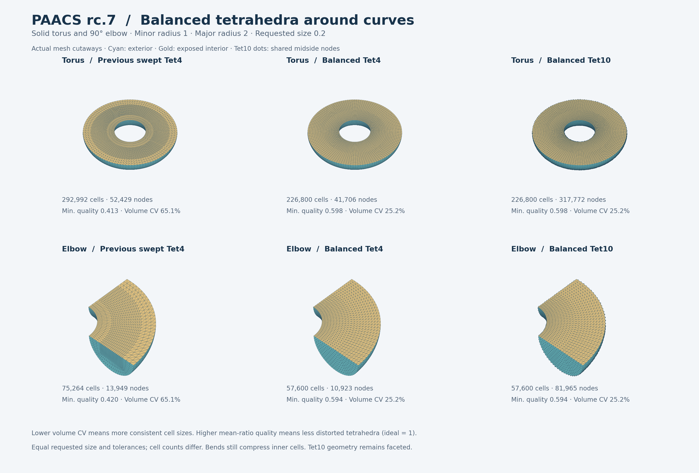
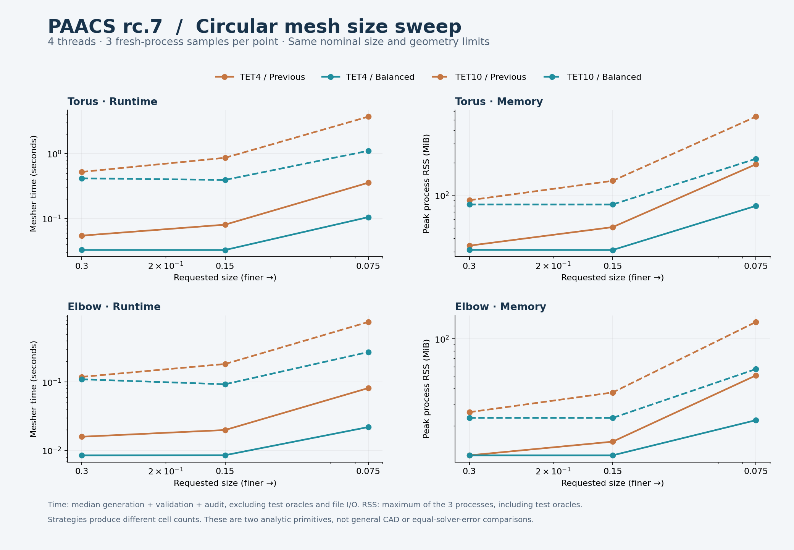

# Balanced solid torus and elbow tetrahedra (PAACS 1.0.0)

The default **Tet4/Tet10** route for a solid torus or solid elbow now uses the
balanced triangular disk used for cylinders. The old O-grid
conversion remains available. HexDominant remains the API's default element
family; this release does not change a caller's chosen element family.

```cpp
paacs::algo::PrimitiveShape shape;
shape.kind = paacs::algo::PrimitiveKind::Torus;
shape.radius = 1;
shape.majorRadius = 2;
paacs::algo::PrimitiveMeshingOptions options;
options.elements = paacs::algo::PrimitiveElements::Tet4; // or Tet10
options.targetSize = .2;
options.circularStrategy = paacs::algo::PrimitiveCircularStrategy::Automatic;
auto result = paacs::algo::meshPrimitive(shape, options, mesh);
```

```sh
paacs-primitive-mesh torus .2 torus.paacsmesh --elements tet4 --threads 4
paacs-primitive-mesh elbow .2 bend.paacsmesh --elements tet10 --circular-strategy uniform
paacs-primitive-mesh torus .2 previous.paacsmesh --elements tet4 --circular-strategy swept
```

`Automatic` chooses this route only for solid circular sections. Hollow tori
and elbows retain the annular O-grid, as do tubes. Explicit `Uniform` rejects
hollow sections, noncircular shapes, and HexDominant. It never silently changes
the requested strategy or drops the bore. `Swept` preserves the previous
circular strategy. Cylinders keep their separate `cylinderStrategy` control.

## Construction and resource bounds

Six triangular sectors fill the disk. Ring k has 6k nodes; radial spacings are
equal. With m radial rings there are `1 + 3m(m+1)` section nodes, `6m²` triangles,
and `6m` perimeter edges. Resolution accounts for nominal size, minor-circle
chord error, and volume error, then rounds m upward to an even count.

The sweep count balances the centreline arc step against radial spacing.
A joint conservative bound on both circle errors determines the radial count.
Each swept triangle creates
three tetrahedra, so volume cells number `18m²L`. The local section ordering
selects every quadrilateral's diagonal. At a torus's last plane, upper node
IDs wrap to the first plane; connectivity and boundary diagonals use the same
section ordering. No duplicate seam nodes or seam-specific tolerance welding
is needed. Cylinder ordering and output hashes remain unchanged.

The cross-section frame uses the same orientation as the established primitive
API. The mapping is radial in the major-circle plane and negative along the
frame axis in the other section direction. Combinatorial orientation comes
from the oriented section; inverted cells are never repaired by indiscriminately
flipping node IDs. Actual cell validation still decides publication.

Counts, output bytes, section/trigonometry scratch arrays, audit storage, and
Tet10 edge-elevation storage are budgeted. Generation uses fixed disjoint
ranges. The construction is linear in output size; Tet10 edge interning uses
in-place sorting. Quadratic-node preflight uses `E = N + T + B/2 - chi`, with
Euler characteristic chi=0 for a solid torus and chi=1 for a capped solid bend.
The final audit checks actual topology; the formula alone is not a certificate.

## What “uniform” does and does not guarantee

Uniform here describes the strategy's balanced cross-section and nominal
centreline spacing. It does not guarantee equal tetrahedron volumes, equal
edges, a specified maximum edge length, or a quality floor. On a bend, sweep
lengths differ by `(R+r)/(R-r)` between the outside and inside. A near-horn
torus necessarily compresses the inner elements in this mapped strategy.
Very short bends also limit the achievable aspect ratio. Both cases have
explicit warning and strict-refusal tests.

The result reports `uniformCircular`, `circularGeometryLimited`, radial spacing,
and innermost/outermost chord spacings. The last two are directional diagnostic
lengths, not the shortest/longest mesh edges. Geometry tolerance can force a
smaller spacing than requested. In coarse requests, the new route can create
more cells and take more memory/time than the old route. It is not uniformly
faster at every input size, and does not silently fall back after exceeding a
budget. See the raw size sweep in `evidence/rc7/circular-scaling.json`.

For beta=r/R and L rounded upward from `sweep*R*m/r`, the combined chord error is
bounded by `r/m² * (pi²/72 + beta*(1+beta)/8)`, using `sin(x)² <= x²`.
The polygonal volume deficit is bounded by `(pi²/9 + beta²)/(6m²)`, using
`1-sinc(a)*sinc(b) <= (a²+b²)/6` for the small positive steps in this construction.
Choosing m to satisfy both bounds avoids arbitrary independent half-tolerances
and unnecessary radial/sweep refinement. The chord allowance reserves coordinate
roundoff first. The reported bound uses actual trigonometric sagittas and includes
both contributions plus roundoff. The volume
constraint is checked after generation against analytic volume, and the test
oracle independently checks the polygonal sweep formula and signed volumes.
All Tet10 midsides remain shared arithmetic midpoints: interpolation order is
quadratic, while geometry stays faceted. Whole-reference Tet10 Jacobians are
still certified, with the existing Bernstein fallback where required.

## Evidence and reproduction



The image and adjacent JSON are generated from actual `.paacsmesh` archives.
Gold cut surfaces are faces of retained volume elements, not invented
triangulations. Independent measurements include signed volume, cell-volume
coefficient of variation (CV), mean-ratio quality, and edge-length quantiles.
CV is a statistical size-consistency measure; it is not a solver accuracy test.

```sh
python3 benchmarks/render_circular_comparison.py /path/to/paacs-primitive-mesh docs/circular_uniform_rc7.png
python3 benchmarks/run_circular_scaling.py /path/to/paacs-primitive-corpus evidence/rc7/circular-scaling.json
python3 benchmarks/render_circular_scaling.py evidence/rc7/circular-scaling.json docs/circular_scaling_rc7.png
```

The scaling runner launches separate processes, alternates strategy/thread
order, and compares identical size/tolerance requests at 1 and 4 threads. It
retains every sample, checks output hashes, and reports phase timings and RSS.
Run it without competing builds or tests. Comparisons use different resulting
cell counts; they are not equal-cell-count or equal-solver-error comparisons.



See [VALIDATION.md](../VALIDATION.md) for the measured table and CPU-scaling
limits. In particular, the serial audit still limits Tet4 thread speedup.

The next uniform-layout work is **annular sections and strongly tapered solids**.
Those need changing cross-section resolution or a different volume strategy;
simply stretching this disk would conceal poor aspect ratios. This release is
an additional explicit primitive strategy, not general curved STEP/BREP support.
