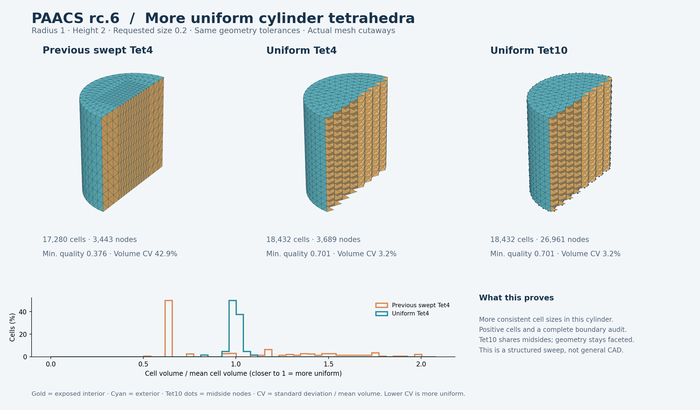
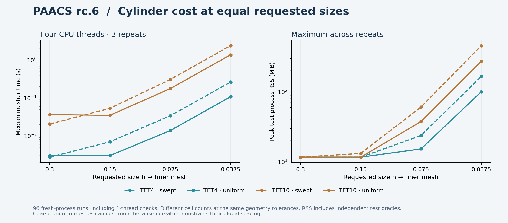

# Uniform cylinder tetrahedra

In PAACS 1.0.0, cylinder Tet4 and Tet10 requests default to a direct
triangular-section sweep with nearly uniform volumes and balanced spacing.
The previous O-grid conversion remains available explicitly. Hex-dominant
cylinders retain their previous default route.

```cpp
#include <paacs/algo/PrimitiveMesher.hpp>

paacs::algo::PrimitiveShape cylinder;
cylinder.radius = 1;
cylinder.height = 2;
paacs::algo::PrimitiveMeshingOptions options;
options.elements = paacs::algo::PrimitiveElements::Tet4; // or Tet10
options.cylinderStrategy = paacs::algo::PrimitiveCylinderStrategy::Uniform;
options.targetSize = 0.2;
paacs::mesh::Mesh mesh;
const auto result = paacs::algo::meshPrimitive(cylinder, options, mesh);
// Check result.published; inspect result.qualityWarning and result.quality.
```

```sh
paacs-primitive-mesh cylinder .2 cylinder.paacsmesh --elements tet4 --cylinder-strategy uniform
paacs-primitive-mesh cylinder .2 cylinder10.paacsmesh --elements tet10 --cylinder-strategy uniform
paacs-primitive-mesh cylinder .2 previous.paacsmesh --elements tet4 --cylinder-strategy swept
```

| Strategy | Meaning |
|---|---|
| `Automatic` / `auto` | Uniform for cylinder Tet4/Tet10; previous O-grid for HexDominant |
| `Uniform` / `uniform` | Direct cylinder triangular sweep; only valid for Cylinder + Tet4/Tet10 |
| `Swept` / `swept` | Previous O-grid and globally conforming conversion |

`Uniform` is intentionally rejected for other shapes and HexDominant. It is
not silently substituted with another algorithm. The independent cone strategy
continues to control cones. Existing callers requesting cylinder tetrahedra
with default options will see changed connectivity, counts, and resource needs;
choose `Swept` to retain the previous route. Uniform does not silently fall back
to another strategy if its resource preflight fails. Recompile C++ consumers because
the options/result structs have new fields. Positional aggregate initializers
may need updating; named member assignments avoid this issue. Archive format is unchanged.

## Construction and cost

The disk has six sectors. Ring k has 6k nodes at radius Rk/m with equally
spaced angles. Neighboring rings form triangles without a square core or
thin outer collar. The section has `1 + 3m(m+1)` nodes and `6m²` triangles.
Each straight triangular prism becomes three Tet4s. A global vertex order
chooses consistent face diagonals, including the closing seam.

The number of rings is selected from nominal size, chord error and polygonal
volume error, then rounded up to an even number. Axial layers use
`ceil(height / (radius/m))`. For L layers there are `18m²L` tetrahedra,
`(1 + 3m(m+1))(L+1)` corner nodes, and `12m² + 12mL` boundary triangles.
Linear-cylinder construction is O(output size); temporary section storage is O(m²).
Tet10 shared-edge sorting still costs O(E log E), followed by certification.
There is no intermediate hex volume mesh or its duplicate validation/audit.

All count arithmetic and array payloads are checked before allocation. Tet10
preflight uses the tetrahedral-ball Euler identity to predict shared midside
nodes; the existing elevation code independently builds/checks the actual
edge bindings. Output storage and auxiliary working limits are separate;
neither is a promise about total process RSS or caller-owned memory.

The existing exact orientation checks and full linear boundary audit remain.
Tet10 uses shared straight midsides and full-reference Jacobian certification.
It is not a curved CAD Tet10 route. Cancellation and failed requests leave the
destination unchanged. Fixed ordinal ranges and chunk reductions preserve
1/4-thread mesh hashes in the test corpus.

## Size, quality and tolerances

`targetSize` is a nominal radial/layer spacing, not a maximum Tet edge length.
Diagonal edges are longer. `cylinderRadialSpacing` and `cylinderAxialSpacing`
report achieved nominal spacings; `cylinderGeometryLimited` identifies when
the geometry bound requires more rings than the nominal size calculation.
`uniformCylinder` reports the selected route. The CLI emits these as JSON.

For R=1, H=2, h=0.2 and default geometry tolerances:

| Measurement | Previous swept Tet4 | Uniform Tet4 | Uniform Tet10 |
|---|---:|---:|---:|
| Volume cells | 17,280 | 18,432 | 18,432 |
| Nodes | 3,443 | 3,689 | 26,961 |
| Minimum corner mean ratio | 0.375703 | 0.700557 | 0.700557 |
| Volume coefficient of variation | 42.9494% | 3.2392% | 3.2392% |
| Chord-error bound | 0.00214108 | 0.00214108 | 0.00214108 |

CV is standard deviation divided by mean, over all volume cells. These values
come from independent NumPy measurements of the actual archives, with
long-double C++ regression checks. More uniform volume is not by itself proof
of good shape; the independent mean-ratio comparison checks shape separately.
Equal requested size does not force equal counts. At coarse sizes tight
curvature tolerances can cause global over-refinement in this strategy.



This is a structured sweep with directional connectivity. It is not an
unstructured isotropic Delaunay mesh or a proof of directional solver accuracy.
Very short cylinders can still require stretched elements. Valid poor cells
remain publishable with bounded warnings; `qualityPolicy=Reject` and the hard
`minimumQuality` floor remain available. No invalid cell is accepted to improve
the apparent success rate. Geometry below coordinate resolution is refused.

For CFD, near-wall anisotropic layers and face-based quality measures remain
separate requirements. See [the structural/CFD roadmap](STRUCTURAL_CFD_ROADMAP.md)
and the current [validation report](../VALIDATION.md).

## Measured scaling

The largest cylinder tested in the isolated rc.6 comparison uses h=0.0375.
Both strategies achieve relative volume error 0.0002331093 and the same
polygonal circumference resolution. At four threads:

| Family / strategy | Volume cells | Median mesher time | Peak test-process RSS | Minimum corner quality |
|---|---:|---:|---:|---:|
| Tet4 / previous Swept | 1,333,584 | 0.26293 s | 166.44 MiB | 0.45123 |
| Tet4 / Uniform | 790,272 | 0.10778 s | 100.38 MiB | 0.68930 |
| Tet10 / previous Swept | 1,333,584 | 2.42279 s | 458.24 MiB | 0.45123 |
| Tet10 / Uniform | 790,272 | 1.38281 s | 274.51 MiB | 0.68930 |

These are different cell counts, not an equal-cell-count throughput test.
There are 96 fresh-process samples across four sizes, two orders, two strategies,
two thread counts and three repeats. Timing includes meshing and validation,
excludes file I/O and independent test checks. RSS includes independent checks
and the process-start baseline. Fine Uniform Tet4 improves only about 1.27x
from one to four threads because auditing and other serial work dominate;
Uniform Tet10 improves about 2.52x. These are CPU results, not GPU benchmarks.

At h=0.3, geometry-driven Uniform uses 18,432 cells against Swept's 10,080;
Tet10 takes 0.03625 s versus 0.02034 s. The crossover is visible below rather
than hidden by reporting only the favorable fine case.



See `evidence/rc6/cylinder-scaling.json` for raw samples and environment notes.

## Reproduce the figures and timing runs

After building the CLI and tests (substitute your executable paths):

```sh
python3 -m pip install numpy matplotlib
python3 benchmarks/render_cylinder_comparison.py build/gcc16-release/paacs-primitive-mesh docs/cylinder_uniform_rc6.png --size .2
python3 benchmarks/run_cylinder_scaling.py build/gcc16-release/tests/paacs-primitive-corpus evidence/rc6/cylinder-scaling.json --repeats 3
python3 benchmarks/render_cylinder_scaling.py evidence/rc6/cylinder-scaling.json docs/cylinder_scaling_rc6.png
```

Run the benchmark when no build, tests or visualization jobs are competing
for resources. Rendering/statistics dependencies are optional; the C++ library
has no NumPy or Matplotlib dependency. The RSS wrapper uses POSIX `resource`;
porting that measurement to Windows is separate from compiling the library.
