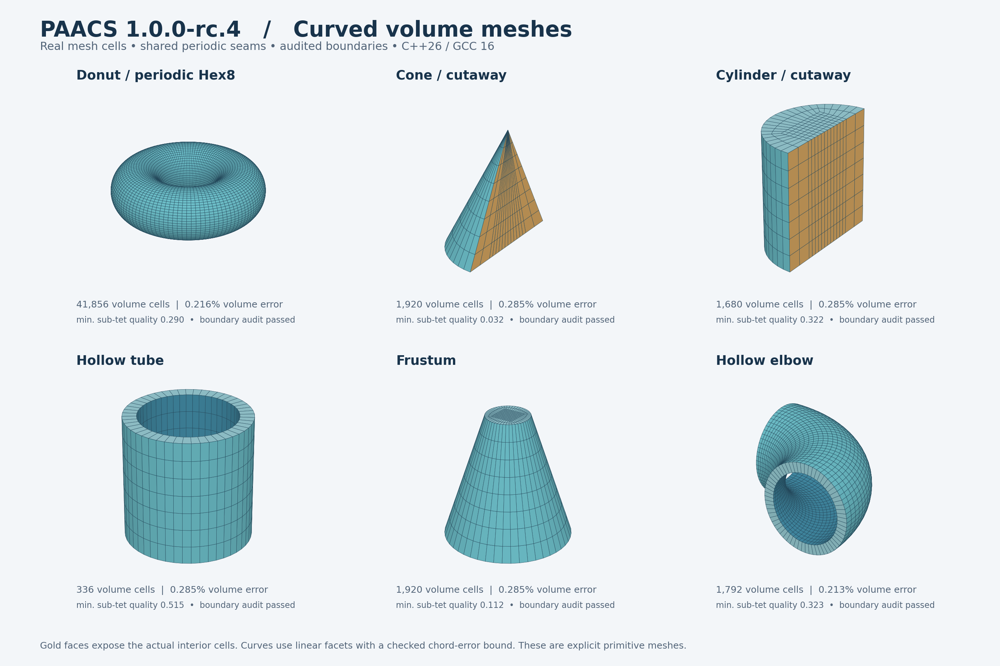
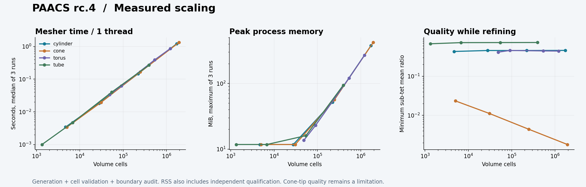

# PAACS Mesh 1.0.0-rc.4 validation

This candidate adds a structured curved-primitive route while preserving the
previous planar geometry and CAD routes. It remains a release candidate.

## Completed checks

| Gate | Result |
|---|---|
| GCC 16.2.0 / C++26 Release, strict FP, library warnings as errors | Passed |
| Full release CTest suite | 21/21 entries passed; 300.26 seconds |
| Final independent analytic-volume oracle checks | 3/3 primitive suites passed again |
| Named curved shape variants | 29/29; equal hashes at 1 and 4 threads |
| Seeded primitive variations | 128/128 |
| Curved approximation convergence | 18 meshes across 6 families |
| Hostile requests, exact limits and rollback | 46 refusals plus exact-budget/automatic-accuracy successes |
| Hex8 validity adversaries | 2,000 random perturbations plus pinned corner-positive fold, scale, collapse and nonfinite cases |
| Primitive allocation-failure rollback | 16 allocation points |
| Independent curved CAD references | 30 STEP/BREP roundtrips; 15 shapes |
| Existing planar corpus | 42/42, all rc.3 mesh hashes unchanged |
| CLI checks | 19 primitive + 20 retained CAD cases |
| Installed SDK consumers | 6/6: C, C++, planar geometry, CAD, grading, primitives |
| ASan + UBSan | 9 distinct targeted suites passed across initial and retry runs |
| Isolated scaling measurements | 96 runs; stable hashes across repeats/thread counts |
| Source ZIP | CRC and every manifest hash verified; fresh extracted CMake configuration passed with CAD/tests/benchmarks enabled |

The original full unit suite, exact-predicate algorithms, recovery/refinement,
Tet10, mapped/sweep engines and previous 2,015-case audit differential suite
remain present. No previous production source file was removed.

Two sanitizer executables in the reused build directory initially lacked
execute permission and could not start. They were relinked into a fresh
CMake runtime output directory and both passed. Seven other suites passed
in the first run. LeakSanitizer was disabled for the known execution-environment
restriction; the full inherited unit suite and OCCT were not sanitizer-tested.
The legacy CAD CLI was checked from the installed SDK, whose executable
permissions were correct. Raw logs retain these distinctions.

## Actual mesh visuals

These are the actual generated volume cells and their exterior faces, not
illustrative CAD renderings. Gold faces in the cone/cylinder are exposed by
removing half of the volume cells. The donut shares its periodic seam nodes.
The gallery shows cylinders, cones, frusta, tubes, tori and hollow elbows.

## Scaling results

AMD EPYC 9V74 host; 8 CPU-equivalent quota, 8 GiB memory limit. GCC 16.2.0,
C++26, Release -O3, strict FP, no native-architecture tuning or IPO. No other
build or test workload ran during these measurements. Three fresh processes
per configuration, 1/4 requested threads, alternating thread-count order.

The times below are medians of generation + cell validation + full boundary
audit. RSS is the maximum process peak across repeats and also includes the
independent qualification checks and streaming hash. Output file serialization
is not part of these measurements. Cell counts are volume cells only.

| Shape | Volume cells | 1 thread (s) | 4 threads (s) | Peak RSS, 4 threads (MiB) | Minimum sub-tet quality |
|---|---:|---:|---:|---:|---:|
| Cylinder | 1,725,696 | 1.216 | 0.605 | 377.3 | 0.457812 |
| Cone | 1,935,360 | 1.322 | 0.695 | 420.2 | 0.001802 |
| Torus | 1,217,195 | 0.858 | 0.427 | 268.1 | 0.440400 |
| Tube | 395,472 | 0.270 | 0.143 | 94.3 | 0.729049 |

Runtime was approximately linear over these tested resolutions. Between the
two largest sizes, observed time-versus-cell-count exponents were 1.03 for
the cylinder, 1.01 for the cone, 0.96 for the torus and 0.96 for the tube.
This is measured evidence for these structured families, not a worst-case
complexity or scaling claim for every retained meshing engine. The complete
per-resolution data includes logical output bytes, planned scratch, audit
scratch, geometry error, individual phase times and whole-qualification time.
Four threads accelerated the largest cases by about 1.9–2.0x; the exact
boundary audit remains serial.

## Failures found and corrected

1. **Thin curved walls:** with radius 1, inner radius 0.9999, height 2 and
   nominal size 0.3, the initial faceting produced 336 cells whose centers
   all fell inside the true bore. Volume and incidence checks alone missed
   it. Angular error is now capped by radial-layer thickness. The corrected
   mesh has 3,136 cells, zero centers inside the bore, a 2.45874e-5 chord
   bound and 3.27830e-5 relative volume error. Thin hollow tori/elbows also
   pass independent analytic containment and CAD-reference checks.
2. **Exact audit budget:** an extra eight bytes in the preflight formula
   rejected a sufficient exact-size budget. It now matches the audit's
   actual prefix-array storage, with exact and one-byte-short regressions.
3. **Validity between corners:** a pinned folded Hex8 has positive Jacobians
   at every corner but a negative value between them. The new sufficient
   Bernstein test refuses it. Collapsed cone apexes are also refused, and
   failure preserves the caller's mesh.

Angular resolution responds to both chord and volume error targets before
allocation. Count, payload and working-array budgets are checked first.
Fixed-size storage and disjoint writes avoid per-cell allocations and spatial
deduplication. See [primitive API and contracts](PRIMITIVES.md).

## Accuracy and remaining limits

- **Cone-tip quality needs more work.** The 1.94-million-cell cone is positive
  and watertight, but minimum sub-tet mean-ratio quality falls to 0.001802.
  The fixed section fan needs adaptive coarsening or a separately qualified
  tip remeshing strategy. Thin-wall anisotropic cells can also have low
  isotropic quality (the film fixture is about 0.001256). Set a minimum
  quality threshold when the downstream solver requires it. There is no
  automatic guarantee of quality repair.
- Boundary facets are linear approximations, with checked geometric error.
  These are not high-order curved elements.
- The optional CAD reference tests use explicit known primitive parameters.
  They check independent CAD volume, 7,680 sampled boundary distances and
  3,840 cell-center classifications over 30 roundtrips. **They do not provide
  automatic curved STEP/BREP recognition.** The production importer retains
  its planar-only contract. Arbitrary trimmed splines, fillets, assemblies,
  healing and general automatic decomposition remain unqualified.
- Hex8 positivity uses a conservative floating-point sufficient bound, not
  exact arithmetic or recursive subdivision; difficult valid cells can be
  refused as numerically unresolved. Existing boundary audits do not by
  themselves certify Jacobians, CAD fidelity or global geometric overlap.
- Platform qualification here is Linux x86-64. Windows/macOS, GPU execution
  and independent concurrent thread-pool sessions are not proven by this run.

See raw evidence (`evidence/rc4/README.md`), [release readiness](RELEASE_READINESS.md),
[rc.3 results](VALIDATION_RC3.md) and [rc.2 results](VALIDATION_RC2.md).
