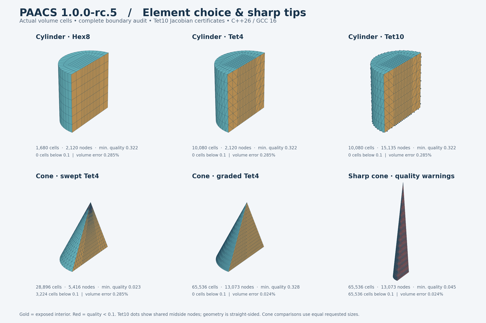
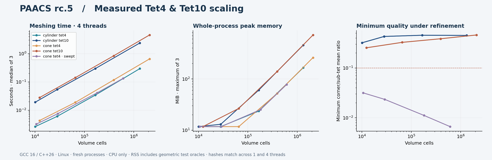

# PAACS Mesh 1.0.0-rc.5 validation

This release adds uniform element selection for the six explicit primitive
families, a graded tetrahedral cone route, and bounded quality warnings. The
reference build remains **GCC 16.2.0, C++26, CMake 4.4.3**, with warnings as errors
and strict floating-point flags. It is a release candidate, not a claim of
universal CAD robustness or a stable 1.0 API/ABI.

## What users can select

Cylinder, cone, frustum, tube, torus and elbow each support Hex-dominant, Tet4
and Tet10 output. A Tet4 request emits only Tet4 volume cells; Tet10 emits only
Tet10 volume cells and shared Tri6 boundary faces. **Tet10 geometry is currently
straight-sided.** Its finite-element order is quadratic; its boundary midsides
are not projected to exact CAD surfaces. Every emitted Tet10 receives a
whole-reference Jacobian certificate, including midpoint rounding, and a check
of its shared edge bindings. Final Tet10 volume integrates the actual quadratic
mapping.

The default quality policy reports poor valid cells. It includes complete counts,
a histogram, worst-cell details, sharp-feature incidence and up to 32 example
cell IDs. Callers can select strict rejection. Invalid or unresolved Jacobians,
zero/negative cells, failed incidence, exceeded budgets and cancellation always
prevent publication. Existing caller/output data survive failed meshing requests.
See [element choices](ELEMENT_CHOICES.md) for the full API and CLI examples.

## Qualification results

| Check | Result |
|---|---|
| Inherited unit suite | All 475 tests passed |
| Registered release checks | All 25 covered successfully; execution-retry details below |
| Primitive geometry matrix | 29 shapes × 3 element choices = 87 configurations, each compared at 1 and 4 threads |
| CAD reference comparisons | 90 successful STEP/BREP comparisons: 15 cases × 3 families × 2 formats |
| Independent emitted topology | 12 shape/family configurations; corner incidence, one midside per edge, reverse uniqueness, actual midpoint coordinates |
| New randomized geometry checks | 48 scaled/rotated/tapered/hollow tetrahedral cases |
| New refusal/rollback checks | 38 cases, plus live cancellation on both tetrahedral routes |
| Fast Tet10 certificate adversaries | 2,000 trials: 1,500 accepted, 500 unresolved; independent long-double derivative samples and Bernstein cross-checks |
| Additional certificate checks | Positive-corner folded Tet10 rejection, NaN rejection, scales 1e−90 and 1e90 |
| New allocation injection | Cylinder Tet4: 26; cone Tet4: 35; cylinder Tet10: 36; cone Tet10: 45 allocation points |
| Existing primitive allocation injection | 16 allocation points, with earlier SDK/model/pipeline tests retained |
| ASan + UBSan | 11 targeted suites covered successfully; final budget regression also rerun under sanitizers |
| Installed SDK | Seven C/C++ consumers passed; final primitive-element consumer relinked and rerun after the last guard fix |
| Primitive CLI | 38 checks, including output preservation and warning/rejection policies |
| Existing mesh stability | All 29 Hex-dominant and 42 planar case hashes unchanged from rc.4 |

The shape matrix includes very thin tubes, near-horn and hollow tori, hollow and
short elbows, shallow and sharp cones, expanding/small-cap frusta, rotations,
translations and scale changes. Geometry checks independently evaluate volume,
surface error, orientation, Euler characteristic and boundary-edge incidence.
The Tet10 test additionally reconstructs a corner-only mesh from the actual
emitted output and checks its incidence independently of the generator.

The CAD reference tests use explicit primitive parameters and Open CASCADE 8.0.1.
For every comparison they query 128 boundary nodes, 128 boundary facet centers
and 128 volume-cell centers. That is 23,040 distance queries and 11,520 solid
classifications. Straight Tet10 midsides are checked against the chord tolerance,
not against an incorrect exact-surface requirement. This is **not** automatic
curved STEP/BREP import.

## Sharp-tip result and trade-off



For the radius-one, height-two cone at requested size 0.15 and default geometry
tolerances:

| Strategy | Tet4 cells | Minimum mean ratio | Cells below 0.1 | Relative volume error |
|---|---:|---:|---:|---:|
| Swept O-grid, converted to Tet4 | 28,896 | 0.023 | 3,224 | 0.285% |
| Graded tetrahedral cone | 65,536 | 0.328 | 0 | 0.024% |

The improvement costs about **2.3× as many tetrahedra** in this example. It is
not a speed claim at equal cell count. The same-resolution refinement regression
at sizes 0.4, 0.2 and 0.1 keeps graded-cone minimum quality above 0.2. Extremely
sharp cones and thin walls can still have poor isotropic mean ratios: the visual's
radius-0.3, height-3 cone is valid, has minimum quality 0.045, and reports its poor
cells. Warning mode preserves that result; strict mode can refuse it.

The tetrahedral cone construction is improved. The existing Hex/Pyramid cone
construction is retained and gains diagnostics, not an automatic tip repair.

## Performance and memory

**120 fresh-process runs completed; all repeated/cross-thread mesh hashes match.**

Largest tested configurations (median mesher time, maximum whole-process RSS):

| Case | Volume cells | Nodes | 1 thread | 4 threads | Peak RSS, 4 threads | Minimum quality |
|---|---:|---:|---:|---:|---:|---:|
| Cylinder Tet4 | 1,333,584 | 231,055 | 0.419 s | 0.296 s | 166.4 MiB | 0.4512 |
| Cylinder Tet10 | 1,333,584 | 1,812,997 | 5.917 s | 2.384 s | 458.2 MiB | 0.4512 |
| Cone Tet4 (graded) | 2,097,152 | 366,145 | 0.809 s | 0.653 s | 261.2 MiB | 0.4606 |
| Cone Tet10 (graded) | 2,097,152 | 2,862,209 | 10.303 s | 4.567 s | 721.8 MiB | 0.4606 |
| Cone Tet4 (swept) | 612,864 | 106,606 | 0.185 s | 0.135 s | 78.0 MiB | 0.0066 |



The largest Tet10 cone retained a minimum corner quality of 0.4606 and 0.0062%
relative volume error. Its output payload was 299.8 MiB; planned auxiliary array
payload was 418.7 MiB, within the default separate 512 MiB limits. Measured peak
process RSS was 721.8 MiB. Four-thread speedup was about 2.3–2.5× for the largest
Tet10 examples and 1.2–1.4× for Tet4. The results show remaining serial work.

All benchmark runs use fresh processes, three repeats per configuration, and
one or four CPU threads. Compiler and sanitizer work are stopped before timing.
Reported mesher time is generation + validation + audit, excluding serialization;
Tet10 validation includes edge sorting, elevation, Jacobian certificates and
actual quadratic-volume integration. Process peak RSS includes the independent
geometric test oracles and hashing, so it is not the library's output payload.

Tet conversion is linear in the number of source cells. Tet10 edge interning uses
contiguous arrays and an in-place sort, O(edge uses log edge uses). Its greater
node count, connectivity, certification and scratch storage have a real cost.
The exact boundary audit and edge sorting remain serial. No GPU path is added;
these results do not establish scaling beyond four threads or concurrent
independent callers of the shared worker pool.

## Failures found and corrected

1. The first cone refinement estimate understated a conservative boundary error
   bound for triangles spanning adjacent radial levels. The final geometry gate
   refused publication. The planner now accounts for that factor and chooses the
   macro sector count and depth together. All final geometry checks remain on.
2. The initial Tet10 test incorrectly required every midside node to lie on the
   exact curved surface. Straight-sided Tet10 must share the faceted geometric
   envelope. The tests now enforce that explicit contract, use the chord bound,
   and verify it independently against OCCT; the Jacobian gate was not relaxed.
3. Final review found a missing output-budget check when a cone requires **zero**
   refinement levels. The initial mesh now receives the same mandatory preflight.
   Eight targeted Tet4/Tet10 limit regressions cover that branch, and the final
   element suite passed again in Release and under ASan/UBSan.

The release run initially recorded two **Not Run / permission denied** entries
for generated local executables, rather than assertion failures. Both passed
after relinking to a fresh output directory. One sanitizer hardening executable
had the same launch issue; an identical-byte executable copy passed. Raw initial
and follow-up logs are included. The final budget guard was followed by all 87
Release primitive configurations and the expanded element-hardening suite;
the sanitizer element suite was rerun after rebuilding that guard.

Sanitizers used Debug with `ASAN_OPTIONS=detect_leaks=0`, retaining the environment's
known LeakSanitizer restriction. The entire 475-case legacy executable was run
in Release; this report does not claim it was rerun under sanitizers. Windows,
macOS, TSan and GPU execution have not been newly qualified here. The existing
planar-CAD importer, general healing/decomposition limitations, archive-writer
I/O contract and shared-pool concurrency contract remain as documented.

## Reproduce

```sh
cmake --preset gcc16-release -DPAACS_WITH_OCCT=ON -DOpenCASCADE_DIR=/path/to/occt/cmake
cmake --build --preset gcc16-release --parallel 2
ctest --preset gcc16-release
python3 benchmarks/run_element_scaling.py /path/to/paacs-primitive-corpus scaling.json
python3 benchmarks/render_element_scaling.py scaling.json scaling.png
python3 benchmarks/render_element_gallery.py /path/to/paacs-primitive-mesh gallery.png
```

The timing/RSS driver currently targets Linux (`resource.ru_maxrss` in KiB).
Plots additionally require NumPy and Matplotlib. Evidence is in `evidence/rc5/`;
all earlier evidence and production source files remain in the archive. Earlier
reports: [rc.4](VALIDATION_RC4.md), [rc.3](VALIDATION_RC3.md).
