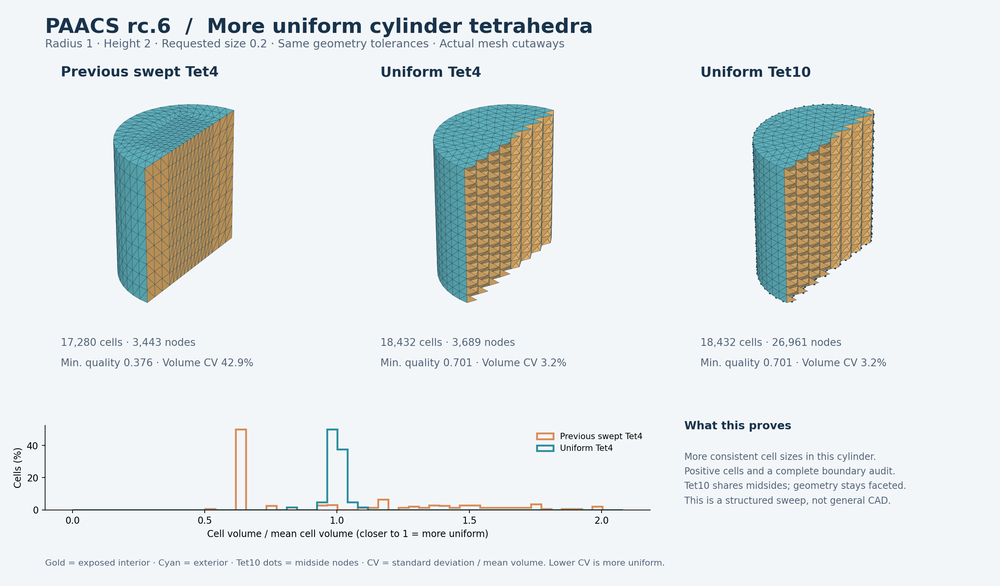
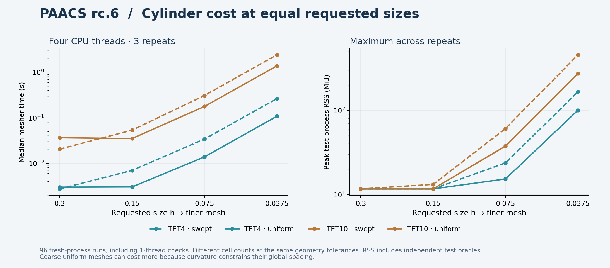

# PAACS Mesh 1.0.0-rc.6 validation

This candidate adds a more uniform cylinder tetrahedral strategy. The reference
build remains GCC 16.2.0, C++26, CMake 4.4.3 and Ninja 1.13.2, with strict FP and
library warnings as errors. It is not a stable general-purpose CAD release.

## Delivered behavior

Cylinder Tet4/Tet10 now select the Uniform triangular-section sweep by default.
Explicit `Swept` preserves rc.5 connectivity; HexDominant and other primitives
retain their routes. The direct strategy avoids the intermediate hex volume
mesh and its validation/audit, but retains the final full boundary audit and
positive-cell checks. Tet10 stays straight-sided, with shared midside nodes and
whole-reference Jacobian certificates.

The API/CLI reports nominal radial/axial spacings and whether geometry sizing
is more restrictive than the nominal-size calculation. Count/output/working
budgets, cancellation and transactional publication remain enforced. Thin valid
meshes can warn; strict quality policies reject them. Invalid meshes never pass
because warnings were enabled. Recompile C++ consumers for the extended structs.

## Qualification

| Check | Result |
|---|---|
| Complete registered Release suite | 24/24 passed, including all 475 inherited unit tests |
| Primitive matrix | 87 configurations (29 shapes × 3 element families), each checked at 1 and 4 threads |
| New uniform-cylinder checks | 50 configurations, including 48 seeded scaled/rotated cases and two thin-disk warning cases; additional coarse/strategy/geometry checks |
| New refusal/rollback checks | 27; output/working/audit limits, coordinate resolution, cancellation, quality policy, wrong family/shape/enum |
| Independent tetrahedral checks | Existing 12 shape/family topology checks, 48 random shapes, 38 rollback cases and 2,000 Tet10 certificate adversaries passed |
| Allocation-failure injection | Uniform cylinder Tet4: 13 allocation points; Tet10: 23; all retained cone/model/SDK tests passed |
| Primitive CLI | 47 checks passed, including explicit uniform/swept selection and preservation of existing output on failure |
| Installed SDK consumers | 6/6 passed (C and C++, including the explicit Uniform Tet4/Tet10 example) |
| Mesh stability | 79 primitive hashes unchanged; eight intended default-cylinder changes; all eight explicit Swept cylinder hashes still match rc.5 |
| ASan + UBSan | 7/7 targeted suites passed: allocation failures, primitive hardening, uniform cylinders, tetrahedral element hardening, Tet4 corpus, Tet10 corpus and CLI; Debug, leak detection disabled |

No Release or sanitizer launch retries or skipped tests were needed. Release unit timings
overlap sanitizer compilation and are qualification times, not benchmark data.

The new randomized tests span radii from 1e-6 to 1e6, rotations, translations,
coarse/fine size and geometry controls, both tetrahedral families and 1/4 threads.
Long-double independent determinants and size statistics check positive volume,
volume CV, maximum/minimum volume and mean-ratio shape quality. Existing primitive
oracles additionally check analytic volume, surface fidelity, boundary topology
and semantic classifications. Existing Tet10 tests reconstruct actual shared
edge bindings and audit an independent corner mesh.

The initial cylinder probe caught an incorrect half-angle in the reported
chord-bound formula. This was corrected before the successful corpus runs and
all measured benchmarks. The new route has no unresolved known test failures.

## Representative size/shape comparison

R=1, H=2, requested h=0.2, default geometry tolerances. The two routes have the
same boundary polygon and analytic geometry-error bounds in this example.

| Metric | rc.5 Swept Tet4 | rc.6 Uniform Tet4 |
|---|---:|---:|
| Volume cells | 17,280 | 18,432 |
| Nodes | 3,443 | 3,689 |
| Minimum mean ratio | 0.375703 | 0.700557 |
| Cell-volume coefficient of variation | 42.9494% | 3.2392% |
| Chord-error bound | 0.00214108 | 0.00214108 |

The 6.7% increase in cells buys much more consistent size and better corner
shape in this example. Tet10 has the same corner metrics and 26,961 total nodes.
`docs/cylinder_uniform_rc6.json` contains statistics independently calculated
from the actual serialized meshes. CV means standard deviation / mean volume;
it is not a Jacobian or conditioning metric.

## Isolated performance measurements

96 fresh-process samples: four sizes, two strategies, Tet4/Tet10, one/four
threads and three repeats. All repeat and cross-thread mesh hashes match.
No build, test suite or renderer ran alongside these samples. See the complete
raw dataset in `evidence/rc6/cylinder-scaling.json` and the environment manifest.

The largest request uses h=0.0375. Both strategies achieve relative volume error
0.0002331093 and the same circumference resolution. Four-thread measurements:

| Family / strategy | Cells | Median mesher time | Peak test-process RSS | Minimum corner quality |
|---|---:|---:|---:|---:|
| Tet4 / Swept | 1,333,584 | 0.26293 s | 166.44 MiB | 0.45123 |
| Tet4 / Uniform | 790,272 | 0.10778 s | 100.38 MiB | 0.68930 |
| Tet10 / Swept | 1,333,584 | 2.42279 s | 458.24 MiB | 0.45123 |
| Tet10 / Uniform | 790,272 | 1.38281 s | 274.51 MiB | 0.68930 |

These are equal requests, not equal cell counts. Timing includes generation,
validation and auditing, excluding file I/O and independent checks. Peak RSS
includes the test oracles, hashing and process-start baseline. It is not solely
output storage; the separate output and auxiliary budgets describe array payloads.

Uniform Tet4 takes 0.13686 s on one thread versus 0.10778 s on four (~1.27x).
Uniform Tet10 takes 3.48190 s versus 1.38281 s (~2.52x). The remaining serial
boundary audit accounts for about 68% of the fine Uniform Tet4 four-thread time.
It has not been disabled to obtain speedups.

Coarse requests can be more expensive with Uniform: at h=0.3 it creates 18,432
cells against 10,080 for Swept; four-thread Tet10 takes 0.03625 s against
0.02034 s. Curvature-driven global refinement explains this trade-off.

## Limits of the evidence

- This is a structured cylinder fast path with directional connectivity, not
  arbitrary curved-CAD meshing or a solver-accuracy demonstration.
- The original optional OCCT importer/tests are retained but OCCT is disabled
  in this turn's local build. The rc.5 90 STEP/BREP comparison results are
  historical evidence, not rerun rc.6 qualification.
- This turn does not qualify Windows/macOS, Clang, TSan, GPUs or concurrent
  independent dispatcher sessions. The existing dispatcher contract remains.
- The full inherited unit suite is a Release gate; only the listed targeted
  suites run under ASan/UBSan. No full-unit sanitizer claim is made.
- Straight-sided Tet10 does not fix faceted boundary geometry. Extremely short
  cylinders can still be stretched and require warnings or explicit rejection.

See [Uniform cylinders](UNIFORM_CYLINDERS.md) for algorithm and API details,
and [the structural/CFD roadmap](STRUCTURAL_CFD_ROADMAP.md) for prioritized
upgrades with acceptance criteria. rc.5's report and all earlier source/evidence
are retained in the archive.
