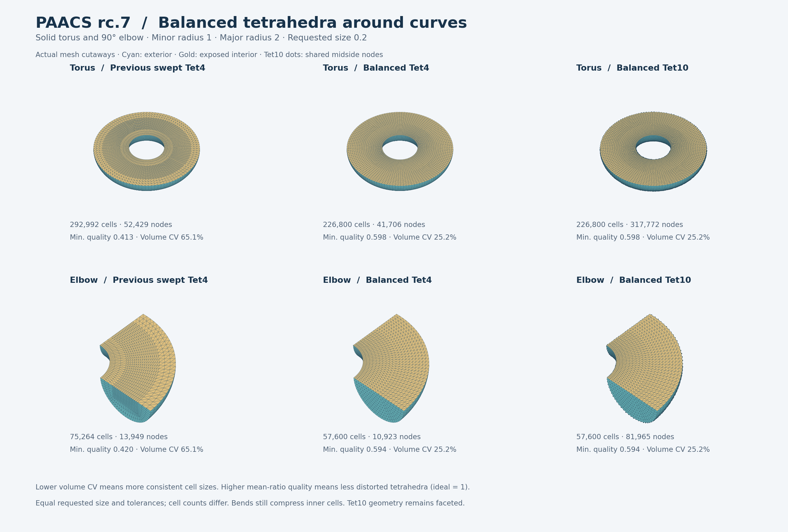
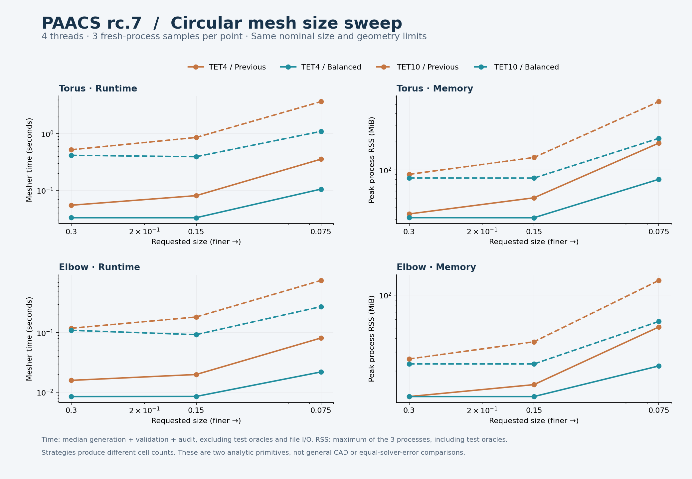

# PAACS Mesh 1.0.0-rc.7 qualification

Reference: Linux x86_64, GCC 16.2.0, C++26, CMake 4.4.3, Ninja 1.13.2,
strict floating point, library warnings treated as errors. Container limits:
8 CPU equivalents and 8 GiB RAM. Detailed environment, commands, raw outputs,
source fingerprints and recovery logs are in evidence/rc7 (`evidence/rc7/README.md`).
This is a release candidate, not a declaration of general CAD/solver readiness.

## Implemented and qualified in this revision

- Automatic balanced solid-torus and solid-elbow Tet4/Tet10 meshes, with a
  shared torus seam, direct tetrahedral generation, explicit legacy selection,
  and a joint conservative chord/volume sizing bound. Existing uniform
  cylinders retain identical meshes. Quality warnings and hard refusals remain.
- Optional, read-only surface feature analysis for Tri3/Tri6/Quad4, off by
  default. Angle, angular tolerance, minimum edge-segment length, optional tag
  seams, resource limits and cancellation are configurable. It does not change
  element density or replace CAD/boundary/Jacobian checks.
- Installed C++ example, CLI options/diagnostics, new independent tests,
  actual mesh cutaways, and an isolated size/thread performance sweep.

## Validation gates

| Gate | Result |
|---|---|
| Complete Release CTest run | **26/26 passed**, 279.36 s wall time |
| Inherited unit suite within that run | **475 tests passed** |
| Primitive fixture matrix | **87 configurations**: 29 fixtures × 3 element families; each compares 1/4-thread output hashes |
| rc.6 output compatibility | **69 unchanged hashes**; 18 intended default solid-circular changes |
| Explicit legacy circular strategy | **18/18 exact rc.6 hashes**, including rotated/scaled, near-horn and short/long bends |
| New circular stress suite | **38 configurations + 54 rollback checks** |
| New surface-feature suite | **41 successful checks + 21 refusal checks** |
| Existing uniform-cylinder suite | **50 configurations + 27 rollback checks** |
| CLI suite | **74 checks passed**, including unchanged archive bytes with feature analysis enabled and preservation of existing files on refused requests |
| Installed SDK | **7/7 C/C++ consumers passed**, including the new Tet10 bend/feature example |
| Targeted ASan + UBSan Debug suites | **8 suites passed**; the allocation suite needed a longer sanitizer-only timeout and follow-up run, as detailed below |
| Isolated performance sweep | **144 fresh-process samples**, 48 summarized rows; all repeat and 1/4-thread hashes agree |

The circular stress suite covers rotated/transformed geometry, radius scales
1e-6 through 1e6, ordinary major/minor-radius ratios, near-horn ratios, extremely
short bends, independent long-double determinants/quality, polygonal analytic
volume, boundary orientation/Euler characteristic, exact resource limits and
one-below-limit refusals, extreme sizes/tolerances, pre-cancellation, Warn/Reject
policies and explicit/automatic selection. Tet10 certification and shared-edge
binding checks remain active. Failed requests retain the destination mesh.

Surface-feature tests include known cube edges in Tri3 and Quad4 meshes,
scales 1e-150 through 1e150, open/folded patches, coplanar tag seams, exact
thresholds and tolerance bands, length filters, malformed winding/nonmanifold
adjacency, nonfinite/degenerate faces, default-off zero allocation, and actual
Hex/Tet4/Tet10 cylinder/torus/elbow boundaries. Filtering cannot conceal bad
adjacency. Tri6 analysis deliberately uses corner geometry.

Allocation fault injection reaches every observed allocation until success:
new torus and elbow routes each exercise **14 Tet4 and 24 Tet10 allocation
points**; the detector exercises **3**. Existing cylinder 13/23, cone 35/45,
legacy primitive 16, geometry model 178, geometry pipeline 242, audit 2 and
other mesh/SDK failure checks remain. The production code is not built with
white-box topology testing hooks.

## Actual mesh comparison

Minor radius 1, major radius 2, requested size 0.2, default geometry limits.
Both compared strategies satisfy those limits; their cell counts and achieved
geometry errors differ. Quality is corner-tetrahedron mean ratio (ideal 1).
CV is the coefficient of variation of cell volume (smaller means more uniform).
These statistics are independently recomputed from exported mesh coordinates.

| Shape | Strategy / family | Volume cells | Nodes | Min. quality | Volume CV |
|---|---|---:|---:|---:|---:|
| Torus | swept / tet4 | 292,992 | 52,429 | 0.4135 | 65.12% |
| Torus | uniform / tet4 | 226,800 | 41,706 | 0.5981 | 25.22% |
| Torus | uniform / tet10 | 226,800 | 317,772 | 0.5981 | 25.22% |
| Elbow | swept / tet4 | 75,264 | 13,949 | 0.4201 | 65.12% |
| Elbow | uniform / tet4 | 57,600 | 10,923 | 0.5943 | 25.22% |
| Elbow | uniform / tet10 | 57,600 | 81,965 | 0.5943 | 25.22% |

The joint geometry bound replaced an initial independent half-tolerance plan.
For the displayed torus it reduced the initial candidate from 391,392 cells
to 226,800 while retaining both error limits and balanced spacing. The old
O-grid conversion has 292,992 cells. The initial candidate's records are kept
separately; all final results use the joint bound. Neither this route nor its
name promises equal edge lengths, a maximum edge length, or good aspect ratios
for every bend. Inner cells compress as major radius approaches minor radius;
the warning and strict-refusal tests explicitly cover that constraint.

## Isolated performance and memory

No competing builds, tests or renderers ran during the performance sweep.
Each sample starts a separate executable process, alternates strategy/thread
order, and retains the raw results. Runtime is the median of generation +
validation + audit over three samples. It excludes independent geometric test
oracles, archive/hash processing and file I/O. Peak RSS is the maximum of the
three processes and includes the test oracles/hash and process startup; small
runs have a roughly 11.6 MiB startup measurement floor. It is not the same as
reported output/auxiliary array payload. Thread pool startup is included in
mesher phases. See `benchmarks/run_circular_scaling.py` for exact procedure.

The following table uses **4 threads**. Values show previous swept → balanced.

| Shape | Family | Requested size | Cells | Mesher seconds | Peak RSS MiB |
|---|---|---:|---:|---:|---:|
| Torus | tet4 | 0.3 | 251,136 → 226,800 | 0.05476 → 0.03294 | 34.26 → 31.29 |
| Torus | tet4 | 0.15 | 387,072 → 226,800 | 0.08079 → 0.03291 | 50.84 → 31.23 |
| Torus | tet4 | 0.075 | 1,555,848 → 620,928 | 0.35671 → 0.10543 | 193.77 → 79.90 |
| Torus | tet10 | 0.3 | 251,136 → 226,800 | 0.52370 → 0.41709 | 90.21 → 82.43 |
| Torus | tet10 | 0.15 | 387,072 → 226,800 | 0.86320 → 0.39429 | 136.34 → 82.33 |
| Torus | tet10 | 0.075 | 1,555,848 → 620,928 | 3.70828 → 1.10579 | 534.48 → 217.82 |
| Elbow | tet4 | 0.3 | 64,512 → 57,600 | 0.01588 → 0.00850 | 11.62 → 11.62 |
| Elbow | tet4 | 0.15 | 98,304 → 57,600 | 0.01990 → 0.00853 | 14.97 → 11.62 |
| Elbow | tet4 | 0.075 | 388,962 → 155,232 | 0.08144 → 0.02197 | 50.89 → 22.25 |
| Elbow | tet10 | 0.3 | 64,512 → 57,600 | 0.11875 → 0.10947 | 25.82 → 23.23 |
| Elbow | tet10 | 0.15 | 98,304 → 57,600 | 0.18308 → 0.09264 | 37.15 → 23.21 |
| Elbow | tet10 | 0.075 | 388,962 → 155,232 | 0.75110 → 0.27336 | 136.70 → 57.23 |

At the finest tested torus request, Tet10 changes from 3.70828 s / 534.48 MiB
to 1.10579 s / 217.82 MiB, with 60.1% fewer volume cells and better minimum
quality. This is an equal-request comparison with different meshes, not an
equal-cell-count or equal-solver-error comparison.

Four-thread speedup of the balanced finest mesh over its one-thread run is
**1.03× for torus Tet4, 2.58× for torus Tet10, 1.34× for elbow Tet4 and 2.54× for
elbow Tet10**. CPU scaling is therefore not uniformly strong yet. In those
Tet4 runs, the serial boundary audit accounts for about 56–64% of the total;
it remains a measured target for bounded, deterministic parallel work. The
library still runs the full audit. Tet10's heavier certification gains more
from the current worker loops. This is not proof of asymptotic scaling over
all CAD inputs or of scaling to arbitrary core counts.

Coarse requests or slender/tight geometry can force substantially smaller cells
than the nominal size to satisfy boundary accuracy and balanced spacing. In
the full corpus, the slender torus uses more cells than the old strategy.
Do not extrapolate the standard-radius benchmark advantage to every shape.
Budgets and explicit legacy selection remain available; no silent coarsening
or fallback after budget exhaustion has been introduced.

## Sanitizer scope and build diagnostics

The eight Debug ASan+UBSan suites cover the full Tet4/Tet10 primitive corpus,
primitive-element hardening, uniform cylinder/circular stress tests, surface
features, allocation faults and CLI behavior. Options were
`ASAN_OPTIONS=detect_leaks=0:halt_on_error=1` and
`UBSAN_OPTIONS=halt_on_error=1:print_stacktrace=1`.
This is not a full 475-test sanitizer run or a leak-sanitizer qualification.

Seven suites passed in the first run. The expanded circular allocation-fault
suite exceeded the inherited 60-second timeout. Its sanitizer-only limit was
increased to 300 seconds; the unchanged assertions passed in **63.35 seconds**
on the follow-up. Release retains its 60-second limit. Logs retain both runs.

The first full Release build hit a zero-byte object for unchanged
`TetRefinementMesher.cpp`; rebuilding it produced a 1,670,520-byte object and a
successful link. The final complete Release run followed. A scan also found
an empty sanitizer object for unchanged `PolyhedralMesh.cpp`. Compiling the
recorded command to a fresh temporary path produced a 2,041,480-byte object;
restoring it and relinking recovered the complete archive. All seven sanitizer
executables remained **byte-identical** to the binaries used for their tests,
confirmed by retained SHA256 fingerprints. That archive member was not linked
into these targeted executables. Every final object was nonempty.

One follow-up launch failed because the agent-built executable had mode 0644
after relinking. Restoring execute permission allowed the same binary to run.
These build-artifact problems did not require changing meshing source or
weakening test assertions. They are retained in the evidence rather than
reported as clean first-attempt builds. Container OOM/kill counters did not
increase during this revision.

## Boundaries of this evidence

- New balanced routes cover **solid** torus/elbow Tet4/Tet10. Hollow tori,
  tubes, strongly tapered frusta and all HexDominant layouts retain their
  existing strategies. Annular/tapered uniform layouts remain next work.
- Feature analysis is read-only; local feature-driven refinement, chains,
  patch segmentation and CAD-owned feature recovery remain future work.
  Coarse facets can yield apparent sharp mesh edges on a smooth CAD surface.
- Primitive Tet10 remains straight-sided. Midpoint sharing and whole-reference
  Jacobian certification do not constitute curved CAD projection.
- No new Open CASCADE build, arbitrary curved STEP/BREP import qualification,
  CAD healing, general geometry decomposition or solver convergence study was
  performed here. Historical CAD reports are retained as historical evidence.
- No Windows, macOS, Clang, TSan, GPU or many-core qualification was added.
  Cross-platform support remains a release gate, not a claim established by
  this Linux build. C++26/GCC 16 remains the requested reference toolchain.

The complete source ZIP retains the previous source files, includes all new
code/tests/docs/scripts and raw evidence, and is checked against its SHA256
manifest and ZIP CRC. Final C/C++ and build inputs match `code-sha256.json`.
All 284 recorded inputs also match a fresh review-ZIP extraction, which
successfully configures with the reference toolchain. This packaging check
does not claim a second full rebuild. All 72 inherited production `.cpp`
files are retained; the feature detector brings that count to 73.
See [roadmap](STRUCTURAL_CFD_ROADMAP.md) for acceptance gates toward 1.0.
