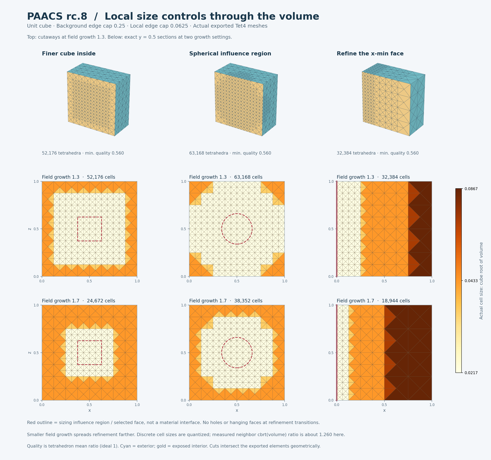
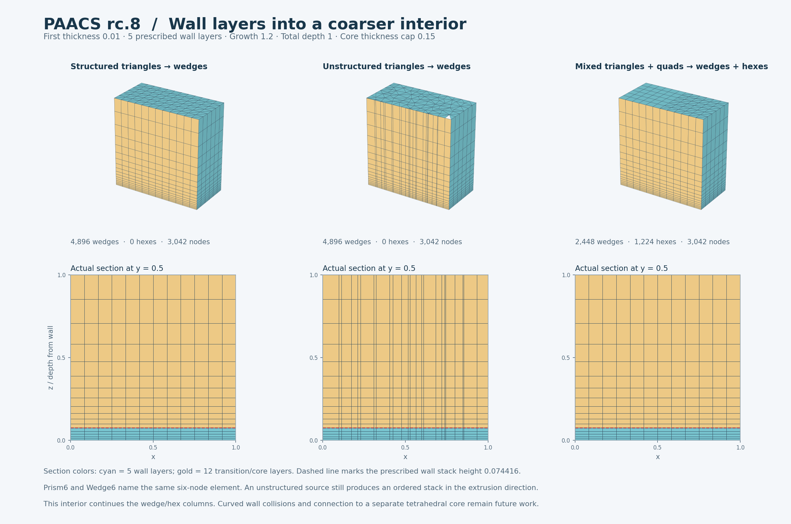
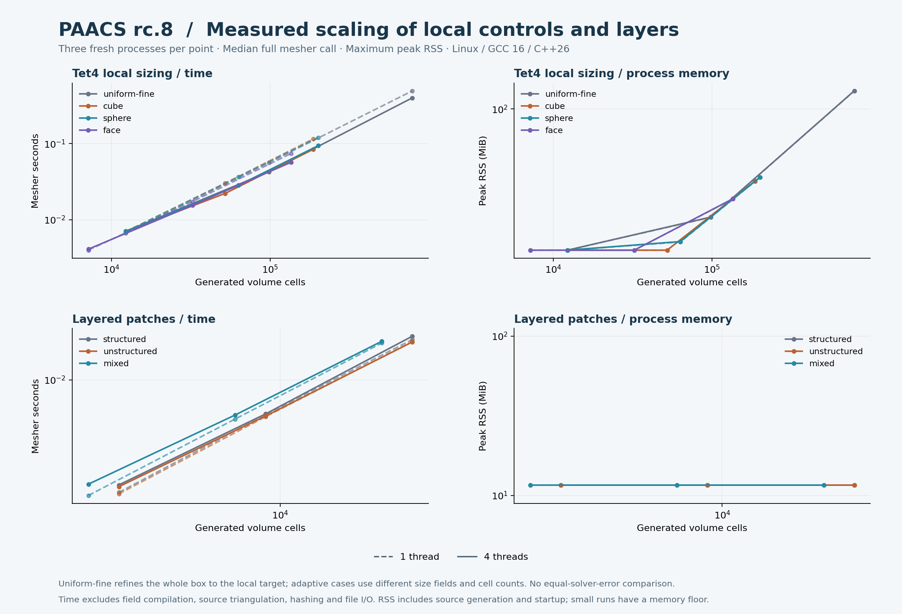

# PAACS Mesh 1.0.0-rc.8 qualification

Reference: Linux x86_64, GCC 16.2.0, C++26, CMake 4.4.3, Ninja 1.13.2,
strict floating point, library warnings treated as errors. Container limits:
8 CPU equivalents and 8 GiB RAM. Raw evidence (`evidence/rc8/README.md`) includes
commands, results, source fingerprints and build-recovery diagnostics.
The previous [rc.7 report](VALIDATION_RC7.md) is retained.
This remains a release candidate; general CAD and solver readiness are not established.

## Implemented in this revision

- Immutable compiled box, ball and finite rectangular-patch size controls,
  including selection of all six box faces, physical growth ramps, overlap by
  minimum, an optional size floor and bounded compilation.
- Conforming local Tet4 meshes in an axis-aligned box: conservative whole-block
  field minima, strong 2:1 octree balancing, exact shared integer node keys,
  deterministic generation, geometric checks and a full boundary audit.
- Measured face-neighbor equivalent-size growth fused into the existing audit,
  plus an optional strict acceptance limit. Existing callers keep the compact
  audit path unless they supply cell-volume data.
- Prescribed planar wall layers followed by a bounded graded interior, using
  structured or unstructured Tri3 sources for Prism6/Wedge6 and convex Quad4
  sources for Hex8; conforming mixed sources are supported. Source intersections
  and T-junctions are checked before extrusion.
- Installed C++ usage example, independent tests, reproducible benchmark and
  rendering scripts, actual exported mesh cutaways and exact section cuts.

The APIs are additive. Uniform sizing remains the default; feature analysis is
still opt-in. Public C++ request/report structs gained fields, so rebuild C++
consumers. The archive format remains v1. All 87 primitive fixture hashes match
rc.7 exactly, including the existing default Tet4/Tet10 circular strategies.

## Validation gates

| Gate | Result |
|---|---|
| Complete Release CTest run | **28/28 passed**, 267.46 s wall time |
| Inherited unit suite within that run | **475 tests passed** |
| New adaptive sizing suite | **42 successful mesh configurations, 4 field-check groups, 31 refusal/rollback cases** |
| New layered-patch suite | **29 successful mesh configurations, 41 refusal/rollback cases** |
| Primitive compatibility matrix | **87/87 unchanged rc.7 hashes**; each fixture also checks one/four-thread identity |
| Existing CLI suite | **74 checks passed** |
| Installed C/C++ SDK consumers | **8/8 passed**, including the new local-control/layer example |
| Targeted Debug ASan + UBSan | **7 distinct suites passed**: six initially, allocation suite after repairing its generated executable |
| Isolated scaling sweep | **126 fresh-process samples**, 42 summarized rows; every repeat and one/four-thread hash agrees |

The new sizing oracle independently recomputes signed long-double volumes,
mean-ratio quality, boundary incidence, face-neighbor growth and edge-to-field
bounds. Cases include all six selected faces at scales 1e-6, 1 and 1e6;
12 seeded off-center controls; a tiny off-grid sphere; a steep field that forces
additional balancing; exact/one-below budgets; depth, quality and growth limits;
pre/audit cancellation; invalid parameters; control-order invariance; and
Lipschitz checks. Refused requests preserve the prior destination mesh.

Layer checks independently measure actual node-to-node layer heights, unit
volume and full reference face incidence. They cover structured triangles,
seeded unstructured triangulations, quads and mixed sources; 24 schedule
variants; explicit sweep fractions; overlap/containment/duplicates, unmerged
contacts, T-junctions, nonplanarity, bow-tie quads, unused nodes, budgets,
cancellation and invalid inputs. Geometry is not validated only through the
planner's own metadata.

Allocation-fault injection reaches every observed allocation until success:
**13 adaptive-box allocation points**, **27 layered-patch points**, and the
size-field compilation allocation. The inherited geometry, primitive, feature,
audit and SDK fault checks also pass. Ordinary production objects are built
without white-box topology testing hooks.

## Actual sizing and layer results

All three local-control galleries use a unit box, background edge cap 0.25,
local edge cap 0.0625 and field growth 1.3. Quality is Tet4 mean ratio, ideal 1.

| Control | Tetrahedra | Nodes | Minimum quality | Maximum measured neighbor size ratio |
|---|---:|---:|---:|---:|
| Fine central cube | 52,176 | 11,195 | 0.560259 | 1.259921 |
| Fine spherical influence region | 63,168 | 13,729 | 0.560259 | 1.259921 |
| Selected x-min face | 32,384 | 7,434 | 0.560259 | 1.259921 |

The continuous field growth and actual mesh growth are distinct. Field slope
is `2*(g-1)/(g+1)`; lower growth spreads refinement farther. Dyadic leaf widths
quantize the mesh sizes. The actual metric is the maximum cube root of the
volume ratio across face-sharing tetrahedra, not an edge ratio. Set
`maximumAdjacentSizeRatio` if that measured value is a hard requirement;
a tighter incompatible request is refused. The fine regions are influence
zones, not recovered material interfaces. The new outer domain is a box;
a spherical influence zone does not add an outer-sphere mesher.

For the layer gallery, first height 0.01 and wall growth 1.2 give heights
0.01, 0.012, 0.0144, 0.01728 and 0.020736. These five layers total 0.074416;
12 additional layers fill unit depth while retaining a core thickness cap of
0.15. Measured maximum adjacent thickness ratio is 1.2000000000000013.

| Source patch (12 x 12 grid) | Prism6/Wedge6 | Hex8 | Nodes |
|---|---:|---:|---:|
| Structured triangles | 4,896 | 0 | 3,042 |
| Unstructured triangles | 4,896 | 0 | 3,042 |
| Quads | 0 | 2,448 | 3,042 |
| Mixed triangles/quads | 2,448 | 1,224 | 3,042 |

The core continues the same wedge/hex columns. A separate tetrahedral core,
curved wall fronts and automatic layer termination are future integrations.
The schedule planner preserves wall heights, checks actual achieved ratios,
and may refuse a transition that its bounded construction cannot fit. It is
not an exhaustive optimizer over all possible layer distributions.

## Isolated performance and memory

No competing build, test or rendering jobs ran during this sweep. Each point
uses three fresh processes, alternating one/four-thread order. Time is the
median complete mesher call, including planning, geometric validation and
full boundary audit. Field compilation, source triangulation, hashing and
file I/O are outside that timer. Peak RSS is the maximum of the three runs;
it includes process startup, source generation and hashing. Small processes
have a **11.62 MiB measurement floor**, so their RSS points cannot establish
fine-grained memory scaling. Payload counters and process RSS are different.

The finest box sweep uses background cap 0.125 and local cap 0.03125, growth
1.3. The uniform-fine comparison applies that local cap everywhere. These are
different meshes with different size fields, not equal-error solver comparisons.
Four-thread results are shown; speedup compares each mesh to its own one-thread run.

| Box case | Volume cells | Mesher seconds | Peak RSS MiB | 1-to-4-thread speedup |
|---|---:|---:|---:|---:|
| uniform-fine | 786,432 | 0.39806 | 132.00 | 1.24x |
| cube | 186,336 | 0.08385 | 33.27 | 1.37x |
| sphere | 200,592 | 0.09377 | 35.42 | 1.28x |
| face | 135,680 | 0.05698 | 25.50 | 1.30x |

Local-cube refinement uses 76.3% fewer tetrahedra than uniform-fine in this
fixture, with about 4.75x lower runtime and 74.8% lower peak RSS. Gentler fields
can instead refine nearly the whole box; the gallery's growth-1.15 central
cube is an example. Local control is a way to allocate resolution, not an
unconditional speedup for every request.

The largest layered-patch sweep uses a 32 x 32 source grid, first height 0.01,
growth 1.2, and 17 total layers:

| Patch | Volume cells | Mesher seconds | Peak RSS MiB | 1-to-4-thread speedup |
|---|---:|---:|---:|---:|
| structured | 34,816 | 0.02221 | 11.62 | 0.94x |
| unstructured | 34,816 | 0.01999 | 11.62 | 1.01x |
| mixed | 26,112 | 0.02026 | 11.62 | 0.97x |

The tested Tet4 cases show modest parallel gains; their serial audit is
approximately 24-28% of the four-thread total at the finest size. Planning,
balancing and sorted node-key work are additional serial costs. Layered cases
show little or no four-thread gain at these sizes, with overhead occasionally
making four threads slower. Source validation, the inherited sweep analysis
and the final audit remain optimization targets. The bounded projected-pair
checker can still be quadratic on pathological source bounds and refuses at
its work budget. No check is skipped to obtain these timings.

The sweep covers up to 786,432 Tet4 cells or 34,816 wedges. It does not prove
asymptotic scaling, many-core performance, GPU acceleration, equal-solver-error
performance. Raw samples, counts, phase timings,
work counters and hashes are retained for comparisons in subsequent releases.

## Sanitizer scope and build diagnostics

ASan+UBSan covers the two new suites, geometry corpus, audit differential,
primitive-element hardening, surface features and allocation faults. Options:
`ASAN_OPTIONS=detect_leaks=0:halt_on_error=1` and
`UBSAN_OPTIONS=halt_on_error=1:print_stacktrace=1`. This is not a full 475-test
sanitizer run, leak-sanitizer qualification or TSan qualification.

Six suites passed in the first sanitizer run. The allocation executable could
not launch: its generated file began with zero bytes instead of an ELF header.
The original error, file fingerprint and size are retained. Relinking the
unchanged recorded objects/archive to a fresh temporary path produced a valid
263,733,296-byte executable. It was copied back and fingerprinted immediately
before CTest; the allocation suite then passed in **65.95 seconds**. No test
assertions or timeout settings were relaxed for this recovery.

The first full Release job was interrupted before completion. A resumed build
then found a zero-byte testing object for unchanged `TetFacetSetRecovery.cpp`,
causing undefined references. Removing only that intermediate and rebuilding
produced a 1,473,872-byte object and a successful complete link. The full
28-suite run followed. The source digest before/after recovery is identical.
Final scans found valid ELF headers for all **200 Release and 90 sanitizer
objects**. These observations are retained without claiming an established
cause for the damaged intermediates. OOM/kill counters did not increase.

## Qualification boundary and package

- Local Tet4 refinement currently has an axis-aligned box outer domain. No new
  adaptive Tet10, arbitrary outer CAD boundary, material-interface recovery or
  automatic feature-to-control coupling is claimed. Very elongated boxes can
  have lower quality; use the measured score and acceptance threshold.
- New layer qualification covers straight normal extrusion of planar prepared
  patches. The older curved-front APIs remain separate. This is not yet a
  general viscous CFD boundary-layer mesher or prism-to-tetrahedral-core join.
- No new Open CASCADE, arbitrary curved STEP/BREP, healing, curved Tet10
  projection, structural convergence or fluid-solver convergence study was run.
- No Windows, macOS, Clang, GPU or many-core qualification was added. Cross-
  platform execution remains a release gate; C++26/GCC 16 is the reference.
- Budgets bound documented output/working payloads and work counts, not all
  allocator/process memory. The layer working estimate is conservative on the
  reference ABI, not a portable hard RSS bound. See the API guides for details.

The complete ZIP retains every prior source file and adds three production
translation units (76 total), the tests, guides, examples, figures and raw
records. The packager checks ZIP CRC and every SHA256 manifest entry. There
are **294 recorded C/C++ and CMake inputs** in `evidence/rc8/code-sha256.json`.
A review extraction is checked against those inputs and configured with the
reference toolchain; this packaging check does not claim a second full build.
See [local controls](LOCAL_SIZE_CONTROLS.md), [layers](PRISM_LAYER_CONTROLS.md)
and the [structural/CFD roadmap](STRUCTURAL_CFD_ROADMAP.md) for API usage and next gates.
