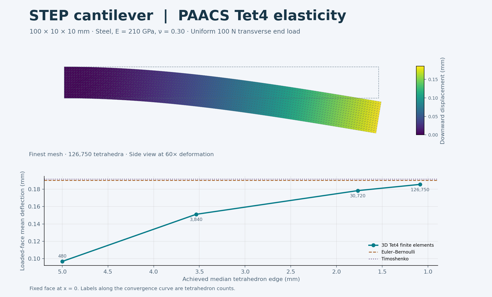

# STEP cantilever with a linear elasticity solve

The [cantilever STEP](cantilever.step) is an OCCT-written, closed
100 × 10 × 10 mm rectangular solid. PAACS imports the STEP, publishes
an audited Tet4 mesh, and preserves the two cap face tags. The Python
example assembles and solves three-dimensional small-strain isotropic
elasticity on the exported mesh.

The beam uses Young's modulus of 210,000 N/mm² and Poisson's ratio of
0.30. All three displacement components are fixed on the x = 0 mm
cap. The x = 100 mm cap receives uniform traction of −1 N/mm² in the
z direction, for a total load of 100 N. The solver checks that each
cap is represented by exactly one complete CAD-tagged surface of
area 100 mm². The recorded STEP gives fixed face tag 1, loaded face
tag 2 and solid tag 1.



| Requested target | Achieved median edge | Tet4 | Loaded-face mean downward displacement | Difference from Timoshenko |
|---:|---:|---:|---:|---:|
| 5.00 mm | 5.000 mm | 480 | 0.096691 mm | −49.63% |
| 2.50 mm | 3.536 mm | 3,840 | 0.151100 mm | −21.29% |
| 1.25 mm | 1.768 mm | 30,720 | 0.178445 mm | −7.04% |
| 0.80 mm | 1.088 mm | 126,750 | 0.185623 mm | −3.30% |

The Euler–Bernoulli tip displacement `P L³ / (3 E I)` is
0.190476 mm. The Timoshenko estimate adds `P L / (κ G A)`, using
κ = 5/6, and gives 0.191962 mm. These beam theories approximate
the three-dimensional clamped and uniformly loaded model. The
computed displacement approaches their range from below as the mesh
is refined. The finest result is 2.55% below Euler–Bernoulli and 3.30%
below Timoshenko. The example reports a loaded-face area average to
match the uniform traction and its total applied work.
[MIT beam theory notes](https://mit.edu/abeyaratne/ElasticSolids-Vol.1-Math.pdf)

All four levels passed an exact affine displacement patch test with
interior unknowns. The finest level's relative displacement error
was 7.12 × 10⁻¹⁵. The solves also checked force and moment equilibrium,
applied work versus strain energy and the free-DOF residual. The
[recorded convergence data](recorded-convergence.json) contains the
mesh, STEP and mesher hashes, geometry and solver checks.

## Run

Use a PAACS build with the optional OCCT adapter and put its OCCT
runtime DLLs on `PATH`. The example uses Python with NumPy, SciPy
and Matplotlib. From the repository root in PowerShell, select an
output directory that does not yet exist.

```powershell
python -m pip install numpy scipy matplotlib
$example = 'examples/elasticity_cantilever'
$mesher = 'build/windows-msvc-release/Release/paacs-cad-mesh.exe'
$result = 'out/elasticity-cantilever'
python "$example/run.py" --step "$example/cantilever.step" --mesher $mesher --output $result
python "$example/plot.py" $result "$result/convergence.png"
```

The recorded run used OCCT 8.0.1 and one meshing worker and one native
validation worker. `run.py` saves every mesh, native report,
displacement field and solver receipt under the output directory.
Its nominal edge targets are the four table entries. The measured
Tet4 edges include cell diagonals and can be longer than the target.

To regenerate the STEP with the installed OCCT SDK, configure this
example directly using the SDK CMake package path and build its fixture
generator. The writer records a timestamp in the STEP header.

```powershell
cmake -S $example -B out/elasticity-fixture -DOpenCASCADE_DIR=path/to/occt/cmake
cmake --build out/elasticity-fixture --config Release
out/elasticity-fixture/Release/make-cantilever-step.exe out/cantilever.step
```
