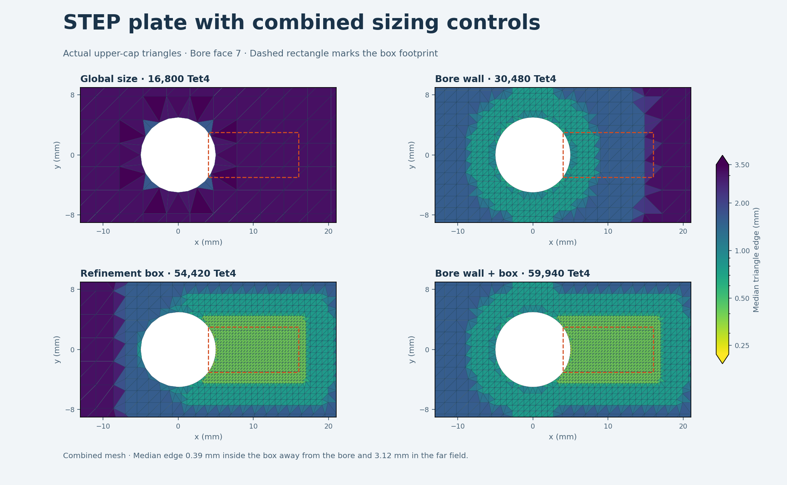
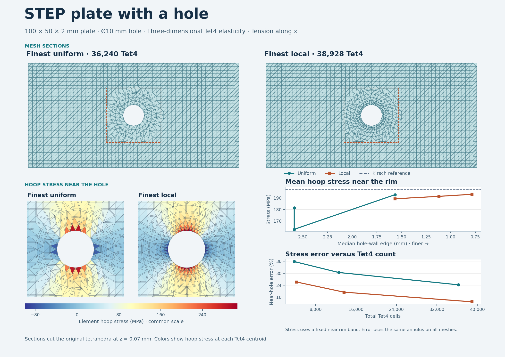

# STEP plate with a circular hole

The [STEP fixture](plate-hole.step) is a 100 × 50 × 2 mm solid with a centered
10 mm through-hole. The convergence example solves three-dimensional linear
elasticity on two families of PAACS Tet4 meshes. Each pair uses the same
nominal far-field spacing and through-thickness layers. The local member
uses a rim target 45% of that far-field spacing with graded in-plane spacing
around the rim. The three pairs progressively refine the overall plate.

## Reference problem

The load represents 100 MPa far-field tension along x. Analytical Kirsch
tractions are applied along the four outside edges of the finite rectangle.
Both cap faces and the cylindrical wall are traction free. Six displacement
constraints remove rigid motion. The elastic modulus is 210 GPa. At a
Poisson ratio of 0.30, the Kirsch plane-stress solution is a thin-plate
reference for this three-dimensional model. The additional zero-Poisson
run makes the ideal circular-domain solution exact through the thickness.
In both cases the linear Tet4 meshes approximate the cylinder with planar
facets. [Kirsch stress factor](https://ntrs.nasa.gov/citations/19930082747) ·
[Finite-thickness elasticity](https://ntrs.nasa.gov/citations/19820018834)

This geometry-specific example exercises the PAACS core using an imported
STEP rim. It recovers the rectangular outline and sampled circular rim as
constraints in a planar Delaunay triangulation, then sweeps it through the
thickness and splits the prisms conformingly into Tet4. The volume and all
seven boundary face tags come from the STEP import. Each export passes the
linear volume boundary audit and original-solid centroid checks. The general
native CLI still needs a hole-wall sizing route for this type of part.

## Saved bore-wall and volume-box controls

The [plate sizing recipe](plate-sizing.json) selects CAD face `7` on body
`1`. It combines a 0.86 mm target on the bore with a 0.40 mm request in an
offset 12 × 6 × 2 mm box. The 0.55 mm minimum clamps the box request to
0.55 mm, the global target is 3.50 mm, and the growth setting is 1.25.
The finer target wins wherever the controls overlap. The box spans the
plate thickness, so a shared in-plane sizing field drives the straight
sweep through five layers. Selection uses the imported CAD tags, scoped
to the STEP file's SHA-256.



| Controls | Tet4 | Rim inside box | Rim elsewhere | Left bore band | Box interior away from bore | Far field |
| --- | ---: | ---: | ---: | ---: | ---: | ---: |
| Global | 16,800 | 1.31 mm | 1.31 mm | 2.99 mm | 3.12 mm | 3.12 mm |
| Bore | 30,480 | 0.65 mm | 0.65 mm | 0.78 mm | 1.56 mm | 3.12 mm |
| Box | 54,420 | 0.33 mm | 0.65 mm | 1.56 mm | 0.39 mm | 3.12 mm |
| Combined | 59,940 | 0.33 mm | 0.65 mm | 0.78 mm | 0.39 mm | 3.12 mm |

The columns show median mesh edges. Rim measurements use circumferential
edges on the bore triangles. The other columns use in-plane edges whose
midpoints lie in the specified regions. In the combined case the box
interior's 95th-percentile edge is 0.552 mm. The minimum and growth set the
target field. Discrete measurements remain separate. The ratio of equivalent
sizes of neighboring tets, measured as the cube root of their volume ratio,
is 1.14 at the 95th percentile and 1.53 at maximum.

The saved project contains a portable STEP copy and the complete sizing
recipe. Reopening it in a fresh process reproduced the native mesh and
`mesh.inp` byte for byte. All seven original faces export as named
`CAD_FACE_1` through `CAD_FACE_7` element surfaces. The 59,940 C3D4 elements
are in `CAD_BODY_1`. The elasticity example reads the exported include,
verifies the surfaces against exterior element sides and reproduces the
native mesh solve. This verifies the mesh include with the included solver.
[Sizing and round-trip receipts](recorded-sizing-workflow.json) ·
[Element and face numbering](https://docs.software.vt.edu/abaqusv2026/English/SIMACAEELMRefMap/simaelm-r-3delem.htm)

Use the [example build below](#run) and execute from the repository root:

```powershell
$example = 'examples/elasticity_plate_hole'
$mesher = 'out/elasticity-plate-hole/mesh-plate-hole.exe'
$study = 'out/plate-sizing'
python "$example/plate_controls.py" "$example/plate-sizing.json" `
  --mesher $mesher --output "$study/first" --ablation
python "$example/plate_controls.py" "$study/first/project.json" `
  --mesher $mesher --output "$study/reopened"
python "$example/solve.py" --output "$study/solve" `
  --mesh archive "$study/reopened/combined/mesh.paacsmesh" `
  --mesh exported "$study/reopened/combined/mesh.inp"
python "$example/plot_controls.py" "$study/first" "$study/achieved-sizing.png"
```

## Achieved refinement

| Pair | Thickness layers | Median far-field edge | Median near-hole edge, uniform → local | Tet4, uniform → local |
| --- | ---: | ---: | ---: | ---: |
| 1 | 2 | 4.000 mm | 4.061 → 2.093 mm | 3,780 → 4,236 |
| 2 | 3 | 2.632 mm | 2.687 → 1.517 mm | 12,564 → 13,626 |
| 3 | 4 | 1.786 mm | 1.857 → 1.053 mm | 36,240 → 38,928 |

Near-hole medians use in-plane edges with midpoints within 8 mm of the hole
center. Far-field medians use the same measure beyond 18 mm. The two meshes
in each pair have identical vertex coordinates in that far-field region.
The finest local mesh reduces bore chord error from 0.0616 mm to 0.0154 mm
at 7.4% more Tet4 than the finest uniform mesh. The independent exact check
found zero inverted tetrahedra and zero illegal contacts in both finest
archives. [Mesh receipts](recorded-meshes.json) ·
[Exact checks](recorded-exact-checks.json)

## Stress results



The near-hole stress error is a volume-weighted relative tensor L² estimate
evaluated on the same 24,576 physical probes on each mesh. It covers radii from
1.01 to 2 hole radii through the full thickness. The hoop-stress mean uses
7,680 common probes in the two bands within 15° of the transverse hole poles,
from 1.05 to 1.40 hole radii through the thickness. The Kirsch mean in these
bands is 197.58 MPa.

| Pair | Near-hole L² error, uniform → local | Mean hoop stress, uniform → local |
| --- | ---: | ---: |
| 1 | 35.88% → 25.59% | 181.40 → 189.22 MPa |
| 2 | 30.38% → 20.47% | 162.83 → 191.31 MPa |
| 3 | 24.17% → 15.61% | 192.77 → 193.08 MPa |

Local refinement gives a 35% lower near-hole stress error on the finest pair.
The local band mean moves toward the reference across all three levels at the
recorded quadrature resolution. Repeating the finest means with 61,440
samples gave 194.60 and 192.82 MPa, so the small difference between the
finest meshes is within sampling sensitivity. The finest locally refined
rim probe reads about 207 MPa against the thin-plate peak of 300 MPa. The
wall peak remains unresolved at this resolution.

The zero-Poisson check on the same six meshes gives annulus errors of
32.45%, 26.84% and 19.84% for uniform sizing and 21.35%, 16.50% and 12.40%
for local sizing. All twelve solves pass force and moment balance and the
work-to-strain-energy check. [Recorded stress results](recorded-solve.json) ·
[Recorded zero-Poisson results](recorded-solve-zero-poisson.json)

## Run

Build PAACS with `PAACS_WITH_OCCT=ON` and install the build to a local prefix.
Set `$occtCmake` to the OCCT SDK's CMake package directory and put its runtime
DLL directories on `PATH`. The example uses NumPy, SciPy and Matplotlib.
These commands run from the repository root in PowerShell.

```powershell
python -m pip install numpy scipy matplotlib
$example = 'examples/elasticity_plate_hole'
$out = 'out/elasticity-plate-hole'
cmake --install build/windows-msvc-release --config Release --prefix "$out/install"
cmake -S $example -B "$out/build" `
  "-DPAACSMesh_DIR=$PWD/$out/install/lib/cmake/PAACSMesh" `
  "-DOpenCASCADE_DIR=$occtCmake"
cmake --build "$out/build" --config Release
Copy-Item "$out/build/Release/mesh-plate-hole.exe" "$out/mesh-plate-hole.exe"
python "$example/mesh_plate.py" --step "$example/plate-hole.step" `
  --mesher "$out/mesh-plate-hole.exe" --output "$out/meshes"
$pairs = @()
foreach ($level in 1..3) {
  foreach ($family in @('uniform', 'local')) {
    $label = "$family-$level"
    $pairs += @('--mesh', $label, "$out/meshes/$label/mesh.paacsmesh")
  }
}
python "$example/solve.py" --output "$out/solve" @pairs
python "$example/solve.py" --poisson 0 --output "$out/solve-zero-poisson" @pairs
python "$example/plot.py" "$out/solve" "$out/stress-convergence.png"
```

Run the executables alongside matching OCCT DLLs or from a clean directory
with the matching SDK on `PATH`. The STEP comes with the example. To
regenerate it, give `make-plate-hole-step` from the same build a new filename.
