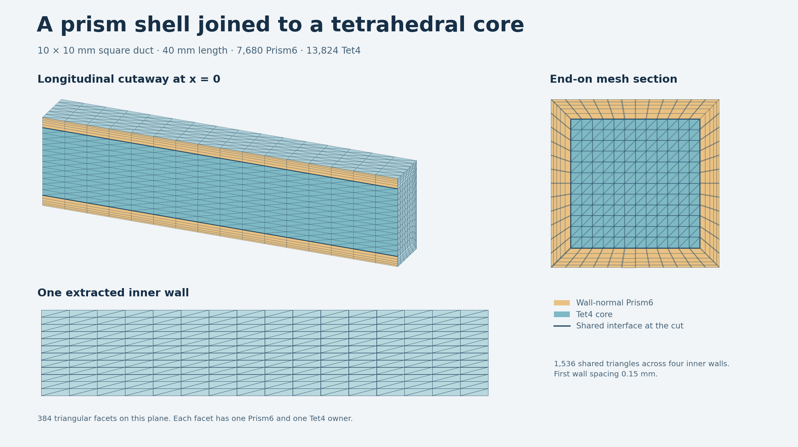
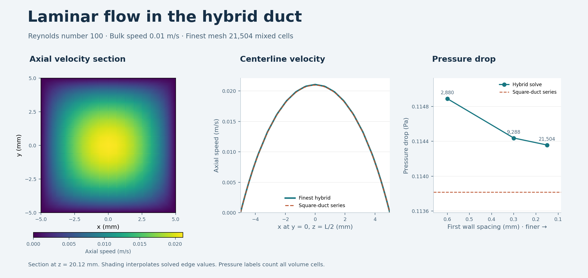

# Square STEP duct with a Prism6 shell and Tet4 core

This study uses the [same straight STEP duct](../flow_straight_duct/straight-duct.step)
as the all-prism example. The fluid section is 10 × 10 mm and the duct is
40 mm long. The mesh has wall-normal Prism6 layers on all four walls and a
Tet4 core. The wall layers meet on the diagonals of the square section.



PAACS tetrahedralizes the structured core by a conforming pulling
triangulation. Its oriented exterior triangles seed the inward-offset wall
stacks, so each transition triangle uses the same three node IDs and has
opposite winding on its prism and tetrahedron. Every level preserves the six
original STEP face tags and the one fluid volume tag. Each cap has the same
partition and transverse coordinates as the opposite cap.

An archive audit checks the rectangular perimeter and coverage of each
transition, the matching miter seams, analytical wall-sweep maps and the
minimum Jacobian over each whole Prism6. The exact Tet4 audit separately
checks orientation and geometric intersections inside the core. Cell
volumes sum to 4,000 mm³ at all levels. The finest level has 384 transition
triangles per wall, 320 shared miter quads across the four corners and five
wall rows with a 0.15 mm first height and 1.22 growth ratio. These checks use
the mesh archives that are passed to the solver. [Mesh receipts](recorded-meshes.json) ·
[Independent audit receipts](recorded-audits.json)

The mitered wedges use their isoparametric maps. Some internal prism quads
are bilinear, with identical face geometry on both owners. All shared
Prism6–Tet4 faces are planar triangles. The example constructs this
particular straight-duct transition using the existing PAACS core APIs.

## Flow and pressure-drop convergence



The fluid has viscosity 0.001 Pa·s and density 1,000 kg/m³. Fixing its bulk
speed at 0.01 m/s gives a Reynolds number of 100 and target flow of
1.0 × 10⁻⁶ m³/s. The exact fully developed square-duct solution gives a
pressure drop of **0.113816615 Pa**. Its conductance is checked using two
Fourier expansions. [Square-duct velocity series, Eq. 19](https://ntrs.nasa.gov/api/citations/20010103867/downloads/20010103867.pdf#page=40)

| First layer | Wall rows | Prism6 | Tet4 | Shared Tri3 | Pressure drop | Pressure error | Velocity L² error |
| ---: | ---: | ---: | ---: | ---: | ---: | ---: | ---: |
| 0.60 mm | 3 | 1,152 | 1,728 | 384 | 0.114889 Pa | +0.942% | 0.769% |
| 0.30 mm | 4 | 3,456 | 5,832 | 864 | 0.114437 Pa | +0.545% | 0.426% |
| 0.15 mm | 5 | 7,680 | 13,824 | 1,536 | 0.114357 Pa | +0.475% | 0.354% |

The solver assembles the scalar axial momentum equation on the original
three-dimensional Prism6 and Tet4 cells. Prism6 uses its isoparametric
shape functions. The end velocities are identified periodically, the four
walls enforce no slip, and the driving gradient is scaled to the target
flow. Each level checks the discrete residual, pressure work versus viscous
dissipation and flux through five transverse sections. Entrance flow and
the coupled velocity–pressure equations remain separate qualification work.

The pressure drop and volume-weighted velocity error both decrease across
the three levels. The centerline velocity error is nonmonotonic between
levels. Wall depth changes with the first layer and row count, so this
sequence measures the combined mesh changes. [Flow receipts](recorded-flow.json)

## Reproduce

Use an OCCT-enabled PAACS install and the matching OCCT runtime on `PATH`.
Set `$occtCmake` to the SDK CMake package directory. These commands run from
the repository root in PowerShell with NumPy, SciPy and Matplotlib available.

```powershell
python -m pip install numpy scipy matplotlib
$example = 'examples/flow_hybrid_duct'
$out = 'out/flow-hybrid-duct'
cmake --install build/windows-msvc-release --config Release --prefix "$out/install"
cmake -S $example -B "$out/build" `
  "-DPAACSMesh_DIR=$PWD/$out/install/lib/cmake/PAACSMesh" `
  "-DOpenCASCADE_DIR=$occtCmake"
cmake --build "$out/build" --config Release
Copy-Item "$out/build/Release/mesh-hybrid-duct.exe" "$out/mesh-hybrid-duct.exe"
python "$example/mesh_hybrid.py" --step examples/flow_straight_duct/straight-duct.step `
  --mesher "$out/mesh-hybrid-duct.exe" --output "$out/meshes"
$levels = @()
$height = @(0.60, 0.30, 0.15)
for ($i = 0; $i -lt 3; $i++) {
  $label = "level-$($i + 1)"
  $archive = "$out/meshes/$label/mesh.paacsmesh"
  python "$example/audit_hybrid.py" $archive "$out/meshes/$label/audit.json" `
    --first-height $height[$i] --growth 1.22 --wall-layers ($i + 3)
  $levels += @('--mesh', $label, $archive)
}
python "$example/solve.py" --output "$out/solve" @levels
python "$example/plot.py" "$out/solve" "$out/figures"
```
