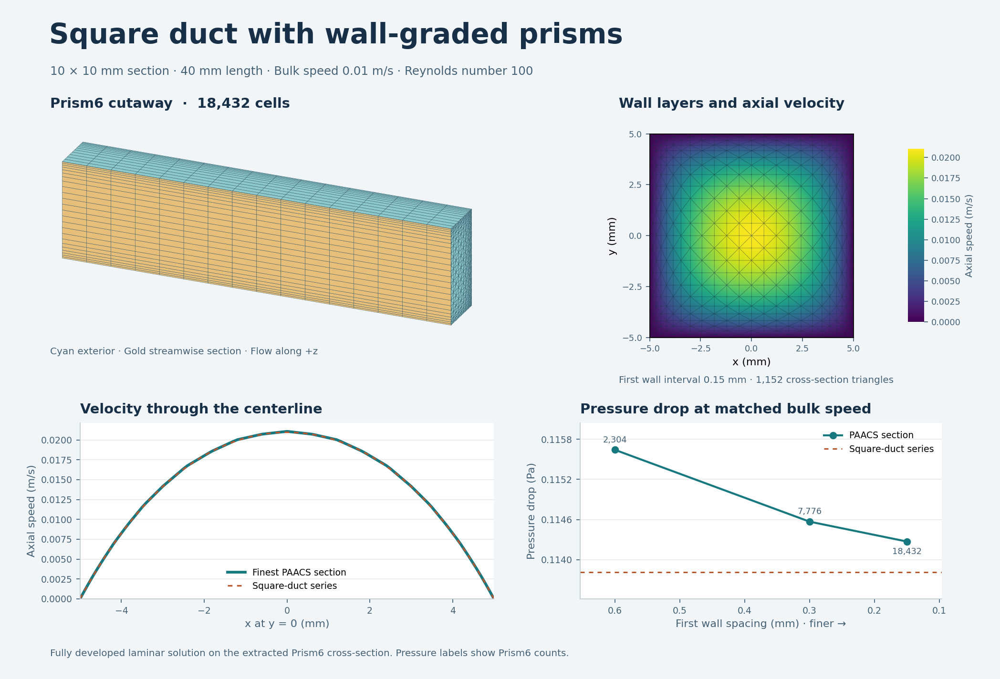
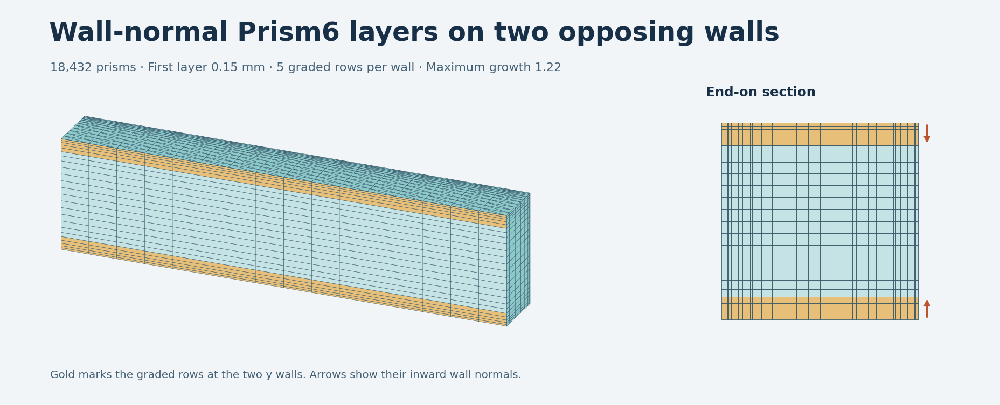

# Straight square duct with Prism6 wall layers

The [STEP fixture](straight-duct.step) describes the fluid region of a
10 × 10 mm square duct, 40 mm long. The flow is steady, incompressible and
fully developed, with no slip on all four walls. The benchmark sets the
dynamic viscosity to 0.001 Pa·s, density to 1,000 kg/m³ and bulk speed to
0.01 m/s. This gives a flow rate of 1.0 × 10⁻⁶ m³/s and Reynolds number 100.

## Meshes and results



The STEP-based mesh grades the cross-section toward all four walls and
sweeps those triangles **along the flow**. The exports retain STEP solid tag
1, inlet/outlet tags 5 and 6, and wall tags 1–4. A companion construction of
the same duct dimensions sweeps Prism6 cells **normally to two opposite
walls**, with mirrored spacing and tangential grading at the other two
walls. Both constructions use the same first heights and growth schedule.
The companion uses prepared planar geometry and its own boundary tags.



| First height | Prescribed rows per wall | Prism6 per mesh | STEP streamwise pressure drop | Two-wall normal pressure drop |
| ---: | ---: | ---: | ---: | ---: |
| 0.60 mm | 3 | 2,304 | 0.115642 Pa (+1.60%) | 0.114881 Pa (+0.94%) |
| 0.30 mm | 4 | 7,776 | 0.114569 Pa (+0.66%) | 0.114293 Pa (+0.42%) |
| 0.15 mm | 5 | 18,432 | 0.114272 Pa (+0.40%) | 0.114124 Pa (+0.27%) |

The analytical drop is **0.113817 Pa**. Both series converge from above.
The finest STEP mesh gives a relative velocity L² error of **0.218%**.
Its raw mean wall shear is 0.006989 Pa against the analytical 0.007114 Pa.
In both mesh families the summed volume is 4,000 mm³, the achieved maximum
adjacent layer growth ratio is 1.22 and every affine Prism6 has positive
Jacobian. The STEP archives reproduced byte for byte. [STEP mesh receipts](recorded-meshes.json) ·
[STEP flow receipts](recorded-flow.json) · [Opposing wall receipts](recorded-opposed-wall-flow.json)

## Analytical reference and discretization

With axial velocity `u`, the fully developed momentum equation reduces to
`−μ Δ⊥u = G` with `u = 0` on the walls, where `G = −dp/ds` is constant.
The square-duct Fourier series gives `Q = 0.0351442537388 G a⁴/μ`, where
`a` is the full side length. The solver checks the conductance against a
second series. [Mei et al., square-duct velocity series, Eq. 19](https://ntrs.nasa.gov/api/citations/20010103867/downloads/20010103867.pdf#page=40)

The STEP solve takes its cross-section and wall boundary directly from the
exported prisms. It uses linear triangles and scales the solution to the
fixed flow rate before computing `Δp = G L`. The opposing-wall Prism6
discretization reduces to bilinear quadrilaterals, assembled separately.
Both use the fully developed reduction. Entrance flow, general 3D CFD
boundary conditions and wall-layer transitions into a separate Tet4 core
remain outside this example.

## Reproduce

Use an OCCT-enabled PAACS build, with the matching OCCT runtime on `PATH`.
Set `$occtCmake` to the SDK CMake package directory. The commands below run
from the repository root on Windows with NumPy, SciPy and Matplotlib.

```powershell
python -m pip install numpy scipy matplotlib
$example = 'examples/flow_straight_duct'
$out = 'out/flow-straight-duct'
cmake --install build/windows-msvc-release --config Release --prefix "$out/install"
cmake -S $example -B "$out/build" `
  "-DPAACSMesh_DIR=$PWD/$out/install/lib/cmake/PAACSMesh" `
  "-DOpenCASCADE_DIR=$occtCmake"
cmake --build "$out/build" --config Release
Copy-Item "$out/build/Release/mesh-straight-duct.exe" "$out/mesh-straight-duct.exe"
python "$example/mesh_duct.py" --step "$example/straight-duct.step" `
  --mesher "$out/mesh-straight-duct.exe" --output "$out/meshes"
$levels = @()
foreach ($level in 1..3) {
  $label = "level-$level"
  $levels += @('--mesh', $label, "$out/meshes/$label/mesh.paacsmesh")
}
python "$example/solve.py" --output "$out/solve" @levels
python "$example/plot.py" "$out/solve" "$out/flow-convergence.png"
```

Build and solve the companion layers from the same build. The four numeric
arguments are first height, wall rows, core cap and axial intervals.

```powershell
$recipes = @(@('0.60','3','1.15','8'), @('0.30','4','0.90','12'), @('0.15','5','0.65','16'))
for ($i = 0; $i -lt $recipes.Count; $i++) {
  $label = "opposed-level-$($i + 1)"
  $recipe = $recipes[$i]
  & "$out/build/Release/duct-opposed-wall-layers.exe" "$out/$label.paacsmesh" @recipe
  python "$example/check_opposed.py" "$out/$label.paacsmesh" "$out/$label.json" `
    --first-height $recipe[0] --wall-rows $recipe[1]
}
python "$example/plot.py" "$out/opposed-level-3.paacsmesh" "$out/opposed-wall-layers.png" --wall-normal
```

The example includes the STEP. To regenerate it, run `make-straight-duct-step`
from the same build with a new output filename and the matching OCCT runtime.
