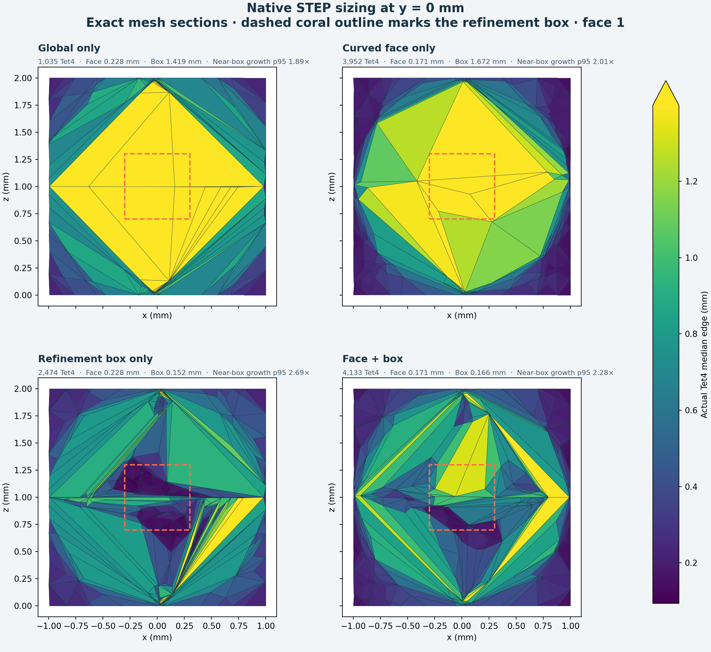

# STEP sizing through Python

This example imports the project-generated cylinder and meshes four variants:
global size, curved-face refinement, an interior box, and both controls together.
All use the same native spatial route, one meshing worker, one validation worker
and unchanged native publication checks.

Install a development wheel containing the [Python sizing API](../../docs/PYTHON.md),
then run from the repository root:

```powershell
python examples/python_step_sizing/mesh_controls.py out/python-step-sizing
```

The new directory contains the STEP source, its hash and sizing recipe, native
reports, and tagged archives and VTK files for each variant. The script refuses
an existing output directory. Face and box controls are sizing influences on
the original body; no extra material domain is created.

To measure achieved sizes and plot exact mesh sections, install NumPy and
Matplotlib in the example environment and add `--plot`:

```powershell
python examples/python_step_sizing/mesh_controls.py out/python-step-sizing-plots --plot
```

The measurements include selected-face edge lengths, median Tet4 edge lengths
inside and outside the box, and size ratios between neighboring tetrahedra.
Read the median, 95th percentile and maximum together: refinement can leave
coarser cells in a controlled region. Minimum size clamps the requested field;
growth controls its spatial transition. Neither is a hard bound on achieved
element edges or adjacent-cell ratios.



The saved [measurements](measurements.json) record the fixture hash, controls
and exported archive hashes. All four meshes passed the native checks.

| Controls | Tet4 | Wall edge median (mm) | In-box Tet4 edge median (mm) | In-box Tet4 edge p95 (mm) |
|---|---:|---:|---:|---:|
| Global | 1,035 | 0.228 | 1.419 | 1.873 |
| Face | 3,952 | 0.171 | 1.672 | 1.802 |
| Box | 2,474 | 0.228 | 0.152 | 0.983 |
| Face + box | 4,133 | 0.171 | 0.166 | 0.644 |

Box membership is measured at tetrahedron centroids; the characteristic Tet4
size is the median of its six edges. The remaining coarse cells are visible in
the sections and in the percentile values, despite the finer medians.

The cylinder STEP fixture is generated by `tests/occt_corpus.cpp` using OCCT.
The plot uses actual exported meshes, not a sampled or illustrative mesh.
